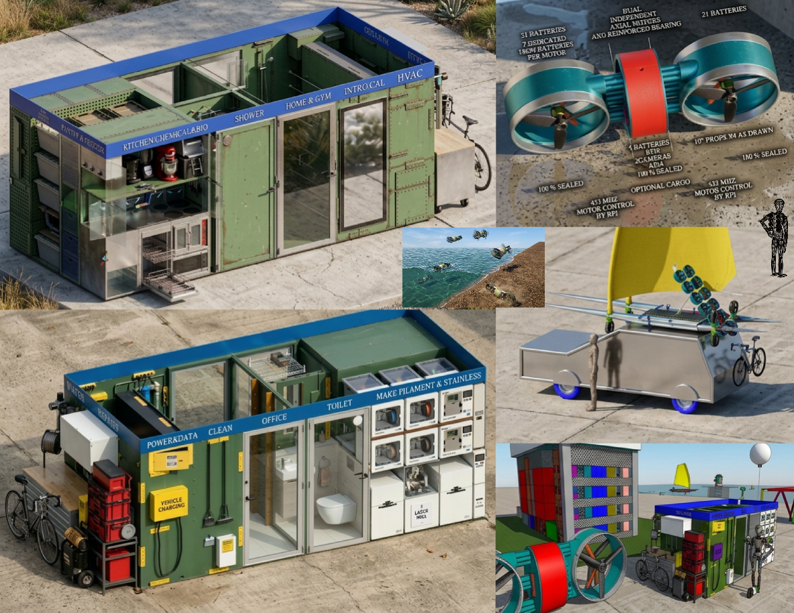
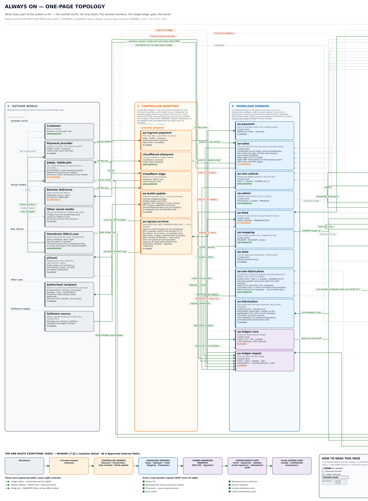
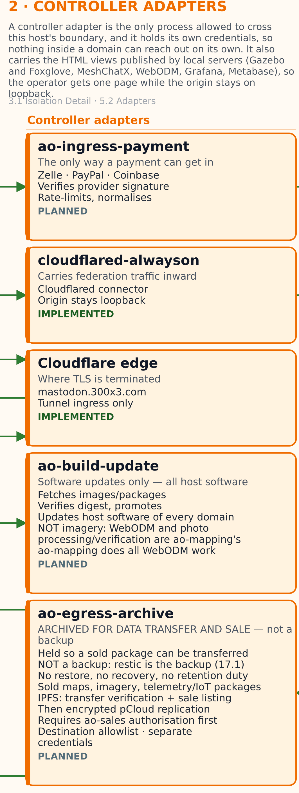
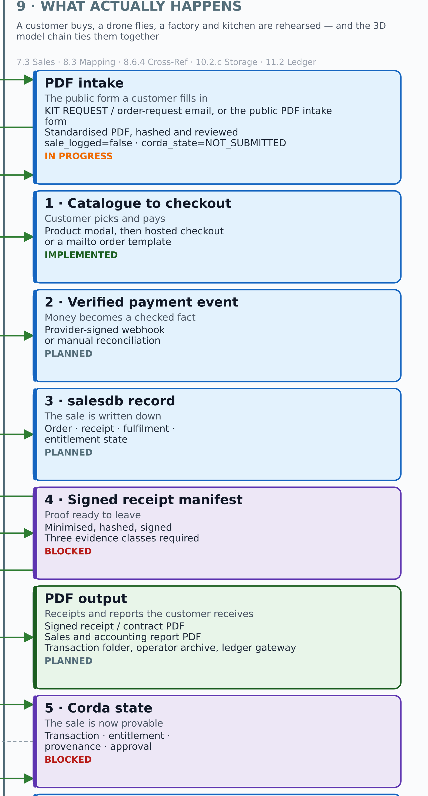
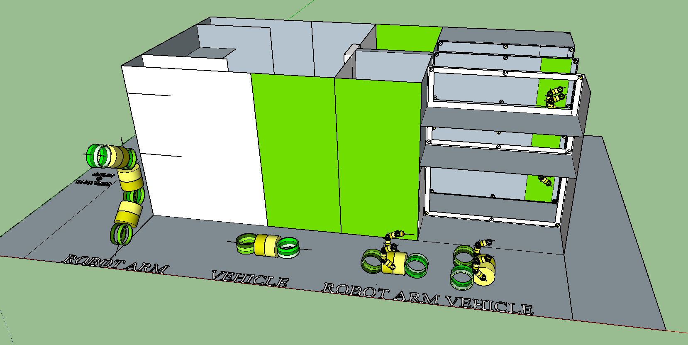
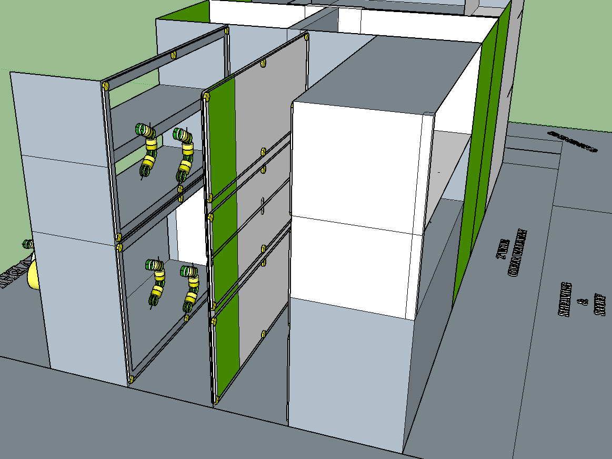
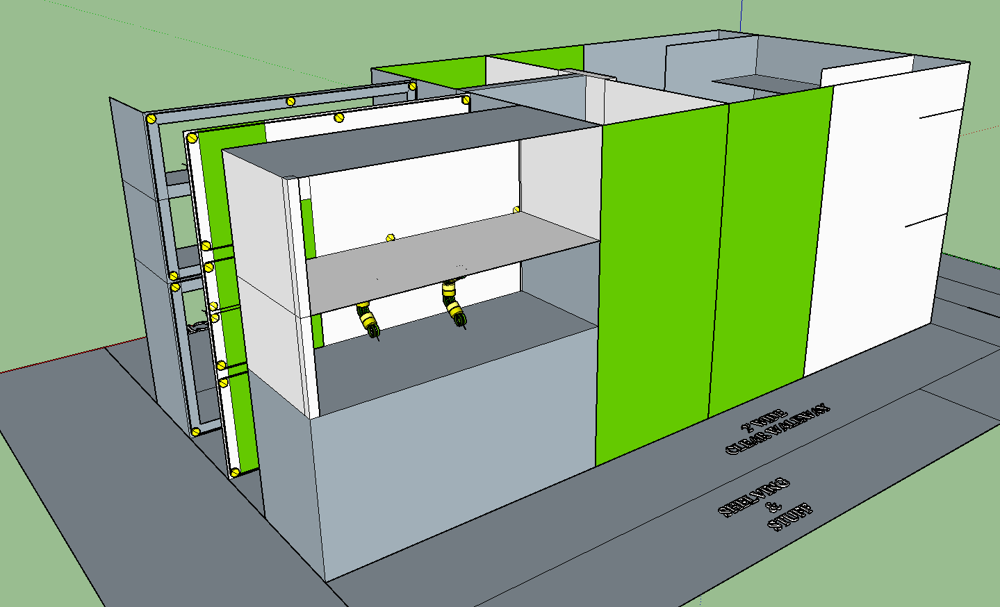

# ALWAYS ON

| Field | Value |
|---|---|
| Document | Complete single-file architecture, integration, security, operations, evidence, and active-work report |
| License | CC BY-NC-SA — creativecommons.org |
| Project origin | Building ~2010 · Drone ~2012 · Equipment ~2022 · Linux systems ~2023 |
| **Why** | **A fully autonomous live/work/fabricate area supporting air/land/sea vehicles, and the daily-carry equipment that goes with them. The goal: it literally does everything itself — for any business, and any owner, even when the internet turns off — at the size of a small storage unit, a garage, or a parking space.** |
| Website | https://www.300x3.com |
| Supporting plan | https://archive.org/details/@scott_widmann |
| Created with | Bluebeam and LibreDraw (PDF project plan), Perplexity.ai, Cline.bot |
| Revision | History lives in `docs/readme-change-log.md` |
| Current main host | ATX desktop - running Linux Kubuntu |
| Peripheral host | Drone — Raspberry Pi 5 and Autopilot Module, running KaliOS |
| Format rule | Tables and topology diagrams are primary; original detailed commands/evidence are retained in-place below for operational completeness |
| Reading order | **ES.1** is the specification of intended architecture and **ES.2** is the master topology. **Sections 1–16 are specification**: the planned future state, stated once, with no status, history, revision, or decision in them. **Section 17** is the current backup/restore/monitoring and completion criteria. The current status log and references have been split into `README-ACTION_ITEMS/status-and-references.md`; no status, history, revision, or decision appears in the compiled README for those. Where §1–16 and §17 differ, §17 is the current fact and §1–16 is the requirement. Revision history for this document is in `docs/readme-change-log.md`, never in the body. |

## Contents

| Section | Title | Page |
|---|---|---:|
| ES | Executive Summary | 3 |
| ES.1 | Current Architecture Corrections | 3 |
| ES.2 | Master Topology | 4 |
| ES.3 | Detailed System Record | 12 |
| 1 | System Purpose | 13 |
| 2 | Platform Baseline | 14 |
| 3 | High-Level Architecture | 16 |
| 4 | Security, Isolation, and Data Policy | 21 |
| 5 | Network Domains and Controlled External Access | 24 |
| 6 | Component Boundaries, GUI Reporting Tools, and Operator Access | 29 |
| 7 | Public Storefront and Payment Policy | 31 |
| 8 | Mapping and Photogrammetry | 36 |
| 9 | Field and LoRa Architecture | 41 |
| 10 | Simulation Architecture | 43 |
| 11 | Ledger, Provenance, Archive, and IPFS | 48 |
| 12 | Host Installation and Configuration | 54 |
| 13 | Podman Runtime and Quadlet Policy | 57 |
| 14 | Secrets and Service Identity | 60 |
| 15 | Sales, Mastodon, OpenClaw, and Local AI | 63 |
| 16 | Scripts and Operational Standards | 68 |
| 16.4 | Document Coordination | 71 |
| 17 | Backup, Restore, Monitoring, and Completion Criteria | 70 |


## Executive Summary

### ES.1 Current Architecture Corrections

| Subject | Current plan; replaces any contrary older text below |
|---|---|
| Social media | Most closely tied to the **remote fediverse**: public marketing/contact across website chat, email, Mastodon, and approved social channels, with the fediverse chatbot eventually routing into other social media systems. **OpenClaw** is the direct Mastodon publisher; its local output is standardized PDFs for order/follow-up/support/payment workflows, processed into the sales, payment, and ledger records. `ao-sales` connects to the remote fediverse only (§4.3) |
| LM Studio | Fundamental local LLM host for OpenClaw |
| Browser | Konqueror — dedicated browser for automation |
| Automated testing | Playwright and Chrome verify loopback service reachability per `config/platform/loopback-services.yaml`; results are recorded in §19.2 |
| RNode client A — PEOPLE-RADIO | **MeshChatX**, which is the coordination system for the ALWAYS ON Reticulum network stack and the LoRa radios. It only needs to speak to the **Reticulum network stack**, and the RNode is its radio. **LoRaWAN for communication only** — the public human side (§9.2.2). **End-to-end encryption** is built into the stack: strong modern encryption by default, ephemeral keys, forward secrecy by default, and no unencrypted links or packets possible |
| RNode client B — DRONE-RADIO | **LoRa mesh RNode for drones only** — the private drone side. Carries a **dedicated RNS-enabled connection** from QGroundControl to the drones over DRONE-RADIO, so local QGC missions reach the QGC session on the Pi5 drone and missions can be **updated midflight** (§9.2.2) |
| Radios | **Wi-Fi** — Wi-Fi/Ethernet from the main desktop reaches the main internet; that desktop manages all DHCP. **2 LoRa radios** — `PEOPLE-RADIO` (915 MHz) = public human chat, `DRONE-RADIO` (917 MHz) = authenticated private drone mission/status traffic (§9.2.2) |
| QGroundControl | Desktop primary mission planning; KaliOS RPi5 fallback/out-of-range mission-update operation; and drone — KaliOS on the Raspberry Pi 5 with the Autopilot Module, running ArduPilot. It holds a **dedicated RNS-enabled connection to the drones over DRONE-RADIO**, and so receives **midflight mission updates** relayed by DRONE-RADIO to the QGC session on the Pi5 drone (§9.2.2) |
| **Email endpoint** | The storefront routes the buyer through the **EMAIL TEMPLATE** (not an inbox); the host reviews every purchase request against that template. Complete → published as a PDF, a **WORK ORDER REQUEST**; incomplete → sent back by email requesting the remaining information (§4.3) |
| Prometheus | Prometheus is for security only. It acts alone and independently, operating on the other systems to ensure security and to address any problems: time-series store, rule evaluation, alerting, and security evidence; operated under the §17 security controls |
| Grafana | Dashboards and metrics only; it reads the databases that already exist and does not write to them |
| Metabase | Reporting only, and it does ad-hoc read-only reporting, so it requires **its own dedicated PostgreSQL application database** to hold its Metabase schema, saved questions, dashboards, and subscriptions. That application database holds Metabase's own state only — it is not a system of record for business data, and it never receives data from the reporting sources. Metabase connects to the other PostgreSQL and MySQL databases, and to local desktop-application SQLite files, as a **read-only** user in order to report on them, and it never writes to them. Ad-hoc reports that become recurring are promoted into stable Grafana dashboards |
| Corda | Blockchain-enabled accounting, ledger, receipt, entitlement, fulfillment, provenance, and approved state-transition system. Built on **Corda 5.2.2** against `cordadb` — one database within the regular host PostgreSQL 18 cluster, with its own roles and backup scope (§11.1) |
| IPFS | **File-transfer verification and, potentially, sales listing on a blockchain** for approved map/imagery and telemetry/product-operational packages. **It is not a backup.** No Corda/ledger/accounting dependency |
| Backup/restore | Local authority + **encrypted restic** (§17.1). Independent of IPFS and Corda. This is the *only* backup |
| Sale transfer | `ao-egress-archive` holds packages **"archived for data transfer and sale"** — a transfer copy, **not** a backup. IPFS first (transfer verification + possible blockchain listing), then encrypted pCloud. **Requires `ao-sales` authorisation** first (§11.6) |
| Secret authority | KDE Wallet; services needing Wallet secrets start after KDE login |
| GPU policy | Priority: desktop/Konqueror → SketchUp/SketchUp Web → active LM Studio/OpenClaw → ROS/Gazebo/SITL → WebODM batch |
| Additive fabrication | Real machines, not simulated cells: **MainsailOS/Moonraker/Klipper operate on each individual 3D printing machine**, each on its own BigTreeTech CB1 / Raspberry Pi; individual CNC machines likewise. These are **real peers**, not children of the simulated domain. `ao-sim-fabrication` **rehearses** the flow for the **kitchen, cooler/freezer/pantry carousel, storage carousel, and their robot-arm boxes** (2 arms in 2 boxes at storage, which organize and manage the additive-manufacturing machines; 2 arms on independent rails at the kitchen, which cook); it runs the kitchen and holds no production data. **The simulation does not manage those robot arms or carousels** — they need the separate future `ao-auto(kitchen,cool,store,fab)-` domain (§10.2) |
| **Real fabrication** | **`ao-fabrication`** is the real (non-simulated) fabrication domain, distinct from `ao-sim-fabrication` in every respect (§3.3.0): it **pulls data into its own database** for industrial engineering and fabrication optimisation — per-machine production data lands in **`a_fab`** (`10.89.12.0/24`, `Internal=true`). Individual CNC machines on their own RPis SHALL run **bCNC** where a machine-side sender is required, tied to Klipper/MainsailOS where the machine supports it |
| Simulation (fabrication) | `ao-sim-fabrication` requires, as baseline capability and not optional extras: **3D world setup** (its own world), **boning** (alignment and datum structure built into that world), **reinforcement learning objects** (the trainable entities for scenario and policy work), and an **HTML portal to operation** — set up and operated from a browser, with no desktop GUI client (§10.2) |
| Simulation (vehicles) | `ao-sim-vehicle` requires the same four baseline capabilities as `ao-sim-fabrication` (§10.1) |
| Home automation | Domoticz/RPi for the usual Domoticz home automation features: HVAC, doors/locks/access, security/alarms, lighting/scenes, cameras, weather, environmental sensing, media, and other typical Domoticz device classes; separate from printers and future building robotics |

### ES.2 Master Topology

This is the **single authoritative diagram of the entire project**. Every other
diagram in this document is a detail view of one part of it and must not contradict
it. Domain names, network names, and paths are abbreviated here and defined in full
in the sections referenced.





The panels above are the same graphic folded at its seam, for reading at a larger
scale. The seam falls on the gutter immediately left of the green section 4
(Stores and reporting) column, so each numbered column sits wholly within one
panel and none is split across the fold. For a fully zoomable,
resolution-independent view, or to open the two portrait panels side by side, use
the vector and self-contained viewer:

**[Open the live topology viewer](https://filedn.com/l5JNexbL2ipFNaQcAkmV7lQ/%2A%2A%2ACURRENT%2A%2A%2A/site/alwayson-single-topology.html)** — the interactive
diagram, hosted and always current. This link is stable; it is
replaced in place each time the diagram is rebuilt, so it never changes.

| Artefact | Use it for |
|---|---|
| **[Live topology viewer](https://filedn.com/l5JNexbL2ipFNaQcAkmV7lQ/%2A%2A%2ACURRENT%2A%2A%2A/site/alwayson-single-topology.html)** | **Interactive, zoomable, self-contained HTML. Hover a card to trace its links, click to pin, use find to jump to a node. Hosted copy at a stable link, so it is the one that stays current** |
| [ao-single-topology.svg](assets/ao-single-topology.svg) | Vector master. Scales to any zoom with no loss; opens in a browser or Inkscape |
| [ao-single-topology.html](assets/ao-single-topology.html) | The same viewer, committed here — works offline, no server needed |
| **[Software status — markdown](docs/software-status.md)** | **Every installed package, image, application and tool, in one table: what is installed, whether it is up to date, what is released, and whether it is pinned.** [PDF](docs/software-status.pdf) for printing and offline reading. Generated, not hand-maintained. Refresh with `sudo ./scripts/build-update/refresh-install-log.sh` |

Every detail view in this document is a zoom of that one master graphic, never a
separate diagram.

**The only public entries.** Nothing reaches an internal service directly. There are exactly four, each purpose-built and each carrying nothing but its own approved traffic:

| Entry | Network | What it carries | Direction and status |
|---|---|---|---|
| **Storefront** — `300x3.com` / `www.300x3.com`, static HTML in the pCloud Public Folder | pCloud (not a Podman network) | Products, docs, legal, downloads. Also the hosted-checkout origin and the public PDF intake forms. | Outbound publication; static asset delivery |
| **Federation and chat** — `mastodon.300x3.com`, and `chat.300x3.com` (OpenClaw relay / sitebot) | `ao-sales` via the Cloudflare Tunnel | `ao-sales` coordinates social media, email, and Mastodon; the AI bot and chat; and the order-request and receipt workflows. Mastodon web/streaming and OpenClaw chat. Origin stays loopback (`127.0.0.1:3000`, `:4000`, `:18790`). It is the only domain that touches customers directly. | Inbound via `cloudflared-alwayson.service`; outbound federation via Sidekiq on `ao-sales` |
| **`ao-ingress-payment`** | adapter | **Zelle, PayPal, and Coinbase payment verification.** Receives provider webhook/relay events, verifies the signature, and emits a normalized payment event. | Inbound. Deployable once the provider decision is recorded (§7.2) |
| **`ao-egress-archive`** | adapter | **Moving large data and the image/map/telemetry files into IPFS for transfer after sale**, plus encrypted pCloud replication. Destination allowlist, separate credentials, transfer audit. | Outbound. Deployable once archive credentials are provisioned |
| **`ao-html-window`** | adapter | **A public-facing (egress) window for viewing HTML content on the 300x3.com website.** It behaves like the locally hosted iframes in §7.1.2, but it only ever needs to publish to 300x3.com — not to the local loopback readers. It is view-only: it displays HTML and takes no input. Network `10.89.14.0/24`. | Outbound publication to 300x3.com only. Deployable |
| **`ao-build-update`** | adapter | **Software updates.** Image and package acquisition before controlled promotion, with digest capture and update audit. Never attaches to a workload. | Outbound. **Scaffolded — not enabled** (§5.2.1) |

**AO- means "ALWAYS ON".** Every `ao-*` network is one isolation domain. The internal workloads (`ao-payment`, `ao-field`, `ao-mapping`, `ao-sim-vehicle`, `ao-sim-fabrication`, `ao-ledger-ingest`, `ao-ledger-core`, `ao-data`, `ao-admin`, `ao-fabrication`) are all `Internal=true` with no public listener. `ao-sales` is the deliberate exception: it is `Internal=false` so Sidekiq can deliver ActivityPub to remote instances, and it is held to containment by having no attachment or route to any other `ao-*` domain. The adapters above are the other deliberate exceptions.

| Question | Answer |
|---|---|
| Where does money move? | Hosted checkout at the provider → `ao-ingress-payment` → verified event → `ao-payment`/`salesdb` → signed manifest → `ao-ledger-ingest` → Corda. Cards are never handled locally. |
| Where else does a transaction enter? | From the website: email → PDF → Corda processing. A customer email produces a standardized PDF request which is processed into the ledger workflow. |
| Where is the ledger (the only copy)? | `ao-ledger-core` on `cordadb` in PostgreSQL 18, a separate database with its own roles and backup scope. PostgreSQL is authoritative (§11.1). |
| What can the internet never reach? | The internal `ao-*` workload networks. All are `Internal=true` with no public listener. `ao-sales` is non-internal for ActivityPub delivery only, and still publishes no listener of its own. |
| What crosses a domain boundary? | Only a signed, minimized manifest through `ao-ledger-ingest`, under mTLS with authorization, replay defence, idempotency, and audit. |
| Where do secrets come from? | KDE Wallet, after Plasma login, by design. See §14.1.1. |
| What are the database reporting tools and their functions? | Three tools, and **all three are read-only over the databases that already exist — none of them is a system of record, and none of them ever writes to a source database.** **Prometheus** is the security instrument: it acts alone and independently on the other systems to ensure security and to address problems, and it keeps its own time-series store. **Grafana** is for stable dashboards and metrics. **Metabase** is for ad-hoc reporting by users. A recurring ad-hoc Metabase report that proves its worth is promoted into a stable Grafana dashboard. Each keeps its own application database, separate from every source database. See §3.3 and §6.A.2. |

The five points below are the ones most often asked about. Each is drawn in the master
graphic above.

**Two ALWAYS ON loopback listeners.** The Gazebo world portal (`:8765`) and the
ALWAYS ON operator console (`:8099`) **are part of ALWAYS ON** and are drawn as such in the
master topology. They are listed separately only because they are host services rather
than `ao-*` network members:

| ALWAYS ON loopback listener | Process | Status |
|---|---|---|
| `127.0.0.1:8765` | `ao-sim-fabrication-portal.service` | **Gazebo world portal**, view-only HTML, returns `200`. Loopback only. Part of operating `ao-sim-fabrication` (§10.2) |
| `127.0.0.1:8081` | `ao-sim-fabrication-foxglove.service` | **Foxglove bridge**, a WebSocket server only — no HTTP, so a browser pointed at it gets no page. Loopback only. Carries the eight camera feeds to the `/viewer` client. Part of operating `ao-sim-fabrication` (§10.2) |
| `127.0.0.1:8099` | `python3` (`web-console-server.py`) | **ALWAYS ON operator console**, returns `200` when started. **Not a deployed service** — no unit or timer starts it; run it by hand. Open item in §19.1; evidence in §19.2 |

**Other listeners on this host that are not part of ALWAYS ON.** The isolation
statements above describe `ao-*` infrastructure. A small number of other services
listen here; they are recorded so the exposure picture is exact rather than
overstated:

| Listener | Process | Status |
|---|---|---|
| `0.0.0.0:4242` | ReticulumMeshChat | Documented, part of the mesh tooling |
| `127.0.0.1:8080` | Domoticz web UI | Loopback only. Started with `-wwwbind 127.0.0.1 -nomdns`; LAN address refused. Not an `ao-*` service; intended future use is other equipment on the equipment LAN — see §3.3.0.2. |

The only non-loopback listeners are ReticulumMeshChat (documented) and `dnsmasq`/`socat`, bound to the equipment LAN the desktop manages. The "no public listener" claim is therefore true of every `ao-*` service, of the Gazebo portal, of the operator console, and of Domoticz.

- **The fabrication machines are real machines, not simulation nodes.** MainsailOS,
  Moonraker, Klipper, the individual additive-manufacturing machines (3D printers and
  CNC), and the BigTreeTech CB1 are therefore not drawn as `ao-sim-fabrication`
  children. `ao-sim-fabrication` coordinates all industrial engineering and production
  related details for the rehearsal, and it runs the kitchen. It receives no production
  data: that is handled by the separate
  `ao-fabrication` domain. See ES.1 and §10.2.
- **Post-sale transfer is authorized-recipient only**, with no Corda or archive
  dependency: an approved map/imagery or telemetry package is transferred as
  package · hash · recipient authorization over IPFS (private swarm, pinning,
  encryption). See §11.
- **Secrets come from KDE Wallet**, which is the authority. Plasma login →
  `kwalletd6` unlock → `fetch-kwallet-secret.sh` (`ExecStartPre`, ≤60s) → a 0600 env
  file per unit. Services needing Wallet secrets start after login **by design**. All
  services run under the operator account; there is no separate service user. See
  §14.1.1.
- **Monitoring is split by purpose.** Prometheus is for security only and acts alone
  and independently on the other systems to ensure security and address any problems.
  Grafana is for stable dashboards and metrics. Metabase is for ad-hoc reporting. Each
  keeps its own application database and reads the business databases read-only; none
  of them is the system of record. See §3.3.2 and §17.
- **Prometheus is isolated, and the isolation is a requirement.** Nothing queries
  Prometheus — no dashboard, service or query may read it. Nothing acts
  on it either: no rule, job or component may reconfigure, reload or silence it.
  Configuration is operator action through §16 only. `ao-admin` is
  `Internal=true`, so there is no egress path, and the boundary to hold is
  lateral and local: anything sharing `ao-admin`, and anything able to reach a
  published Prometheus port (OPS-29).
- **The isolation is one-directional: Prometheus acts outward, nothing acts on it.**
  The access it holds is a working capability, not an exposure. Prometheus does
  security work **on the databases of the system — PostgreSQL and SQLite** — and
  on the services and hosts around them. That outward direction is its purpose
  and is required. What is forbidden is the reverse: no database, service,
  dashboard or operator tool may reach *into* Prometheus to read it, reconfigure
  it, feed it, or influence what it does. Access *to* Prometheus is denied;
  access *from* Prometheus is its job.
- **Topology is input to Prometheus, never its output.** Prometheus does not create
  system topology. It must *know* the topology — which networks, units, ports and
  domains exist, and how they relate — in order to enact security policy, so
  topology is read *into* it. That knowledge is never published back out as
  something another system may query or depend on.
- **Radio profiles** are `PEOPLE-RADIO` 915 MHz/125 kHz (public) and `DRONE-RADIO`
  917 MHz/250 kHz (authenticated). See §9.


### ES.3 Detailed System Record — Start of the README

**Architecture, Installation, Configuration, Operations, and Status**

This is the single authoritative document for the ALWAYS ON project. It contains the
intended architecture, implemented configuration, operational requirements, validation
evidence, and the open work items that close the remaining gaps. The remaining tables,
commands, evidence, paths, full interface inventory, operational requirements,
payment/ledger forms, Mastodon details, installation procedures, backup rules, and
service records follow, numbered 1–17. Status, work queue, and references live in §19–20 (`README-ACTION_ITEMS/status-and-references.md`), never in this body. Where an older statement conflicts with ES.1,
ES.1 governs. When the current implementation differs from an architecture
requirement, the gap SHALL be tracked as an Open work item in §19.1 with owner,
acceptance criteria, and closure evidence — no implementation ships with an
untracked gap.

> **Operator warning.** Everything here is difficult until it is easy. These tools
> are sharp and dangerous, and if you disrespect them they will can/will harm you —
> the same as any trip, fall, or car ride. Perhaps not as bad, perhaps worse. In my
> opinion, ignoring them is more dangerous than understanding them.

---


# 1. System Purpose

ALWAYS ON is an on-premises platform supporting an automated modular live/fabricate facility
of roughly 160 square feet, and an accompanying micro-aircraft carrier. Both scale in size
and quantity without changing the architecture.

| Capability | Scope |
|---|---|
| Field | Drone telemetry and field communications over the Reticulum mesh |
| Mapping | Photogrammetry and 3D model production |
| Simulation | Vehicle rehearsal; fabrication, facility, inventory, kitchen and logistics rehearsal |
| Facility | Home automation |
| Commerce | Static storefront, hosted checkout, receipt generation |
| Provenance | Corda-backed receipts, entitlements and approved state transitions |
| Archive | Encrypted pCloud replication and controlled IPFS distribution |
| Content | Static HTML and interactive iframe content from other servers |

**Deployment roles.** The workstation is the development, integration and validation host. It
runs Kubuntu 26.04 LTS on an Intel Core i7-8700K with an NVIDIA GTX 1080. Compute-intensive
production workloads may move to an immersion-cooled server rack and a Raspberry Pi
edge-computing cluster.

Kubuntu is the desktop for four reasons: it is built on Ubuntu LTS with standard security
maintenance to May 2031, giving a predictable maintenance horizon; it carries the ROS 2 and
Gazebo toolchain plus
QGroundControl that the simulation work depends on; KDE Plasma provides the login-gated KDE
Wallet secret flow (§14.1) and Konqueror as the dedicated automation browser; and the KDE
suite covers the desktop and portable hardware this system is built for.

**Container runtime.** Podman is the only supported container runtime. Containers are managed
through systemd Quadlet definitions — never Kubernetes, Docker Compose, a Docker daemon, or
shell-wrapper orchestration (§13).

**Platform identity.** The workstation runs **Ubuntu 26.04 LTS as the base, with KDE Plasma as
the desktop.** Requirements that follow from this, and which the provisioner and any
verification step must be written against:

- The base distribution is Ubuntu 26.04 LTS. The `kubuntu-desktop` metapackage is **not**
  required and must not be assumed installed; only the Kubuntu-flavoured settings packages are
  expected. Verification must not test for `kubuntu-desktop`, `/etc/kubuntu-release`, or any
  `Kubuntu` distributor string — on this platform those correctly read as absent or as
  `Ubuntu`.
- The **KDE Plasma desktop is required**, because the login-gated KDE Wallet secret flow
  (§14.1) and Konqueror as the automation browser depend on it.
- **Support horizon:** standard security maintenance runs to **May 2031**. This is *standard*
  security maintenance, not full support; expanded security maintenance extends to **May 2036**
  under Ubuntu Pro. The 2031 date is therefore when routine maintenance ends, not when the
  release becomes unusable.
- The horizon above is the **Ubuntu LTS base** cycle. Do not substitute a desktop-flavour
  support window for it; flavour cycles are maintained separately and are not covered by the
  base distribution's published dates.

**Toolchain, and how each tool is supplied.** ROS 2 Lyrical is required at `/opt/ros/lyrical`.
Gazebo Sim 10.5.0 is required but runs **containerised**, so `gzserver` must not be expected on
the host `PATH`. QGroundControl is required as an operator tool but **is not a distribution
package**: it is supplied as a user-level AppImage with a `.desktop` launcher under
`~/.local/share/applications`, so neither a `qgroundcontrol` binary on `PATH` nor an entry under
`/usr/share/applications` may be assumed. Any inventory, install list or verification step must
treat AppImage-supplied and locally-built tools as a distinct class from packaged software, and
must not report them as missing merely because no package owns them.


# 2. Platform Baseline

## 2.1 Intended Platform Standard

| Area | Architecture requirement |
|---|---|
| Host OS | Kubuntu 26.04 LTS workstation; the selection rationale is in §1 |
| Current CPU/GPU | AMD CPU and EVGA NVIDIA GTX 1080 |
| Future compute | Immersion-cooled server rack and Raspberry Pi edge cluster |
| Container engine | Podman only |
| Container lifecycle | systemd and Podman Quadlet |
| Public website | Static HTML in pCloud Public Folder + Cloudflare domain registration |
| Payments | Provider-hosted checkout and verified payment events; no local card handling; local stablecoin processing |
| Sales and support | Sales API, PostgreSQL, Mastodon integration, OpenClaw, and LM Studio |
| Drone compute | Raspberry Pi 5 with Waveshare SX1262-class LoRa top-hat |
| Drone autopilot | 3DR N1 connected to Raspberry Pi 5 by MAVLink |
| Desktop radios | Two Heltec LoRa 32 V3 (SX1262), distinguished by USB port topology as `/dev/ao-drone-radio` (ttyUSB0, DRONE-RADIO 917 MHz) and `/dev/ao-people-radio` (ttyUSB1, PEOPLE-RADIO 915 MHz) |
| Field protocol | RNS/Reticulum and MeshChatX over raw LoRa unless a true LoRaWAN deployment is selected |
| Mapping | WebODM and supporting services under Podman |
| Mapping storage | `/media/scottw/500GBPHOTOGRAM/` |
| Vehicle simulation | ROS 2 Lyrical, Gazebo Sim 10.5.0, ArduPilot SITL, MAVLink, QGroundControl |
| Fabrication simulation | ROS 2 Lyrical, Gazebo Sim 10.5.0, robot cells, additive manufacturing, storage, kitchen, and logistics models |
| Ledger | Corda core behind a dedicated ledger-ingestion gateway |
| Archive | Local source data, signed manifests, encrypted pCloud replication, private or encrypted IPFS workflow |
| Monitoring | Prometheus-compatible metrics, alerts, health checks, and protected administration access |
| Backup | PostgreSQL/Corda-aware backup, restic or equivalent encrypted backup, and scheduled restore testing |

## 2.2 Platform Baseline

The host baseline the platform requires. Every value below is a **requirement**: a rebuilt host
or a verification step is written against this table. Measured values for a running host are
**not** recorded here — they belong in `README-ACTION_ITEMS/status-and-references.md`. Where the
two disagree, the tracker is the fact and the requirement below is what must be corrected.

| Area | Baseline |
|---|---|
| Kernel | Ubuntu LTS kernel |
| Podman | Rootless for every workload (§13.1, §13.2) |
| Podman networks | **Fourteen** `ao-*` networks, all registered in `config/platform/network-cidrs.yaml`, which is the only authoritative list. **Eleven** are `Internal=true`: the ten workload domains `ao-admin`, `ao-data`, `ao-fabrication`, `ao-field`, `ao-ledger-core`, `ao-ledger-ingest`, `ao-mapping`, `ao-payment`, `ao-sim-fabrication`, `ao-sim-vehicle`, plus `ao-html-window`. **Three** are deliberately `Internal=false`: `ao-sales` for ActivityPub delivery, `ao-reporting-egress` for Grafana and Metabase, and `ao-build-update` for software acquisition |
| GPU | EVGA NVIDIA GTX 1080 |
| NVIDIA driver | Pinned, recorded in the version matrix |
| NVIDIA integration | CDI devices registered, including `nvidia.com/gpu=0`. The authoritative spec is `/var/run/cdi/nvidia.yaml`. `/etc/cdi/nvidia.yaml` is not a source of truth and is regenerated or removed at each driver change. Only the authoritative spec contributes devices |
| Simulation stack | ROS 2 Lyrical at `/opt/ros/lyrical`; Gazebo Sim 10.5.0 |
| Host PostgreSQL | PostgreSQL 18, loopback-only |
| Host Redis | Redis 8, loopback-only |

## 2.3 Packages the Verification Steps Depend On

A package is part of the platform baseline if the platform's own verification asserts on it. The
install list itself is written in §12.3; the requirement is stated here because the two must agree.

Every package below is **required to be reproducible from the repository's own bootstrap chain**
(`scripts/bootstrap/02-install-host-dependencies.sh` and
`scripts/bootstrap/ao-bootstrap-privileged.sh`, documented in §12.3). A host that is correct only
because an operator installed a package by hand does **not** satisfy this requirement — the
provisioning path is the deliverable, not the host's current package list.

| Package | Required for |
|---|---|
| `apparmor-utils` | `aa-enforce`, `aa-decode`, `aa-genprof`, `aa-logprof` — the profile tools §4.1 relies on |
| `nvidia-container-toolkit` (+ `libnvidia-container1`, `libnvidia-container-tools`, `nvidia-container-toolkit-base`) | GPU access from rootless containers via CDI; the `nvidia.com/gpu=0` device the version matrix records |

**Verification rules for the AppArmor tooling.** These are normative, because each one has
defeated a naive check:

- Test for **`aa-enforce`**, not `aa-status`. `aa-status` ships in the base `apparmor` package, so
  `command -v aa-status` succeeds on a host with no profile tooling installed at all.
- A check must **not** wrap its subject in `sudo … || true`. On this host `sudo` requires
  interactive authentication, so the pipeline cannot fail and cannot inspect anything — while
  still reporting success.
- Any check whose subject requires privilege must report the privilege failure as a failure. A
  check that cannot fail verifies nothing.

## 2.4 Baseline Verification Must Assert

A verification step **asserts**; it does not print. Each requirement below is normative:

1. Every check must compare an observed value against an expected one and **exit non-zero when
   they differ**. A silent non-zero return that nothing reads is not an assertion.
2. The overall block must exit non-zero if any check fails. A block whose exit status is
   unconditionally zero cannot verify anything, and evidence produced by it cannot be re-run and
   trusted.
3. Each observed value must be **printed beside its expected value**, so a failure is readable
   without re-running the check.
4. A check must run a **control case** before a zero is believed. Counting constructs that return
   a constant regardless of input — for example `systemctl list-unit-files 'pattern' | wc -l`,
   which always prints three lines — must not be used as evidence. Use a form that measures the
   thing itself, such as `grep -c '^ao-'`.
5. Every claim cited as evidence must be **reproducible by the command shown**. A citation that
   does not reproduce is not evidence.

The §12.3 verify block is owned by the OPS-B session; the requirements above are what it must
satisfy.

# failure path: stat() reports tmpfs, loginctl reports Linger=no
$ bash -c 'stat() { if [ "$1" = "-fc" ] && [ "$2" = "%T" ] && [ "$3" = "/sys/fs/cgroup" ]; then echo tmpfs; fi; }; export -f stat; loginctl() { echo Linger=no; }; export -f loginctl; bash scripts/validation/verify-host-baseline.sh; echo "EXIT=$?"' 2>&1
=== ALWAYS ON host baseline verification (asserting) ===
  PASS  podman responds (5.7.0)
  PASS  systemd --user manager reachable
  FAIL  linger is '"'"'Linger=no'"'"', expected '"'"'yes'"'"' - containers stop at logout (OPS-13)
  FAIL  cgroup fs type is '"'"'tmpfs'"'"', expected '"'"'cgroup2fs'"'"'
  PASS  aa-status present
  PASS  aa-enforce present (profile enforcement possible)
--- 4 passed, 2 failed ---
RESULT: FAIL (2 check(s) failed)
EXIT=1
```

The verifier satisfies all five requirements in §2.4: it compares observed against expected,
exits non-zero on failure (1, not 0), prints each observed value beside its expected one, and
the control case above is the proof that a passing result means something. The verifier must
never wrap a privileged command in `sudo … || true`, and `aa-enforce` must be reported as a WARN
when missing rather than passed on `aa-status`.

§12.3 delegates the install verification to an asserting script: it names the script and
documents the test in both directions. §2.4 is the requirement that delegation implements.

## 2.5 Version Matrix Requirements

`config/platform/version-matrix.yaml` is the machine-readable platform baseline and must satisfy:

1. **Every running container image is digest-pinned.** A tag-only image cannot be verified as
   deployed. Only these are permitted exceptions, and both are deliberate:
   - `ardupilot-sitl:latest` — a moving SITL tag by design;
   - the locally built Gazebo Sim image, whose digest records the validated local build.
2. **No stray container may duplicate a Quadlet-managed unit.** Any container whose name is
   generated by `podman run` rather than owned by a Quadlet unit is residue and must be removed.
   Removal is a delete and requires operator approval per §4.1 rule 3.
3. **Every digest the matrix records must be a digest a container actually runs**, and every
   running digest must appear in the matrix. A matrix that names a digest nothing runs cannot be
   used to verify what is deployed.
4. **Kernel and package versions must be captured, not hand-transcribed.** The matrix is to be
   produced by a generator that reads the running host, so it cannot silently drift.

# 3. High-Level Architecture

## 3.1 Isolation Detail View

This is a **detail view of the ingress/egress portion of the master topology in
ES.2** and must not contradict it. For the whole project, read ES.2.



*Figure 3.1 — The controlled adapter column of the ES.2 master topology, enlarged. It is a
zoom of that one graphic, not a separate diagram: the adapter column is the only place a
controlled ingress or egress process SHALL exist, and every route into or out of the host passes
through it.*

The public storefront has no direct route to the host's field, mapping, simulation, database,
AI, Podman or Corda-core services.

## 3.2 Where Status Lives

Sections 1–16 hold no status. **Status and outstanding work are both in §19.1**, the only
place either is recorded. **Verification evidence is §19.2.**

## 3.3 Databases and Data Stores

PostgreSQL is the system-wide relational platform. There is **no single shared cluster**:
a host-managed PostgreSQL 18 cluster, loopback-only, carries host administration and the
Grafana and Metabase application databases, and each domain that owns authoritative data
runs **its own dedicated PostgreSQL container** with its own image and its own version.
Every consumer gets a separate logical database and a separate application role inside its
own container. The version behind each row is stated in §3.3.1.

| Database | Holds |
|---|---|
| `salesdb` | Authoritative sales and payment records |
| `mastodon` | Mastodon application state |
| `webodm` | WebODM/PostGIS mapping data |
| `cordadb` | Corda 5, with its own roles and backup scope (§11.1) |
| `a_fab` | Real-machine production data for `ao-fabrication` (§3.3.0) |
| `postgres` | Administration and maintenance |

**Reporting and coordination stores.** Three stores sit alongside PostgreSQL. **All three are read-only over the databases above;
none is a system of record, and none ever writes to a source database.**

| Store | Purpose | Boundary |
|---|---|---|
| **Grafana** | Stable, curated, long-lived dashboards and metrics — a number that must stay on a wall or in a briefing | Reads approved PostgreSQL datasources read-only. Keeps its own PostgreSQL application database for users, dashboards and datasource configuration |
| **Metabase** | Ad-hoc reporting: a question asked in the browser, saved, filtered, exported. The saved question, not the dashboard, is the unit of work | Reads the other PostgreSQL and MySQL databases **and** local SQLite files over per-source read-only roles — one read-only role per source, so a badly written query cannot modify a source. Keeps its own PostgreSQL application database for its schema, saved questions, dashboards, filters and subscriptions. That database is not a system of record and is never written to by a reporting source |
| **Prometheus** | Security instrumentation only — time-series store, rule evaluation, alerting | Acts alone and independently. Does security work **outward**, on the PostgreSQL and SQLite databases and the services around them; nothing acts on it or reaches into it (§3.3). Not replaced by PostgreSQL, Grafana or Metabase, and does not depend on any of them |

A recurring ad-hoc Metabase report that proves its worth is **promoted into a Grafana
dashboard**, where it becomes stable and curated.

**Redis** is a low-latency speed and coordination layer — caching, queues, locks, task
brokering, transient coordination. It is not the authoritative system of record; business,
payment, user and application metadata stay in PostgreSQL.

**SQLite and H2** are not approved application databases for Grafana or Metabase. They SHALL
exist only where an individual application requires embedded local storage — the browser,
Akonadi, Podman, MeshChatX, QGroundControl — or in retained migration backups.

**Database and ledger authority.**

| Authority | Owns |
|---|---|
| **PostgreSQL** | Detailed operational data, searchable business records, and reporting projections |
| **Corda** | The complete ledger of debits and credits, final sale and contract state, receipt association, entitlement, and approved ledger state transitions |

Where PostgreSQL holds the detailed operational and searchable business record, Corda holds
the authoritative debit and credit position itself.

### 3.3.0 `a_fab` — the real-fabrication database

**`a_fab` is the database of `ao-fabrication`, the real (non-simulated) fabrication
domain.** It is a separate logical database with its own application role, and it is
not shared with `ao-sim-fabrication`.

The distinction that matters:

- **`ao-sim-fabrication`** rehearses the fabrication flow. It holds no production data
  and never commands live machinery.
- **`ao-fabrication`** pulls real production data **from each individual machine into its
  own database** for industrial engineering and fabrication optimisation work.

Each real machine runs **its own** MainsailOS / Moonraker / Klipper on its own
BigTreeTech CB1 / Raspberry Pi. The machines are peers: none of them is a child of the
simulated fabrication domain, and none is drawn as a simulated cell. They sit on the
**equipment LAN** (`10.42.0.0/24`, the wired segment whose DHCP the desktop manages).
That LAN is *ingress* — local equipment — not egress, and it is deliberately not a
workload network.

#### 3.3.0.1 How the domain reaches the equipment LAN (host-mediated)

A container on `ao-fabrication` **cannot** reach `10.42.0.0/24` directly, and this is the
isolation model working correctly rather than a defect. `Internal=true` gives the network
no default route and no NAT, so a container sees only its own subnet:

```
container on ao-fabrication:  eth0 10.89.12.3/24
  /proc/net/route            10.89.12.0/24 dev eth0   (no default route)
  connect 10.42.0.1:5432     unreachable
```

The routing table on `ao-fabrication-db`, the container that owns `a_fab`, holds
exactly one route — its own subnet — so there is no default route and no NAT out of the
domain. This is what `Internal=true` means, and it is the isolation model working rather
than a fault.

The host bridge at `10.89.12.1` **is** reachable from inside the domain — its ARP entry
resolves with a complete MAC (`/proc/net/arp`, flags `0x2`), so the gateway answers at
layer 2 even though no route leaves the subnet. That is the path, and the project already
uses the same shape for PostgreSQL: `ao-postgres-reporting-bridge` runs `socat` on the host
and exposes a host service to containers that could not otherwise reach it.

Note on evidence: a TCP connect test to the bridge fails, because nothing listens there
(`ss -ltn` shows no `10.89.12.*` listener). Reachability must be judged from the ARP table,
not from a refused connect.

# ALWAYS ON - expose the host PostgreSQL loopback listener only on the internal
# ao-admin Podman gateway. PostgreSQL itself remains bound to localhost.
GATEWAY=10.42.0.1
$ systemctl --user cat ao-postgres-reporting-bridge.service | grep -i 'Starts at'
# Starts at login with the reporting containers it serves (ao-admin gateway
# address only exists once those containers' networks are created).
```

The script's own comment and the unit description both name the ao-admin gateway; the code
binds the equipment LAN. **The comment is wrong, not the address.** This is the same class of
error as the mount-flag and label-key traps in §6: a comment asserted a property that is
false.

Three consequences:

1. **It is not an internal-only listener.** `10.42.0.1:5432` is bound to the wired equipment
   LAN, so the host PostgreSQL cluster is reachable by anything that can route to `10.42.0.1`
   — including the real machines on `10.42.0.0/24`. The Wi-Fi address refuses
   (`192.168.87.135:5432` → connection refused), because `socat` binds `10.42.0.1` explicitly
   and not `0.0.0.0`. PostgreSQL itself *is* still loopback-only
   (`listen_addresses = 'localhost'`, `/etc/postgresql/18/main/postgresql.conf:60`), so the
   claim that stops at "PostgreSQL remains bound to localhost" is accurate — but the net
   effect is that the loopback-only cluster is republished onto the equipment LAN, which is a
   security-boundary question belonging to the SEC/NET groups, not one this section can settle.
   **Reported, not remediated** — changing it touches network configuration (stop condition).
2. **`ao-admin` membership is not what makes it reachable.** A container attached only to
   `ao-admin` gets `Network is unreachable`, because that network is `Internal=true` and has no
   default route:

   ```
   $ podman run --rm --network ao-admin … -c '… >/dev/tcp/10.42.0.1/5432 …'
   AO-ADMIN-ONLY-CLOSED      (bash: /dev/tcp/10.42.0.1/5432: Network is unreachable)
   ```

   Both reporting containers reach it because of their *second* attachment,
   `ao-reporting-egress` (`Internal=false`), whose default route NATs out to the host:

   ```
   $ podman inspect ao-grafana --format '{{range $k,$v := .NetworkSettings.Networks}}{{$k}}={{$v.IPAddress}} gw={{$v.Gateway}}{{"\n"}}{{end}}'
   ao-admin=10.89.9.61 gw=10.89.9.1
   ao-reporting-egress=10.89.10.58 gw=10.89.10.1
   $ podman exec ao-grafana ip route
   default via 10.89.10.1 dev eth1  metric 100
   10.89.9.0/24 dev eth0 scope link  src 10.89.9.61
   10.89.10.0/24 dev eth1 scope link  src 10.89.10.58
   ```

   This is consistent with §3.3.1's own network table: `ao-admin` is `Internal=true`,
   `ao-reporting-egress` is `Internal=false`. The unit description's stated reason for the
   service ("ao-admin gateway address only exists once those containers' networks are
   created") therefore explains a dependency that does not exist.
3. **This is the `10.42.0.1:5432 unreachable` line above, restated.** The §3.3.0.1 code block
   shows `connect 10.42.0.1:5432 unreachable` for a container on `ao-fabrication`, which
   remains correct — `ao-fabrication` is `Internal=true` with no egress network, so nothing
   routes out. The reachability that does exist is specific to the two containers that also
   hold `ao-reporting-egress`, and it is an egress-NAT fact, not an `ao-admin` fact.

### Never assume a mechanism from a name

A name is not a mechanism. The error class is **assuming a mechanism from a name**:
"reporting bridge" + "ao-admin" implies the Podman gateway, and only `ss -ltnp` shows the
address a process actually binds. **The gateway a name claims to expose and the address it
exposes can differ by two subnets and an entire security boundary** — bind the address
before relying on it.

#### 3.3.0.2 Domoticz for non-fabrication equipment

No device is connected, and none is to be connected before the equipment exists. This
records the design so it is not re-derived later.

Domoticz is expected eventually to cover other directly connected equipment on
the same **equipment LAN** (`10.42.0.0/24`) — the segment the desktop already
manages. It is not part of `ao-fabrication`, is not simulation, and does not
write to `a_fab`; per-machine production data stays with the Moonraker collector
above.

**Why the host is the right place, same as the collector.** The desktop holds
`10.42.0.1/24` on `eno1`, so a host process reaches that LAN directly. A
container on an `Internal=true` domain could not (§3.3.0.1). Domoticz running on
the host therefore needs no relay, no opened domain, and no new listener to reach
those devices — the same conclusion already reached for `ao-fabrication-collect`.

**Listener posture.** Domoticz only ever needs to be
reachable from this machine:
- the web UI is started `-wwwbind 127.0.0.1 -nomdns` and serves only
  `127.0.0.1:8080`; the LAN address actively refuses
- the shared server on `*:6144` is disabled (`RemoteSharedPort = 0`) and
  there is no shared-server listener

Neither change affects reaching devices on `10.42.0.0/24`, which is a host-side
path independent of the web listeners. Loopback
`10.42.0.1:8080` is refused.

`a_fab` holds per-machine production data only. It is **not** a ledger, **not** a sales
record, and **not** a backup target. Anything that must become provable leaves
`ao-fabrication` as a signed fabrication manifest through `ao-ledger-ingest`, exactly as
the simulation domain does.

**Network:** `ao-fabrication`, `Internal=true`, `10.89.12.0/24`, created and registered in
`/ALWAYSON/config/platform/network-cidrs.yaml` . The subnet is **pinned** in
`/ALWAYSON/quadlet/networks/ao-fabrication.network` because every other network there lets
Podman auto-assign. See §2.2 for the reconciliation of the adjacent
unregistered `10.89.10.0/24` and `10.89.11.0/24`.
### 3.3.1 Program-to-Database Map (single consolidated table)

This is the one table of programs and the databases they use. It is the starting
point for discussing reporting and data integration; it is not a list of every
installed package or desktop settings module.

| Database software | Software/program | Database name or store | Current role and reporting value |
|---|---|---|---|
| **PostgreSQL 18** | Host PostgreSQL service | Host cluster `18-main`; `postgres` | Shared relational platform and administrative/maintenance cluster. Also carries the Grafana and Metabase application databases. PostgreSQL itself is loopback-only (`listen_addresses = 'localhost'`), but the host runs `ao-postgres-reporting-bridge`, a `socat` that republishes it on **`10.42.0.1`** — the equipment LAN, not a Podman gateway (§3.3.0.1) |
| **PostgreSQL 17** | Sales database service | Container `ao-sales-db` on `ao-sales`, database `salesdb` | Authoritative source for customers, orders, products, payments, receipts, entitlements, and audit history |
| **PostgreSQL 17** | Mastodon web/background workers | Container `mastodon-db` on `ao-sales`, database `mastodon` | Accounts, posts, media metadata, federation state, and background-job application data |
| **PostgreSQL 17** | Fabrication database service | Container `ao-fabrication-db` on `ao-fabrication`, database `a_fab`, role `fabrication_role` | Per-machine production data pulled from each individual machine (§3.3.0). Separate from `ao-sim-fabrication`, which holds none |
| **PostgreSQL 9.5** | WebODM web/worker | Container `ao-webodm-db` on `ao-mapping`, database `webodm` (host-side data dir `~/webodm/dbdata`) | Mapping projects, processing state, users, and geospatial data. The app reads database `webodm_dev` in that container. **PostGIS is installed in `webodm_dev` (version 2.3.2) but not in `webodm`** — so the only installed extension in `webodm` is `plpgsql`, and the geospatial extension lives in the database the app actually reads |
| **PostgreSQL 9.5** | NodeODM | The same `ao-webodm-db` container, plus filesystem processing data | Processing-node state and coordination; large image/output artifacts remain filesystem data |
| **PostgreSQL 18** | Corda 5 node | `cordadb` (dedicated Corda PostgreSQL database in the host cluster, per §11.1) | Receipt, entitlement, and provenance state. Built on Corda 5 against `cordadb`. |
| **Redis 8** | Host Redis service | Host Redis database 0 | General low-latency cache/coordination layer; no current application data confirmed |
| **Redis 7** | Mastodon cache/queue service | Container `mastodon-redis`, database 0 | Cache, queues, and background-job coordination; not authoritative business data |
| **Redis 7** | WebODM broker | Container `ao-webodm-broker`, database `broker` | Celery/task broker and worker coordination; not authoritative mapping data |
| **PostgreSQL 18** | Grafana | Grafana application database (dedicated) | Grafana users, dashboards, and datasource configuration. Its own application state, not business data |
| **PostgreSQL 18** | Metabase | Metabase application database (dedicated) | Metabase application schema, saved questions, dashboards, filters, and subscriptions. Not a system of record and never written to by a reporting source |
| **PostgreSQL / MySQL (read-only)** | Metabase reporting sources | Per-source read-only roles | Ad-hoc read-only reporting connections to the business databases. One read-only role per source, with no write, DDL, or owner privilege, so a report cannot modify a source |
| **Prometheus TSDB** | Prometheus | `/prometheus` persistent volume | Security evidence only. Time-series metrics, service health, resource usage, and security evidence. Acts alone and independently of Grafana and Metabase. |
| **SQLite** | MeshChatX / Reticulum MeshChatX | Per-identity database at `~/.reticulum-meshchatx/identities/<identity>/database.db` | MeshChatX messages, rooms, and local Reticulum/MeshChatX application state.
| **SQLite** | QGroundControl | **No application database exists.** Settings are in an INI file and map tiles in a tile cache
| **SQLite** | Akonadi/KDE PIM applications | Akonadi SQLite data | Contacts, calendars, mail indexes, and local personal-information data **Not collected by Prometheus** — excluded by operator instruction: personal and mail-index material is not security telemetry |
| **SQLite** | nPerf | `~/.local/share/nPerf/{history,settings,engine}.db` | Run history and settings; two of the three are snapshotted and read by Grafana. Row counts only — settings values are never selected |
| **SQLite** | Elisa | `~/.local/share/elisa/elisaDatabase.db` | Music library; snapshotted and read by Grafana. Counts only — no titles, artists or paths |
| **SQLite** | Klipper | `~/.local/share/klipper/history3.sqlite` | Clipboard history. **Never snapshotted, metadata only, by design** — a snapshot would copy clipboard content (which can include passwords and tokens) into a world-readable file, which README §4.1 rule 5 forbids |
| **SQLite** | libaccounts-glib | `~/.config/libaccounts-glib/accounts.db` | Account identifiers. **Never snapshotted, metadata only**, same reason as Klipper |
| **SQLite** | Firefox, Brave, Chrome, and Edge | Browser profile SQLite stores | Browser history, site storage, caches, certificates, and profile data **Not collected by Prometheus** — excluded by operator instruction: browsing material is not security telemetry.
| **SQLite** | Podman | Rootless container metadata store | Container, image, network, and volume metadata; not application data BoltDB, not SQLite, so not a Prometheus collector target |
| **Filesystem/local metadata — social** | LM Studio and OpenClaw | Application files, model settings, and local state | Sales/social AI application state that is not automatically part of SQL reporting.
| **Filesystem/local metadata — drone/field** | ArduPilot, MeshChatX/Reticulum field stores, and radio gateway logs | Application files, telemetry spools, and local state | Field operational and engineering data that is not automatically part of SQL reporting |
| **Filesystem/local metadata — sim** | Gazebo, ROS 2, ArduPilot SITL, and simulation tools | Project files, worlds, models, and result artifacts | Simulation operational and engineering data that is not automatically part of SQL reporting |

This table records what each database is and which program uses it. Whether a database is
built and provisioned is status, recorded in §19.1 alongside the work to build it.

### 3.3.2 Data Flow into Reporting and Ledger Records

Corda is not a replacement for the source PostgreSQL databases. The intended
ledger flow is:

The sale chain on the right of the following extract — customer picks to checkout,
verified payment event, salesdb record, signed receipt manifest, and Corda state —
is the same five-step chain drawn in ES.2. Payment intake is shown at the left,
through `ao-ingress-payment` and into `ao-sales`; the reporting projections
(Metabase, Grafana) and the Corda entry are shown in their columns.



*Zoom of the ES.2 master topology, cropped to the five-step sale chain and enlarged so
every label is readable.*

**Where the blockchain entry is recorded.** The entry itself is created by
Corda 5 in `cordadb` (§3.3, §11.1). The approved projection of that state is
recorded in the corresponding PostgreSQL database, keyed by the same
transaction/receipt reference, and the PDF receipts and reports that describe it
are written to the transaction folder under
`/ALWAYSON/data/sales/transactions/<transaction-id>/`.

Use stable correlation fields in the source-to-ledger integration, including a
transaction/order reference, serial number where applicable, UTC timestamp,
event type, status, and content hash. Do not copy payment credentials, private
keys, or unrestricted customer datasets into Corda. Corda remains authoritative
for approved ledger/provenance state, while PostgreSQL remains authoritative
for domain-operational source data.

Before building sales reporting, initialize and verify the `salesdb` schema and
confirm that the reporting identity can read it and produce the standard PDF
reports and receipts listed in §15.1. Before enabling blockchain-related
flows, complete the Corda key/certificate ceremony and implement the
ledger-ingest manifest, correlation-ID, signature, idempotency, and audit
requirements.

---

# 4. Security, Isolation, and Data Policy

## 4.1 Non-Negotiable Rules

1. Inspect before changing.
2. Preserve existing data.
3. Never format, repartition, delete, prune, or overwrite without explicit
   operator approval.
4. Never install Docker daemon, Docker Compose, Watchtower, or Kubernetes.
5. Use Podman and Quadlet only.
6. Never expose a public port without explicit operator approval.
7. Never place secrets in scripts, logs, HTML, Git, pCloud Public Folder, IPFS,
   Corda payloads, shell history, or documentation examples. Only use KDE Wallet
   for passwords, tokens, keys, and other secret material.
8. Never use `--privileged` as a default.
9. Use pinned image digests for operational services (§5.2.1).
10. Verify the photogrammetry drive before deploying or operating WebODM.
11. Record commands, versions, significant output, and failures in the
    installation or operational journal.
12. Stop and report conflicts involving services, packages, networks, mounts,
    ports, serial devices, firewall policy, or existing data.
13. Do not broaden network access, database privileges, filesystem access,
    container privileges, or secret access merely to bypass an error. A
    documented local integration path with least-privilege credentials is
    permitted when it is required for PostgreSQL reporting, backup, health
    checking, or application migration.
14. Require explicit human approval before initiating payments.
15. Require explicit human approval before publishing external communications,
    changing production credentials, deleting data, or modifying external
    records.

## 4.2 Data Classification

| Classification | Examples | Handling requirement |
|---|---|---|
| **Public** | Anything in the pCloud Public Folder, or linked in from it: storefront HTML, intentionally published documentation, approved product data | May be placed in pCloud Public Folder |
| **Internal operational** | The databases — PostgreSQL and SQL — plus non-sensitive configuration, health data, non-sensitive manifests, unit status | Restricted local access; do not publish by default |
| **Sensitive** | Corda blockchain secured data and the accounting ledger, plus customer contact data, payment references, precise telemetry, sensitive imagery, proprietary technical designs | Domain-restricted storage; encrypted backup; no public IPFS |
| **Secret** | Passwords, held in KDE Wallet | KDE Wallet only; delivered to services after Plasma login by design (§14.1.1) |

## 4.3 Prohibited Paths

No component may take any of the following paths. Each prohibition is enforced by the rule
named in the last column; the rule text is in §4.1.

### 4.3.1 Named source-to-target prohibitions

This is the original §4.3 list, recovered verbatim from the superseded v6 archive
(`README - ARCHIVE/ALWAYS ON — Architecture, Operations, and Status - v6.md`,
"## 4.3 Prohibited Paths", added in `b3d35e7`). It states the prohibitions as
concrete source → target pairs, which the rebuilt table below cannot: a rule such
as "one component to a second domain network" says why, not *which* pairs are
named. Both are kept, because the pairs are what an operator checks against a
running host.

```text
Sales/AI → MAVLink, ArduPilot, ROS, Gazebo, LoRa, RNS, MeshChatX
Sales/AI → WebODM workers, raw imagery, Corda core
Payment → OpenClaw, LM Studio, Mastodon, field, mapping, simulation
Field → payment provider, Mastodon, OpenClaw, LM Studio, Corda core
Mapping → flight control, LoRa/RNS, payment provider, Mastodon, Corda core
Vehicle simulation → live drones, live radios, sales, payments, Corda core
Fabrication simulation → live machinery during phase one, sales, payments, Corda core
Public internet → PostgreSQL, Redis, WebODM workers, LM Studio, Corda,
                  ROS, MAVLink, Gazebo, QGroundControl, RNS, MeshChatX
```

Two entries in this list are superseded by operator decision and are marked rather
than silently deleted, because deleting them would hide the decision:

- *Field → payment provider* and *Mapping → payment provider* are prohibited:
  payment is reached only through the controlled `ao-ingress-payment` /
  `ao-egress-archive` adapters (§5.2), never directly from a workload network.
  The prohibition holds in substance: no `ao-field` or `ao-mapping` container
  holds a payment credential.
- *Fabrication simulation → live machinery **during phase one***: the phase-one
  qualifier is historical. The prohibition is absolute in the current design
  (§4.3.2, first row; §10.2).

### 4.3.2 Prohibitions by rule

The rebuilt list, retained because each row names the enforcing rule.

| Prohibited path | Why | Rule |
|---|---|---|
| Simulation domain to live machinery | A rehearsal must never command a real machine, a real robot arm, or a live flight controller | Rule 12, §10.2 |
| ~~Any workload network to the public internet~~ **superseded** | Stated without an exception, this would have prohibited `ao-sales` and `ao-reporting-egress` by name; both are deliberately `Internal=false` per §5.1 and carry eight live containers between them. Restated below as the outbound restriction actually held | Rules 6, §5.2 |
| A workload service reaching the public internet directly, rather than through a controlled adapter | `ao-sales` and `ao-reporting-egress` are non-internal by design, and their containment is the one-network-per-component convention (§5.1), not a control. Any *new* workload path off the host must go through group B | Rules 6, §5.2 |
| One component to a second domain network | A service joins exactly one network; a second requires an explicitly approved path | §5.1 |
| Cross-domain traffic without mTLS, a dedicated identity, and a signed payload where provenance matters | Provenance is meaningless if any hop is anonymous | §4.4 |
| Any secret material outside KDE Wallet | Passwords, tokens and keys exist in the wallet only | Rules 7, 4.2 |
| Sensitive or accounting data to public IPFS, or to the pCloud Public Folder | These are not publishable data classes | Rule 7, §4.2 |
| A storefront or public page to any internal service | The public site carries no internal host, port, or path | Rule 6, §7.1 |
| A reporting tool to write into a source database | Grafana and Metabase are read-only over their sources | §3.3, §6.A.2 |
| A wider privilege, mount, or secret to make an error go away | Least privilege is not negotiable to clear a fault | Rules 13, 6.A.3 |
| An adapter to a workload, or a workload to an adapter | The adapter boundary is one-way and holds its own credentials | §5.2 |

### 4.3.3 What was lost, and where it went

The sale-chain diagram and the catalogue-to-Corda narrative belong to §3.3.2, which
carries them once. The prohibition list for this section is §4.3.1 above.

The list above is recovered from the archived v6 document, which is the
operator-approved original named as this document's own ancestor
(`config/platform/topology-model.yaml` records `authority: "... v6.md"`). It has
**not** been independently re-approved by the operator in its current form; §4.3.1
records where two entries were superseded and by what. Confirmation of the
recovered list as the operator-approved original is the one item in this section
that needs a human decision.

## 4.4 Approved Internal Paths

```text
PDF INTAKE
Website KIT REQUEST / order-request email ─► Public PDF intake form
  ─► standardized PDF request ─► kit-request-intake/ inbox
  ─► extracted text + manifests ─► operator review ─► transaction bundle
Sales receipt PDF ────────────────────────► Ledger-ingestion gateway
Verified payment event ───────────────────► Sales API and/or ledger-ingestion gateway
Field telemetry manifest ─────────────────► Ledger-ingestion gateway
Mapping deliverable manifest ─────────────► Ledger-ingestion gateway
Vehicle simulation manifest ──────────────► Ledger-ingestion gateway
Fabrication simulation manifest ──────────► Ledger-ingestion gateway

PDF OUTPUT
Signed receipt / contract PDF ────────────► Transaction folder + operator archive
Standard sales report PDF ─────────────────► ao-admin reporting output
Standard accounting/ledger report PDF ─────► ao-admin reporting output
Mapping deliverable report PDF ────────────► Deliverables folder + customer transfer
Field telemetry report PDF ───────────────► Field reporting output
Simulation result report PDF ──────────────► Simulation results directory

Purchase-request / receipt / work-order status PDF ────────────────────────────────► Customer, by email
Real-machine production data ─────────────────────────────────────────────► ao-fabrication (pulled into a_fab)
Fabrication manifest ──────────────────────────────────────────────────► Ledger-ingestion gateway
Sales authorisation ────────────────────────────────────────────────────► ao-egress-archive (sale transfer)

Ledger receipt or entitlement status ─────► Authorized service through narrow API
Signed mission release ───────────────────► Field mission-release service
Validated image set ──────────────────────► WebODM intake service
```

All cross-domain requests require:

- Mutual TLS.
- A dedicated service certificate or identity.
- Signed payload where durable provenance is required.
- Schema validation.
- Timestamp and nonce or equivalent replay defense.
- Durable idempotency key handling.
- Audit record.
- Explicit authorization policy.

Mutual TLS authenticates transport peers. Detached manifest signatures permit
independent verification after storage, export, or audit. These are separate
controls and SHALL be used together for provenance-bearing artifacts.

---

# 5. Network Domains and Controlled External Access

## 5.1 Combined Domain, Adapter, Component, and GUI Matrix

The single table for network domains, controlled adapters, component boundaries, and GUI
attachment. A component's domain, inputs, outputs, data and exposure are read from one row.
Gray bars separate the four groups: **A** workload domains, **B** controlled ingress and
egress adapters, **C** component boundaries, **D** GUI and workflow attachment. Status is not
stated here — it is in §19.1.

**Rules that govern every row.**

- **One network per component.** Each service and each GUI or workflow is attached to exactly
  one owning `ao-*` network and is denied all the others. The denied set is the complement of
  the owning network, so it is not repeated per row. A second network is permitted only where
  the approved access path says so explicitly, never as a broad membership.
- **An associated domain is not a grant.** Naming the workflow a tool serves confers no
  Podman-network membership, database access, host access, shared storage, shared
  credentials, or cross-domain control.
- **Host applications have no attachment.** A desktop application, browser or external
  provider dashboard has no Podman network attachment unless it is itself containerized on
  that network.
- **`ao-admin` is the administration plane.** It hosts Grafana, Metabase and narrowly
  authorised administration tools. It is not a shared universal network. `ao-data` is narrow
  controlled data plumbing, not a default GUI, shared-database or reporting network.
- **External connectivity exists only through group B.** These adapters are architecture-
  controlled exceptions, not general-purpose internet access. No sales, mapping, field,
  simulation, database, AI or ledger-core container may attach to an internet-capable network.
  An adapter must use separate credentials, a destination allowlist, validated DNS/TLS,
  firewall policy, minimal permissions and connection logging.
- **No workload service gets unrestricted internet by joining its application network.**

CIDRs and the `Internal` flag for every network are in
`/ALWAYSON/config/platform/network-cidrs.yaml`, which is the only authority (§2.2).
That registry is hand-maintained and read by the validation script, never
regenerated by it. Community publication and federation are carried inside
`ao-sales`; there is no separate community egress network, and the retired
`ao-egress-community` / `10.89.11.0/24` allocation is deliberately left unallocated
(§5.1.1).

<table>
<thead>
<tr>
<th align="left">Item</th>
<th align="left">Owning domain / network</th>
<th align="left">Purpose, inputs accepted, or approved access path</th>
<th align="left">Outputs allowed / permitted output</th>
<th align="left">Persistent data</th>
<th align="left">External connectivity / public exposure</th>
</tr>
</thead>
<tbody>

<tr><td colspan="6" style="background-color:#c9ccd1; border-top:2px solid #8a8f98; border-bottom:1px solid #8a8f98; padding:5px 8px; font-weight:bold; letter-spacing:0.04em;">A · WORKLOAD DOMAINS — every row is an <code>Internal=true</code> Podman network except <code>ao-sales</code>; CIDRs in <code>/ALWAYSON/config/platform/network-cidrs.yaml</code></td></tr>
<tr><td><code>ao-sales</code></td><td><code>ao-sales</code></td><td>Coordinates social media, email, and Mastodon; the AI bot and chat (OpenClaw/LM Studio); and the order-request and receipt workflows, including the public PDF intake forms and PDF output. The only domain that touches customers directly.</td><td>Signed order, receipt, and entitlement manifests; standardized PDF intake and PDF output; published federation and chat posts</td><td>Sales PostgreSQL</td><td>The public PDF intake forms are the exposure point; Mastodon/chat arrive via the Cloudflare Tunnel to loopback origins</td></tr>
<tr><td><code>ao-payment</code></td><td><code>ao-payment</code></td><td>Provider webhook verifier and payment adapter</td><td>Verified normalized payment state</td><td>Minimal event and audit record</td><td>No direct public exposure</td></tr>
<tr><td><code>ao-field</code></td><td><code>ao-field</code></td><td>Heltec gateway, RNS/MeshChatX, telemetry spool, mission-release service</td><td>Signed telemetry and mission manifests</td><td>Raw packet store and telemetry spool</td><td>No direct public exposure; USB serial and radio only</td></tr>
<tr><td><code>ao-mapping</code></td><td><code>ao-mapping</code></td><td>WebODM, NodeODM, Redis, mapping DB, imagery intake/exporter</td><td>Signed mapping deliverable manifests</td><td>Dedicated photogrammetry volume</td><td><strong>No direct operator/VPN access.</strong> Input is 100% by drone and automated WebODM processing</td></tr>
<tr><td><code>ao-sim-vehicle</code></td><td><code>ao-sim-vehicle</code></td><td>ROS 2, Gazebo, ArduPilot SITL, MAVLink, QGroundControl simulation</td><td>Signed vehicle-simulation manifests</td><td>Vehicle simulation data path</td><td>No direct public exposure</td></tr>
<tr><td><code>ao-sim-fabrication</code></td><td><code>ao-sim-fabrication</code></td><td>ROS 2, Gazebo; <strong>rehearses</strong> the industrial engineering and production flow and runs the kitchen. <strong>Holds no production data and never commands live machinery</strong> — real machines belong to <code>ao-fabrication</code> (§3.3.0)</td><td>Signed fabrication-simulation manifests</td><td>Fabrication simulation data path</td><td>No direct public exposure</td></tr>
<tr><td><code>ao-fabrication</code></td><td><code>ao-fabrication</code> (<code>10.89.12.0/24</code>)</td><td><strong>Real (non-simulated) fabrication.</strong> Pulls per-machine production data from each individual 3D printer and CNC machine &mdash; each running its own MainsailOS / Moonraker / Klipper on its own BigTreeTech CB1 / Raspberry Pi &mdash; <strong>into its own database</strong> (<code>a_fab</code>, §3.3.0) for industrial engineering and fabrication optimisation work. Local switch connects the equipment; the desktop manages all DHCP. Does not command machines through the simulator.</td><td>Signed fabrication manifest toward <code>ao-ledger-ingest</code>; fabrication optimisation reports</td><td>Per-machine production data in <code>a_fab</code></td><td>No direct public exposure. Real machines are reached only over the local equipment switch; they are peers, not children of <code>ao-sim-fabrication</code>.</td></tr>
<tr><td><code>ao-ledger-ingest</code></td><td><code>ao-ledger-ingest</code></td><td>mTLS validation gateway, authorization, audit, idempotency</td><td>Corda receipt IDs and status</td><td>Audit and idempotency state</td><td>No direct public exposure</td></tr>
<tr><td><code>ao-ledger-core</code></td><td><code>ao-ledger-core</code></td><td>Corda node, Corda database, certificate/keystore material</td><td>No direct output</td><td>Corda state and PKI</td><td>No direct public exposure</td></tr>
<tr><td><code>ao-data</code></td><td><code>ao-data</code></td><td>Narrow controlled data plumbing where unavoidable</td><td>Controlled references only</td><td>Host services, loopback-only</td><td>No direct public exposure</td></tr>
<tr><td><code>ao-admin</code></td><td><code>ao-admin</code></td><td>Prometheus security monitoring, Grafana dashboards, Metabase reporting, backup, restore validation, administration</td><td>Metabase reports and the Grafana dashboard only</td><td>Prometheus TSDB; Grafana application database; Metabase application database</td><td><strong>No VPN, no explicit allowlist, no public exposure</strong></td></tr>

<tr><td colspan="6" style="background-color:#c9ccd1; border-top:2px solid #8a8f98; border-bottom:1px solid #8a8f98; padding:5px 8px; font-weight:bold; letter-spacing:0.04em;">B · CONTROLLED INGRESS AND EGRESS ADAPTERS — architecture-controlled exceptions, not general-purpose Internet access</td></tr>
<tr><td><code>ao-ingress-payment</code></td><td><code>ao-payment</code></td><td><strong>Payment verification for Zelle, PayPal, and Coinbase.</strong> Receives the provider webhook or approved relay event, verifies the signature, normalizes it, and emits the verified payment event. Also carries the website path: email &gt; PDF &gt; Corda processing. (Implementation and rate-limiting status: §19.1 PAY-11, NET-01.)</td><td>Verified normalized payment event</td><td>Minimal event and audit record</td><td>Inbound only. Minimal listener, provider-signature verification, audit log, normalized event output. <strong>Rate limiting is required</strong> and must be in place before any tunnel or relay route is enabled (see §5.2.2)</td></tr>
<tr><td><code>ao-egress-archive</code></td><td><code>ao-sales</code> (sale-transfer duty)</td><td><strong>ARCHIVED FOR DATA TRANSFER AND SALE &mdash; this is not a backup.</strong> Holds a sold package so it can be <em>transferred</em> to the authorised recipient. IPFS provides file-transfer verification and, where applicable, a blockchain sales listing; encrypted pCloud replication is the second copy. <strong>Requires <code>ao-sales</code> authorisation first</strong> — it is not reached directly from the internet. "Data sales": maps and telemetry/IoT products, not application databases. No restore, no recovery, no retention duty: <strong>restic (§17.1) is the backup</strong>. <strong>Deployable</strong></td><td>Approved encrypted transfer bundle; post-sale IPFS transfer; encrypted pCloud transfer copy</td><td>Staging and transfer log; no backup set, no retention record</td><td>Outbound only, and only after <code>ao-sales</code> authorisation. Destination allowlist, TLS validation, encrypted payloads, separate credentials, transfer audit</td></tr>
<tr><td><code>ao-build-update</code></td><td><code>ao-build-update</code> (10.89.13.0/24, <code>Internal=false</code>)</td><td><strong>Software updates only — all host software.</strong> Image and package acquisition from the upstream software source (package and container registries) before controlled promotion. <strong>It does not touch WebODM or imagery</strong>: all photo processing and verification belongs to <code>ao-mapping</code>. <strong>Scaffolded and deployed, not enabled</strong> (§5.2.1)</td><td>Verified image and package set</td><td>Update audit log</td><td>Outbound only, on its own dedicated egress network. Verified source, digest capture, update audit, no direct workload attachment, and no promotion authority</td></tr>

<tr><td colspan="6" style="background-color:#c9ccd1; border-top:2px solid #8a8f98; border-bottom:1px solid #8a8f98; padding:5px 8px; font-weight:bold; letter-spacing:0.04em;">C · COMPONENT BOUNDARY MATRIX — what each component may accept, emit, store, and reach</td></tr>
<tr><td>Sales API</td><td><code>ao-sales</code></td><td>Verified payment state and approved support requests</td><td>Signed receipt/entitlement manifests</td><td>Sales PostgreSQL</td><td>None directly</td></tr>
<tr><td>Payment verifier</td><td><code>ao-payment</code></td><td>Provider webhook or approved relay event</td><td>Verified normalized payment event</td><td>Minimal event and audit record</td><td>Through <code>ao-ingress-payment</code> only</td></tr>
<tr><td>Mapping intake</td><td><code>ao-mapping</code></td><td>Authenticated imagery upload</td><td>Validated image-set reference</td><td>Intake, validation, quarantine record</td><td>None directly</td></tr>
<tr><td>WebODM/NodeODM</td><td><code>ao-mapping</code></td><td>Validated mapping task input</td><td>Processing output to mapping exporter</td><td>Dedicated photogrammetry volume</td><td>None directly</td></tr>
<tr><td>Field gateway</td><td><code>ao-field</code></td><td>USB serial LoRa frames</td><td>Normalized telemetry manifest</td><td>Raw packet store and telemetry spool</td><td>USB serial and radio only</td></tr>
<tr><td>Vehicle simulator</td><td><code>ao-sim-vehicle</code></td><td>Approved scenario/model artifact</td><td>Signed simulation manifest</td><td>Vehicle simulation data path</td><td>None directly</td></tr>
<tr><td>Fabrication simulator</td><td><code>ao-sim-fabrication</code></td><td>Approved facility/task model</td><td>Signed simulation manifest</td><td>Fabrication simulation data path</td><td>None directly</td></tr>
<tr><td>Real fabrication collector</td><td><code>ao-fabrication</code></td><td>Per-machine production data polled from each machine's own MainsailOS / Moonraker / Klipper</td><td>Signed fabrication manifest; fabrication optimisation reports</td><td>Per-machine production data in <code>a_fab</code></td><td>None directly. Reaches machines only over the local equipment switch, never as a simulator.</td></tr>
<tr><td>Ledger ingestion</td><td><code>ao-ledger-ingest</code></td><td>Signed mTLS manifests</td><td>Receipt/status response</td><td>Audit and idempotency state</td><td>Only to ledger core</td></tr>
<tr><td>Ledger core</td><td><code>ao-ledger-core</code></td><td>Ledger-ingestion gateway requests only</td><td>No direct public output</td><td>Corda state and PKI</td><td>None directly</td></tr>
<tr><td>Archive adapter</td><td><code>ao-egress-archive</code></td><td>Approved encrypted archive bundle</td><td>Replication result/status</td><td>Staging and transfer log</td><td>Outbound only</td></tr>
<tr><td>Community publication</td><td><code>ao-sales</code></td><td>Approved publication or support request</td><td>Remote delivery/status response</td><td>Publication audit log</td><td>Outbound only, via Sidekiq on `ao-sales` (HTTPS/443)</td></tr>

<tr><td colspan="6" style="background-color:#c9ccd1; border-top:2px solid #8a8f98; border-bottom:1px solid #8a8f98; padding:5px 8px; font-weight:bold; letter-spacing:0.04em;">D · GUI AND WORKFLOW ATTACHMENT MAP — each row is attached to exactly <em>one</em> owning network and denied all the others</td></tr>
<tr><td>1 · Mastodon web / Konqueror client</td><td><code>ao-sales</code></td><td>Approved <code>localhost</code> Mastodon web/streaming origin; loopback-only publication when enabled.</td><td>—</td><td>—</td><td>Loopback origin only</td></tr>
<tr><td>2 · WebODM browser UI</td><td><code>ao-mapping</code></td><td><code>ao-webodm-web</code> sets <code>PublishPort=127.0.0.1:8000:8000</code>, so podman reports <code>127.0.0.1:8000-&gt;8000/tcp</code> and the UI opens at <code>http://127.0.0.1:8000/</code> with no SSH tunnel. It is loopback-only: LAN addresses refuse, and <code>ao-mapping</code> stays <code>Internal=true</code>.</td><td>—</td><td>—</td><td>None; internal to <code>ao-mapping</code> only</td></tr>
<tr><td>3 · QGroundControl simulation client</td><td><code>ao-sim-vehicle</code></td><td>Approved local SITL/MAVLink-router endpoint; <code>ROS_DOMAIN_ID=21</code>; <code>GZ_PARTITION=alwayson_vehicle_sim</code>.</td><td>—</td><td>—</td><td>None</td></tr>
<tr><td>4 · Gazebo visualization — vehicle</td><td><code>ao-sim-vehicle</code></td><td>Approved vehicle ROS/Gazebo visualization path; separate DDS/interface policy remains required.</td><td>—</td><td>—</td><td>None</td></tr>
<tr><td>5 · Gazebo visualization — fabrication</td><td><code>ao-sim-fabrication</code></td><td>Approved fabrication ROS/Gazebo visualization path; <code>ROS_DOMAIN_ID=22</code>; <code>GZ_PARTITION=alwayson_fabrication_sim</code>.</td><td>—</td><td>—</td><td>None</td></tr>
<tr><td>6 · LM Studio / OpenClaw support chat</td><td><code>ao-sales</code> (host-local LM Studio) / <code>ao-sales</code> (containerized OpenClaw)</td><td>Host desktop use; approved loopback inference endpoint or narrow authenticated bridge only.</td><td>—</td><td>—</td><td>None</td></tr>
<tr><td>7 · Grafana dashboards and metrics</td><td><code>ao-admin</code></td><td>No VPN, no explicit allowlist, no public exposure. Grafana presents the dashboards and metrics.</td><td>—</td><td>—</td><td>None</td></tr>
<tr><td>8 · Metabase reporting GUI</td><td><code>ao-admin</code></td><td>No VPN, no explicit allowlist, no public exposure. Metabase produces the reports by reading the existing PostgreSQL and MySQL databases over per-source read-only roles, and keeps its own PostgreSQL application database for its saved questions and dashboards.</td><td>—</td><td>—</td><td>None</td></tr>
<tr><td>9 · Sales, receipt, fulfillment, entitlement, return, and approved support reporting</td><td><code>ao-admin</code></td><td>Metabase is for reports, reads the existing PostgreSQL and MySQL databases over per-source read-only roles, and keeps its own application database. PostgreSQL inspection uses pgAdmin over an explicit purpose-limited loopback or approved tunneled connection.</td><td>—</td><td>—</td><td>None</td></tr>
<tr><td>10 · Ledger provenance, receipt, entitlement, approval, release, and ingestion reporting</td><td><code>ao-admin</code></td><td>No VPN. Grafana presents the dashboards and metrics from its own application database plus the approved datasources; Metabase produces the reports by ad-hoc read-only queries against the existing databases.</td><td>—</td><td>—</td><td>None</td></tr>
<tr><td>11 · Backup/restore status display</td><td><code>ao-admin</code></td><td>Shown on the Grafana dashboard; no VPN, no public exposure.</td><td>—</td><td>—</td><td>None</td></tr>
<tr><td>12 · Field gateway / link-quality display</td><td><code>ao-field</code></td><td>Approved USB serial/local diagnostic display or protected Grafana dashboard.</td><td>—</td><td>—</td><td>None</td></tr>
<tr><td>13 · Ledger/Corda console and maintenance</td><td><code>ao-ledger-ingest</code></td><td>Narrow approved operator-management path after key/certificate ceremony; no public access.</td><td>—</td><td>—</td><td>None</td></tr>
<tr><td>14 · PostgreSQL reporting, schema inspection, and controlled administration</td><td>host loopback</td><td>Explicit loopback or approved narrow tunnel/bridge using a dedicated least-privilege database identity.</td><td>—</td><td>—</td><td>None</td></tr>
<tr><td>15 · Redis diagnostic client</td><td><code>ao-data</code> (optional)</td><td>Explicit loopback or approved narrow diagnostic path using a scoped Redis ACL identity.</td><td>—</td><td>—</td><td>None</td></tr>
<tr><td>16 · Payment-provider dashboard</td><td>provider-hosted</td><td>Provider-authenticated browser workflow.</td><td>—</td><td>—</td><td>Provider-hosted only</td></tr>
<tr><td>17 · No GUI — controlled data services</td><td><code>ao-data</code> (narrow only)</td><td>Host services remain loopback-only; administration/reporting uses dedicated host or <code>ao-admin</code> identities and paths.</td><td>—</td><td>—</td><td>None</td></tr>
<tr><td>18 · No GUI — payment verifier</td><td><code>ao-payment</code></td><td>Provider-hosted checkout and provider dashboard; local verifier has no GUI.</td><td>—</td><td>—</td><td>None</td></tr>
</tbody>
</table>

### 5.1.1 Domain Networks

Every `ao-*` network in one place. **There are fourteen: eleven `Internal=true` and
three `Internal=false`.** That count is asserted, not merely stated —
`scripts/validation/check-network-isolation.sh` exits non-zero if the registry and
the running host disagree, and if the total, the internal count, or the egress
count changes without a deliberate decision.

**The registry is the authority and it is hand-maintained.**
`config/platform/network-cidrs.yaml` is the single source of truth for every CIDR
and `Internal` flag (§2.2). The validation script **reads** it; it does not
regenerate it: rebuilding the registry from a hardcoded array of network names would
make the named authority a derived artifact, and any network created in podman but
absent from that array would be silently erased from the authority on the next run.
Adding a network is therefore a deliberate two-step act: create it, then add its line to
the registry. The script asserts both directions: every registered network must
exist with the recorded CIDR and flag, and every live `ao-*` network must appear in
the registry.

The CIDR and `Internal` columns below are generated from the registry with:

```bash
scripts/validation/check-network-isolation.sh --emit-table
```

which prints one row per registered network and a footer carrying the asserted
counts. The two prose columns — what the network belongs to, and what is attached
to it — are architecture, not runtime state, and are maintained here.

| Network | Subnet | Internal | Belongs to (§5.1) | Attached (host state) |
|---|---|---|---|---|
| `ao-sales` | 10.89.0.0/24 | **false** | Mastodon stack, `ao-sales-db`, orders and AI chat | `mastodon-web` `-sidekiq` `-db` `-redis` `-streaming`, `ao-sales-db` (6) |
| `ao-payment` | 10.89.1.0/24 | true | Provider webhook verifier, payment adapter | `ao-ingress-payment` (1) |
| `ao-field` | 10.89.2.0/24 | true | Heltec gateway, RNS/MeshChatX, telemetry spool, mission-release | **none** — gateway runs on host USB serial (ST-22) |
| `ao-mapping` | 10.89.3.0/24 | true | WebODM, NodeODM, Redis, mapping DB, imagery intake/exporter | `ao-webodm-webapp` `-worker` `-db` `-broker`, `ao-nodeodm` (5) |
| `ao-sim-vehicle` | 10.89.4.0/24 | true | ROS 2, Gazebo, ArduPilot SITL, MAVLink, QGC | **none** — Gazebo is host-installed; `ao-ardupilot-sitl.container` never deployed |
| `ao-sim-fabrication` | 10.89.5.0/24 | true | ROS 2, Gazebo; rehearses the engineering/production flow | `ao-sim-fabrication-gz`, `ao-sim-fabrication-foxglove` (2) |
| `ao-ledger-ingest` | 10.89.6.0/24 | true | mTLS validation gateway, authorization, audit, idempotency | **none** |
| `ao-ledger-core` | 10.89.7.0/24 | true | Corda node, Corda database, certificate/keystore | **none** |
| `ao-data` | 10.89.8.0/24 | true | Narrow controlled data plumbing **where unavoidable** | **none — correct by design.** ST-29: host services stay loopback-only; §5.1 forbids it becoming a universal shared network |
| `ao-admin` | 10.89.9.0/24 | true | Prometheus, node_exporter, Grafana, Metabase, backup/restore | `ao-grafana`, `ao-metabase`, `ao-prometheus`, `ao-node-exporter` (4) |
| `ao-reporting-egress` | 10.89.10.0/24 | **false** | Egress for reporting sources only | `ao-grafana`, `ao-metabase` (2) (also on `ao-admin`) |
| `ao-fabrication` | 10.89.12.0/24 | true | Real (non-simulated) fabrication; per-machine production data | `ao-fabrication-db` (1) |
| `ao-build-update` | 10.89.13.0/24 | **false** | Controlled software-update acquisition (§5.2.1) | none — scaffolded, not enabled |
| `ao-html-window` | 10.89.14.0/24 | true | Operator-facing read-only display network for local 3D/2D HTML renders; `Internal=true` deliberately, reached by loopback `PublishPort` only | `ao-sim-fabrication-foxglove` (1) — dual-homed with `ao-sim-fabrication`, see below |
| `ao-egress-community` | **retired** | — | Retired community federation egress adapter; folded into `ao-sales`. Its `10.89.11.0/24` allocation is deliberately left **unallocated** — no network exists at that CIDR on the host | none |

Two `ao-*` networks appear in the topology and must also appear in this table:
`ao-html-window` (`10.89.14.0/24`) and `ao-build-update` (`10.89.13.0/24`).

**The retired `ao-egress-community` network, and why it is in this table at all.**
`config/mastodon/instance-policy.yaml` line 13 records that
`ao-egress-community` was *"replaced by ao-sales"*, and §5.1 group A
states there is *"no separate community egress network"*. Both are true and
neither names the CIDR that was retired, so this row names it: `10.89.11.0/24`.

```
$ podman network ls --format '{{.Name}} {{range .Subnets}}{{.Subnet}}{{end}}' | grep 10.89.11
(no output — no network at 10.89.11.0/24 exists)
```

The CIDR is not in `network-cidrs.yaml`, not in podman, and not asserted by
`check-network-isolation.sh` (the script's `expected_total=14` is the count of
**registered** networks, and a retired allocation is not one). It is deliberately
left unallocated: `10.89.11.0/24` is a hole in the 10.89.0–10.89.14 range, so a
future network cannot silently take it without a visible decision.

The row is marked **retired**, not deleted, for the same reason §4.3.1 marks
superseded prohibitions rather than deleting them: an operator checking a running
host against this table needs to see that `10.89.11.0/24` was *intentionally*
vacated, not forgotten. `docs/runbooks/mastodon.md` §6 still names the old route
(`"the scoped ao-egress-community Sidekiq route"`) as a note; that line is owned by
the Mastodon session (§15) and is superseded by this row.

**The one dual-homed container, and why.** The *one network per component* rule above
permits a second attachment only where the approved access path says so explicitly.
Exactly one container holds two:
`ao-sim-fabrication-foxglove`, on `ao-sim-fabrication` (its own domain) and on
`ao-html-window` (the read-only display network).

```text
$ podman inspect ao-sim-fabrication-foxglove \
    --format '{{range $k,$v := .NetworkSettings.Networks}}{{$k}} {{end}}'
ao-html-window ao-sim-fabrication
```

Both halves are load-bearing, and the reason is mechanical rather than a
convenience: two `Internal=true` bridges do not route to each other, so a
container on one cannot reach a peer on the other. The bridge must sit on both to
carry Gazebo topics out to the browser-facing surface. The `Network=` lines in
`quadlet/sim-fabrication/ao-sim-fabrication-foxglove.container` state this, and
§10.2 records the operational consequence.

The security consequence is bounded and worth stating plainly: the two networks
are joined by one container, so anything reachable on `ao-sim-fabrication` is
reachable from `ao-html-window` by going through it. Both are `Internal=true`, so
neither carries a route off the host, and the bridge publishes nothing but its
loopback `127.0.0.1:8081` WebSocket. This is a bridge between two internal
segments, not an egress path.

**The *Attached (host state)* column goes stale silently; it is not a
permanent fact.** `--emit-table` covers only the two generated columns, so the
attachment column must be re-measured directly before it is relied on:

```bash
for n in ao-sales ao-payment ao-field ao-mapping ao-sim-vehicle \
         ao-sim-fabrication ao-ledger-ingest ao-ledger-core ao-data ao-admin \
         ao-reporting-egress ao-fabrication ao-build-update ao-html-window; do
  printf '%-22s %s\n' "$n" \
    "$(podman network inspect "$n" --format \
        '{{range .Containers}}{{.Name}} {{end}}' | wc -w)"
done
```

**`ao-html-window` is not the storefront window.** The deployed unit and network file are
authoritative: the network is `Internal=true` with no route off the host, and it serves the
operator's own browser over loopback — not public-facing egress to 300x3.com. Where ES.2
describes it as storefront egress, the divergence is recorded in
`proposals/net-NET-05.md`; ES.2 is owned by another section, and this row matches the
deployed unit.

`10.89.11.0/24` is deliberately unallocated and is reserved for
`ao-egress-community`, which is **retired**. no podman
network of that name exists on this host, and the CIDR is allocated to nothing:

```text
$ podman network inspect ao-egress-community
Error: network ao-egress-community: unable to find network with name or ID
ao-egress-community: network not found
```

Community publication and federation are carried inside `ao-sales`
(`Internal=false`, expressly so Sidekiq can deliver ActivityPub), per
`config/mastodon/instance-policy.yaml`. The name survives in the topology model and
the Mastodon runbook as a retired reference; those record the retirement, not a
live network.

`ao-data` carries no containers by design. Which of the remaining networks are
populated is status and is recorded in §19.1.

### 5.1.2 Local Browser Addresses

The loopback address for each GUI above, so the operator does not have to
derive it from the Quadlet units. All are `127.0.0.1`-bound only; the LAN
addresses refuse, and none is published through Podman, nginx, Cloudflare, or a
router. by `scripts/validation/check-local-services.js`
(15 pass, 0 fail) and mirrored in the Firefox bookmarks folder
`SERVERS → SERVERS (THIS MACHINE)`.

| Software / GUI | Address | Notes |
|---|---|---|
| ALWAYS ON operator console | `http://127.0.0.1:8099/` | Not a deployed service; started on demand |
| ALWAYS ON sim console (Foxglove + ROS 2) | `http://127.0.0.1:8099/sim` | Same process; the only thing presenting Foxglove |
| Podman / systemd status view | `http://127.0.0.1:8099/podman` | Same process |
| Gazebo factory.world portal | `http://127.0.0.1:8765/` | View-only HTML portal: boning, RL-object and world state |
| Gazebo 3D viewer | `http://127.0.0.1:8765/viewer` | Served by the same portal process; selects any of the eight read-only camera feeds and resizes the 3D view. It connects to the bridge on `ws://127.0.0.1:8081` |
| Mastodon local UI | `https://127.0.0.1:3300/` | **Self-signed cert — accept once.** Terminates TLS because upstream hardcodes `config.force_ssl = true`; `http://127.0.0.1:3000/` 301s to a TLS port that does not exist and hangs the browser |
| Mastodon web origin (transport) | `http://127.0.0.1:3000/` | Answers `301` only; not usable as a browser entry point |
| WebODM | `http://127.0.0.1:8000/` | Redirects to `/login/`. Loopback-published; no SSH tunnel needed |
| Grafana | `http://127.0.0.1:3001/` | Redirects to `/login` |
| Metabase | `http://127.0.0.1:3002/` | |
| Prometheus | `http://127.0.0.1:9090/` | Redirects to `/query` |
| OpenClaw control | `http://127.0.0.1:18789/` | |
| MeshChatX | `https://127.0.0.1:18000/` | **Self-signed cert.** Reticulum; not a public ingress |
| Domoticz | `http://127.0.0.1:8080/` | Host service, not an `ao-*` container |
| CUPS (printers) | `http://127.0.0.1:631/` | Host service |
| LM Studio | `http://127.0.0.1:1234/` | Bearer-token API only — no browsable UI, so not bookmarked |
| Mastodon streaming / OpenClaw chat relay | `http://127.0.0.1:4000/`, `http://127.0.0.1:18790/` | APIs, not UIs; a bare `/` returns `400`/`404` by design |

## 5.2 Controlled Ingress and Egress Adapters

**Combined into the single matrix in §5.1, group B.** The three controlled adapters
(`ao-ingress-payment`, `ao-egress-archive`, `ao-build-update`) are rows in that table along
with their purpose, direction, and mandatory controls.

Each adapter is specified in its own subsection. All three are required, and each must
satisfy its mandatory controls before it carries any traffic:

| Adapter | Specification |
|---|---|
| `ao-ingress-payment` | §5.2.2 — signature verification, audit log, rate limiting in place before any tunnel or relay route is enabled |
| `ao-build-update` | §5.2.1 — allowlist enforced in code, disabled until the operator authorises a run |
| `ao-egress-archive` | §11.6 — must exist as a Quadlet, container, and network before any credential is provisioned |

### 5.2.1 `ao-build-update` — Controlled Software-Update Acquisition

**The authoritative record of every pinned image and package version is
`/ALWAYSON/config/platform/version-matrix.yaml`.** It is version-controlled, refreshed by
`scripts/validation/capture-version-matrix.sh`, and regenerated from the deployed units
rather than typed by hand. A digest recorded anywhere else is not authoritative (§4.1 rule 9).

**Disabled until authorised.** The unit, its network, its allowlist, and its
acquisition script are all part of the deployment, and the service must stay
disabled, because running it reaches the public internet and that requires
explicit operator authorisation and is never automatic. Acceptance:

```text
$ systemctl --user is-enabled ao-build-update.service
generated
$ systemctl --user is-active ao-build-update.service
inactive
```

The unit files are installed at `~/.config/containers/systemd/` (`generated`
means the service is not enabled to start at boot). The network `10.89.13.0/24`
is allocated and carries no workload container.

> **The allowlist is enforced in code, but not by the network.** These are two
> different controls and it matters which one you are relying on.
>
> *Enforced:* `scripts/build-update/ao-build-update.py` reads
> `config/build-update/registry-allowlist.yaml` at runtime and **refuses**
> anything not on it. a denied host, an
> allowed-but-unpinned reference, and an allowed-and-pinned reference:
>
> ```text
> $ python3 scripts/build-update/ao-build-update.py localhost/foo:latest
> allowlist boundary enforced; see the audit record
>   localhost/foo:latest: DENIED: localhost is on the adapter deny list
> EXIT=4
>
> $ python3 scripts/build-update/ao-build-update.py docker.io/library/nginx:latest
> allowlist boundary enforced; see the audit record
>   docker.io/library/nginx: UNPINNED: docker.io is allowed but the reference carries no sha256 digest
> EXIT=4
>
> $ python3 scripts/build-update/ao-build-update.py \
>     'docker.io/library/nginx@sha256:0000…0000'
>   docker.io/library/nginx@sha256:0000…0000: ALLOWED-PINNED
> EXIT=0
> ```
>
> Every run also appends to the append-only audit log and writes a staging
> report. The control is real, and it is a *refusal to plan*, not a refusal to
> route.
>
> *Not enforced:* the network itself. `Internal=false` is an ordinary bridge, so
> **anything else** attached to `ao-build-update` bypasses the allowlist
> completely — it can reach any host on the internet. The allowlist governs this
> one script; it does not govern the segment.
>
> Therefore the *only sanctioned outbound* sentence in **Containment** below is a
> **requirement the adapter must satisfy, not a property the segment currently
> has.** Segment-level enforcement needs a firewall rule set on the bridge, a
> filtering proxy, or per-destination proxies — all firewall policy, all
> requiring explicit operator approval (Rule 6, §4.1 rule 13). Until that is
> approved and built, do not attach any container to this network. NET-01 tracks this point; see §19.1.

**What it is.** `ao-build-update` is the controlled acquisition stage of the
software-update path. It resolves candidate container images and host package
metadata from allowlisted upstream sources, captures the digest of every
candidate, and writes an append-only update audit record, producing a *verified
image and package set* that an operator can review. It is the formalisation of
the manual chain this system has always used — pull, capture the digest, edit the
`Image=` line, redeploy, restart, verify — with the first two steps automated and
the last three deliberately left alone.

**What it is not, by design.** It has no promotion authority. It never installs a
package, never runs `apt`, `dpkg`, or `unattended-upgrades`, never edits a
Quadlet, never restarts a unit, and never redeploys a container. No workload
container is ever attached to its network.
A fetched image is a **candidate**: promotion to a running service is a separate,
human action, and digest pinning (§4.1 rule 9) is what makes that decision
reviewable. This is the same posture the rest of the platform already takes — no
automatic deployment, no `podman auto-update` policy, no Watchtower — expressed as
a component instead of as an absence.

**Network.** The adapter runs on its own egress network, `ao-build-update` at
`10.89.13.0/24`, `Internal=false`, following the `ao-reporting-egress` precedent.
It requires a non-internal network: `Internal=true` provides no external resolver
and no outbound route, so a container on such a network cannot reach a registry
and could not perform acquisition. `ao-admin` is `Internal=true` and is
additionally the monitoring and reporting plane, so an update audit record does
not belong on it. No workload container is attached to this network.

**Containment — enforced in code, unenforced at the segment.** Acquisition over
HTTPS/443 to the registry hosts named in
`config/build-update/registry-allowlist.yaml` is the *only* outbound this
adapter is permitted to make. That restriction **is** a working control in this
script: it reads the allowlist at runtime and refuses anything not on it, and
refuses unpinned references, exiting non-zero on both (verified by execution
above). What is *not* enforced is the network segment — see the status note.
The allowlist is mounted read-only, so the adapter cannot widen its own boundary.
`packages.ros.org` is on an explicit deny list rather than merely absent, because
it fails TLS verification from this host and that verification is deliberately
not disabled. The adapter publishes no port and serves no listener; it runs as a
oneshot and the host reads its exit status and the audit record. Any reference
that is not both allowlisted and digest-pinned is a finding, not a pass, and the
run exits non-zero.

**Scope boundary: builds.** This adapter's role is *updates*, not image builds.
Builds belong to the domain that consumes the image. The Gazebo Containerfiles
under `GAZEBO/containers/` are owned by `ao-sim-fabrication`, which mounts
`/ALWAYSON/GAZEBO` read-only and runs the world from it; this adapter does not
acquire, rebuild, or promote them. `ao-sim-fabrication-gz` is digest-pinned to a
local build, so a Containerfile rebuild changes the digest and fails the unit
until `ao-sim-fabrication` re-pins it. That fail-safe is intended.

**Files.** `quadlet/build-update/ao-build-update.network`,
`quadlet/build-update/ao-build-update.container`,
`config/build-update/registry-allowlist.yaml`, and
`scripts/build-update/ao-build-update.py`. The CIDR is registered in
`config/platform/network-cidrs.yaml`, and `check-network-isolation.sh` asserts it
as an egress network.

**Reporting: pinned vs stable.** `scripts/build-update/drift-report.py` resolves every
pinned image against its upstream registry and compares apt, snap, and flatpak, then
writes `docs/drift.md`. It is read-only — it never pulls, installs, or restarts — and
distinguishes a real DRIFT from a BEHIND-LATEST condition, which for an image held at
an older major on purpose is information rather than a defect.

**Recommendations: advisory only.** `scripts/build-update/recommend.py` turns the
drift report and the inventory into a ranked, explained recommendation — what needs
a decision, why, the risk, and the command to run *if you choose to*. It applies
nothing: it cannot install, promote, deploy, or restart. **Automatic updates are
the last thing this system does and require review and explicit authorization;
they are not built, and the reporting tools are not to be extended to perform
them.**

**The update procedure.** The full operator path — inventory, acquire, promote,
deploy, verify, record, and roll back — is in
`docs/runbooks/software-update.md`. Promotion is done with
`scripts/build-update/promote-image-digest.sh`, which edits exactly one `Image=`
line and refuses an unqualified, unpinned, or cross-registry reference.

**Enabling it.** `systemctl --user start ao-build-update` runs one acquisition
pass. The unit carries no `WantedBy=`, so it will not start on its own. Enabling
it permanently, and any decision to automate acquisition, requires operator
approval.


### 5.2.2 `ao-ingress-payment` — controlled payment ingress

`ao-ingress-payment` receives the provider webhook or approved relay event, verifies the
signature, normalizes it, and emits the verified payment event on `ao-payment`
(`Internal=true`). It also carries the website path: email → PDF → Corda processing.

**Required controls, each enforced in code:**

- **Separate credential.** `EnvironmentFile=%h/.local/share/ao-secrets/payment.env`, mode
  `0600`. Secret values are never read, printed, or logged (key name and length only).
- **Signature verification before state.** `verify_paypal()` recomputes an HMAC-SHA256 over
  `transmission-id|transmission-time|body` and compares with `hmac.compare_digest`; an
  unverified event is rejected with `401` **before** `sink.record()` is reached, so an
  unsigned webhook cannot create business state. A 300-second timestamp window is enforced
  as replay defence.
- **Fail-closed on missing secret.** With no `PAYPAL_WEBHOOK_SECRET` configured the function
  returns `False` and logs `REJECT`, rather than accepting.
- **Zelle is refused, not auto-verified.** `/webhook/Zelle` returns `501`.
- **Rate limiting.** A per-source throttle with a `429` + `Retry-After` path is required. A
  body-size cap alone is not rate limiting.
- **Least privilege.** `NoNewPrivileges=true`, `ReadOnly=true`, no capabilities beyond
  defaults, `ao-payment` is `Internal=true`, and the published port is `127.0.0.1` only —
  never LAN-reachable. The host-side relay binds `127.0.0.1` only.

Rate limiting must be implemented **before** any Cloudflare Tunnel or relay route that would
front the listener is enabled, or that enablement must be refused — an unthrottled inbound
payment webhook endpoint is exactly where an unthrottled listener is worth attacking. The
absence of rate limiting is a latent gap, not a live exposure, because the endpoint is
loopback-bound and the fronting tunnel route is not enabled (see §19.1 PAY-11, NET-01).

#### 5.2.3 The three `Internal=false` networks are a prohibition boundary, and §4.3 states which rule governs them

This section records the prohibition boundary,
because the question — *which prohibition covers a non-internal workload network*
— is answerable only by reading §5.1 and §4.3.2 together.

Three registered networks are `Internal=false`, and they are **not** three
instances of one thing. §5.1 group A already splits them:

| Network | Group in §5.1 | Live containers | Why it is non-internal |
|---|---|---|---|
| `ao-sales` | **A — workload domain** | 6 (Mastodon stack + `ao-sales-db`) | Sidekiq must deliver ActivityPub outbound |
| `ao-reporting-egress` | **C — component boundary** | 2 (`ao-grafana`, `ao-metabase`) | Reporting sources are remote |
| `ao-build-update` | **B — controlled adapter** | 0 — scaffolded, not enabled | Registry acquisition needs a resolver and a route |

The distinction matters because §4.3.2 row 2 said *"Any workload network to the public
internet"* with no exception, which would have prohibited two of these three by
name. That row is marked superseded in §4.3.2 itself and restated there as the
outbound restriction that is actually intended and actually held: a workload
service reaches the internet only through a controlled adapter, never directly.
**Only the wording of the rule changed** — no network is created, removed, re-CIDRed,
or re-flagged; the registry is untouched.

The honesty point: **non-internal means
anything else attached can reach the internet.** `ao-sales` and
`ao-reporting-egress` have no firewall or destination allowlist between them and
the public internet. Their containment rests on the one-network-per-component
rule (§5.1) plus the fact that nothing else is attached to them — a
convention, not a control. `ao-build-update` is the one case where the
convention is load-bearing and unenforced; §5.2.1 covers it and NET-01 is tracked in §19.1.

## 5.3 Approved Local Data Paths

The following local paths are normal integration paths and do not require a
new architecture decision:

- Application containers to their approved PostgreSQL database endpoint.
- Metabase to its own application database on PostgreSQL, and from there to the PostgreSQL
  and MySQL reporting sources over per-source read-only roles, where Metabase is for
  reports. The read-only role is what enforces that a report cannot modify a source.
- Grafana to the existing PostgreSQL databases, where Grafana is
  for dashboards and metrics. Grafana does not read Prometheus; Prometheus is
  the isolated security layer (§17.2).
- Host administration and backup jobs to PostgreSQL through loopback or an
  explicitly documented local bridge.
- Application workers to their required Redis queue or broker.

These paths must not become public listeners, must use separate credentials,
and must not grant unrelated applications access to each other's owner,
migration, backup, payment, or ledger credentials. Network isolation remains
a defense-in-depth control; PostgreSQL roles and grants are the primary
authorization boundary for database access.

---

# 6. Component Boundaries, GUI Reporting Tools, and Operator Access

## 6.1 Component Boundary Matrix

**Combined into the single matrix in §5.1, group C** — what each component may accept as
input, emit as output, persist and reach externally, on the same row as its owning domain and
its §19.1 status.

## 6.A GUI Reporting Tools and Podman Network Mapping

An **architecture requirement**: the required relationship between operator GUIs, reporting
tools, dashboards, desktop clients, external provider dashboards, workload domains, and Podman
networks. Work remaining against it is in §19.1.

### 6.A.1 GUI ↔ Podman Network Mapping

**Combined into the single matrix in §5.1, group D** — eighteen GUI and workflow rows, each
with its one owning network, its approved access path and its §19.1 status. The attachment
rule in §5.1 governs every one of them.

### 6.A.2 Reporting Tool Roles

Each tool has one purpose and one hard boundary. Grafana and Metabase are specified in
detail in §3.3; this table records only what is unique to each tool's role here.

| Tool | Role | Hard boundary |
|---|---|---|
| **Grafana** | Stable, curated dashboards and metrics | Never becomes a shell, container-management or control path |
| **Metabase** | Ad-hoc reporting by users | Never receives superuser, database-owner, migration, backup, payment-provider or Corda-key credentials |
| **Corda management / API / CLI** | Corda lifecycle, configuration, certificate-aware administration, controlled maintenance | Uses a documented narrow management path after the required ceremony (§11.1); not replaced by Metabase or Grafana |
| **Payment-provider dashboard** | Provider-authoritative charges, refunds, disputes, payouts, exports, reconciliation | External provider service with no Podman network attachment, and no replacement of local verified-event controls |

**Both application databases live on the host PostgreSQL 18 cluster**, not in their own
containers, and are reached differently. Grafana mounts the host's `/var/run/postgresql` and
connects over the Unix socket with `GF_DATABASE_HOST=/var/run/postgresql`. Metabase connects
over TCP to the host's `10.42.0.1` on `ao-reporting-egress`; both containers are also on
`ao-admin`. Both are loopback-and-socket scoped, which is why neither needs a public port:
Grafana on `127.0.0.1:3001` and Metabase on `127.0.0.1:3002`, loopback-bound only (`ss -ltn`).

### 6.A.3 Conformance Requirements

Every current and future GUI, dashboard, reporting, database-administration and
operator-access implementation must comply with this subsection and §§4, 5, 14 and 17.

- Every tool must have a named operator purpose, runtime placement, approved
  data/status source, documented access path, and a §19.1 status.
- Every containerized GUI must have a documented Podman-network membership,
  listener policy, service owner, image digest, authentication method, and
  least-privilege identity.
- Every host desktop GUI and provider dashboard must be recorded as having no
  Podman network attachment unless it is actually containerized.
- Reporting identities must enforce read-only access to source databases or
  services. Grafana and Metabase each keep their own application database and read the
  business databases over per-source read-only roles, writing to none of them.
  `sales_reporting_role` holds `SELECT` on **five views** and nothing else on `salesdb` —
  `v_reporting_orders`, `v_reporting_receipts`, `v_reporting_entitlements`,
  `v_reporting_sale_provenance`, `v_corda_entry_readiness`. It is not a superuser and has no
  `CREATE`/`CREATEDB`/`CREATEROLE`. It holds no privilege on any base table: reading `orders`
  directly fails with `permission denied for table orders`, while reading `v_reporting_orders`
  succeeds. That is the read-only boundary holding, not merely declared. Note the word
  **views**: the grant is on views owned by `sales_migration_role`, and the underlying tables
  are granted to `sales_api_role` and `sales_backup_role`, never to the reporting role.
  The separate `metabase_app` role exists **only** on the Metabase application database, not on
  `salesdb`, so the reporting path to the business data is `sales_reporting_role`.
  One thing to watch, not a breach: `sales_migration_role` on the same cluster **is** a
  superuser with `CREATEDB` and `CREATEROLE`. That is the migration identity and it is not
  handed to a reporting tool, but any future convenience that grants it to Metabase or
  Grafana would void the read-only boundary above.
  Execution as the reporting role — not a catalog read — is how this is verified:
  a catalog view reports what is *granted*; connecting proves what actually *happens*,
  which is the claim that matters:

  ```
  $ podman exec ao-sales-db psql -U sales_reporting_role -d salesdb -tAc "select count(*) from orders;"
  ERROR:  permission denied for table orders
  $ podman exec ao-sales-db psql -U sales_reporting_role -d salesdb -tAc "select count(*) from v_reporting_orders;"
  1
  $ podman exec ao-sales-db psql -U sales_migration_role -d salesdb -tAc \
      "select rolname,rolsuper,rolcreatedb,rolcreaterole from pg_roles where rolname like 'sales_%';"
  sales_admin_role|f|f|f
  sales_api_role|f|f|f
  sales_backup_role|f|f|f
  sales_migration_role|t|t|t
  sales_reporting_role|f|f|f
  ```

  Denied on the base table, permitted on the view, and `sales_migration_role` is the only
  row with superuser/`CREATEDB`/`CREATEROLE` set — exactly as the watch-note above says.
  The grant set is still exactly the five views, and `metabase_app` still does not exist
  in `salesdb`, so the reporting path remains `sales_reporting_role`.

  **A trap worth naming, because it reads as a broken container.** The obvious probe —
  `psql -U postgres` inside `ao-sales-db` — fails with `role "postgres" does not exist`,
  because that cluster is initialised with `POSTGRES_USER=sales_migration_role` and has no
  `postgres` role at all. The container is not broken and the database is not missing;
  there is simply no `postgres` superuser in it. Use the `sales_migration_role` identity.
  Someone reading "PostgreSQL 17 container", reaching for `-U postgres`, and recording
  "reporting store unreachable" would be wrong, and the fix is to read
  `POSTGRES_USER` from the container env before concluding anything about the data.
- `ao-admin` receives approved PostgreSQL reporting, exporter, status,
  projection, API, relay, tunnel, or push paths. It must not join every
  workload network.
- `ao-data` is not a shared unrestricted database, general-purpose shell, or
  authorization bypass. It SHALL carry only narrowly approved local data paths.
- No GUI may add a public listener, broad host networking, unrestricted Podman
  socket access, `--privileged`, shared writable storage, or unrelated-domain
  secret merely to simplify deployment or troubleshooting.
- Any material gap against these boundaries SHALL be tracked as an Open work item
  in §19.1 with owner and acceptance criteria before a production declaration —
  no production declaration ships with an untracked gap.

The machine-readable inventory that implements this requirement is
`/ALWAYSON/config/platform/gui-boundary-matrix.yaml`.

# 7. Public Storefront and Payment Policy

## 7.1 Storefront Boundary

The public storefront is static HTML hosted in the pCloud Public Folder. It carries no
secrets, no local ports and no internal hosts. Its permitted and forbidden content is listed in
§7.1.1.

## 7.1.1 Frontend Website Details

Source is the [HTML-300X3](https://github.com/300x3/HTML-300X3) repository. It publishes as
a **single self-contained `index.html`** — one page, no build-time subpages. The sections
below are regions of that page; each catalog entry is a `data-item` JSON payload rendered
into a modal.

```text
www.300x3.com
└── index.html                       the entire site, ~85 KB, self-contained
    ├── MAIN PAGE                    hero, project introduction, status highlights
    │   └── navigation to every section below
    ├── EQUIPMENT                    Camping (Walk&Car) Essentials · Adapter · Boiler
    │   │                             Pneumatic Speargun Ulu · Structural Battery
    │   │                             Appliances · Computer
    ├── BUILDINGS                    Furniture · ADU (80sf and up) · Mall · Tower
    │                                 Concrete Island
    ├── VEHICLES                     Drone (air/land/sea) · Boat (micro modular
    │                                 aircraft carrier) · Personal Vehicle
    │                                 Electric Car Wheel · Balloon
    ├── DIGITAL                      Images (Reality Capture) · Topography (3D points)
    │                                 Route Around Your County (turn-by-turn)
    │                                 Where's My ______? (telemetry)
    ├── DISCUSSION                   Forum (Mastodon) · RNS MeshChatX (+LoRa)
    ├── DOCUMENTATION                 Introductory Video · Project Plan (Working PDF)
    │                                 Server Coding · 3D Models · Heads Up Display App
    │                                 Simulations · AI Systems · Hardware · Software
    │                                 Fabrication · Raw Material
    ├── DONATE                       PayPal button; Zelle; Coinbase / stablecoin;
    │                                 other — customisation at 300X3@POSTEO.NET
    ├── KIT REQUEST                  written request form, composed to the operator
    └── CHAT                         OpenClaw assistant panel, exposes no infrastructure
```

The publish folder holds exactly two files:

```text
PCLOUD-PUBLIC/***CURRENT***/site/
├── index.html                       the site
└── alwayson-single-topology.html    the topology viewer (ES.2)
```

Catalog entries are modal payloads inside `index.html`, not directories. Every Equipment,
Buildings and Vehicles entry carries the sales action below. `§7.1.2` lists the additional
live views specified for the product modals that are not in this build.

### Order of follow-up, support, and chat links

The order below is deliberate and is the order presented on the page:

1. Follow-up — order status and follow-up links.
2. Support — support request and help links.
3. Chat — AI-assisted support entry point (OpenClaw), which exposes no private
   infrastructure.

Mastodon/community links follow these three.

### Sales-link integration plan

Each catalog modal under Equipment / Buildings / Vehicles gets a sales action
that stays inside the static-site boundary (no secrets, no local ports, no
internal hosts — see Section 7.1 prohibitions):

1. Modal shows product images, parts list / detailed drawings link, pCloud
   folder link, and IPFS digital-asset mark where applicable.
2. A purchase button routes to provider-hosted checkout (PayPal hosted button;
   Zelle instructions and Coinbase/USDC flow per §7.2 as
   if built) or to a `mailto:300X3@POSTEO.NET` order-request template
   carrying product name, options, and quantity.
3. Checkout completion returns a provider-signed event (or manual
   reconciliation record for Zelle/wire) into the Section 7.3 sales and
   receipt sequence; Corda records the receipt/entitlement state per
   Section 11.
4. No payment-card data, webhook secrets, OAuth tokens, or ledger keys ever
   appear in the static HTML, pCloud folder, or Git history.

The public site SHALL contain only:

- Product catalog and documentation.
- Hosted payment checkout links.
- Provider-controlled payment buttons.
- Order follow-up links.
- Support links.
- Chat: AI-assisted support entry points that do not expose private infrastructure.
- Mastodon/community links.
- Shipping, return, warranty, privacy, and legal content.

The public site must never include:

- Payment-provider secret keys.
- Corda keys, RPC credentials, or node addresses.
- Mastodon OAuth tokens.
- pCloud archive credentials.
- IPFS private keys or swarm keys.
- Local hostnames, LAN addresses, Podman ports, or private API routes.
- Database connection strings.
- Drone radio configuration, control endpoints, or flight-control access.
- Internal service certificates, identifiers, or diagnostic output.

### 7.1.2 Live HTML Views for Product Modals

These are the **live HTML views on the product modals** of the storefront. This table is the
requirement list for each one, not a status report.

Every view below must satisfy the same boundary as the rest of §7.1: the public
site carries only public content and interactive iframe content from other
servers, and never a local hostname, LAN address, Podman port, or private API
route (§7.1 prohibitions; ES.1 "Static HTML & interactive iframe content from
other servers"). The Instructables view is the straightforward case — it is an
outbound link and a static image. The remaining eight are not, and that is the
substance of the constraint column.

| # | View | Placement | What it shows | Requirement and constraint |
|---|---|---|---|---|
| 1 | **Instructables — fabrication directions** | Bottom-right of **each** product modal | The robot picture, linked to the operator's Instructables member page. **Not** the "Autodesk Instructables" wordmark | No image asset may be fetched or substituted: the operator supplied an Instructables logo SVG and specified *not* to use it |
| 2 | **MeshChatX — network visualizer** | Modal window area | The Reticulum network stack visualizer, live, plus a direct-messaging entry point | MeshChatX is `https://127.0.0.1:18000/`, loopback-only and **not a public ingress** (§9.2.1), so it cannot be iframed. It must be a static export, an approved published view, or an existing external public visualizer |
| 3 | **IPFS/pCloud — route orthotiff** | Maps / digital | WebODM-processed orthotiff along the 300X3 route, the full way around the county, as a **free download including route times and telemetry data** | A public download must carry no internal host, port, or path; check against §4.2 before publication |
| 4 | **Trimble — San Vicente Reservoir point clouds** | Maps / digital | Point-cloud viewing of the reservoir, from a processed WebODM topography | Requires a completed WebODM task for the reservoir (§8) |
| 5 | **LocusMap** | Maps / digital | Downloadable route around San Diego County in the LocusMap format | Format and licensing of the published tile set must be confirmed before any public link |
| 6 | **Mapbox** | Maps / digital | Mapping tiles, San Vicente Reservoir | Requires a Mapbox account and an access token held **outside** the repository. A public browser token is publishable by design; a secret-classified token is not (§4.2, §7.1) |
| 7 | **Mastodon — live forum** | Discussion | A live forum view inside the modal | `mastodon.social` refuses to be framed, and that refusal is enforced by the remote. The local instance UI is `https://127.0.0.1:3300/`, loopback-only, so it is not a substitute without a new approved public entry |
| 8 | **Gazebo/Foxglove — simulation** | Modal, three views | Kitchen; storage/CNC; vehicle | Both origins are loopback-only (sim console `127.0.0.1:8099/sim`, Gazebo portal `127.0.0.1:8765/` and its `/viewer` 3D view, §5.1.2), as is the bridge on `127.0.0.1:8081`. A live embed is a new public entry requiring explicit operator approval under §4.1 rule 6, and depends on §19.1 |
| 9 | **Trimble SketchUp — grid of 3D views** | Modal grid | The SketchUp model views | SketchUp is a desktop/paid service; no SketchUp view SHALL be linked or embedded publicly without explicit operator confirmation before use |

**No public port is opened by this section.** Rows 2, 7 and 8 each require explicit operator
authorisation before any live view is published, and none of them may be satisfied by
publishing a loopback address. Which rows are built is status and is recorded in §19.1 and
§19.1.

## 7.2 Payment and Settlement Policy

ALWAYS ON does not process, transmit, or store payment-card numbers, CVV
values, or payment-provider secret material in the storefront, sales database,
Corda, Git repository, logs, pCloud Public Folder, or IPFS.

There are three forms of payment processing:

| # | Form | Providers | Intended use | Required control |
|---|---|---|---|---|
| 1 | **Card / PayPal** | Hosted card checkout and hosted PayPal checkout | Standard online transactions | Provider-hosted checkout, signature-verified webhook, no local card handling |
| 2 | **Wire transfer / Zelle** | Wire transfer and Zelle | Approved high-value and direct-to-bank transactions | Manual reconciliation, operator approval, auditable reference record |
| 3 | **Coinbase / stablecoin (USDC)** | Coinbase or similar | Crypto/stablecoin settlement | Documented provider terms, accounting treatment, refund process, and explicit operator approval |

**In scope, decided, and closed as a policy question: PayPal, Zelle and Coinbase/USDC.**
This is the single normative statement of provider scope for the project; provider
selection is not open. Wording elsewhere that treats provider selection as undecided —
ES.2's "deployable once the provider decision is recorded (§7.2)" and ST-27's "open on
payment-provider selection" —
refers to the *implementation* being gated, not to the choice being unmade, and
is corrected by this statement. Choosing the providers never authorised accepting
a payment: §4.1 rule 14 still requires explicit operator approval before payment
acceptance is enabled, and ST-12 remains the gate for that.

The default payment model is provider-hosted checkout; the provider is
responsible for card capture and authorization. The local payment verifier
accepts only provider-signed webhook events and stores normalized business state.

`ao-ingress-payment` exposes three webhook paths. Zelle publishes no webhook and
returns 501 on any inbound POST, so Zelle is verified by operator reconciliation
against the provider record. Coinbase is verified against the on-chain settlement
record. Bodies are capped at 256 KiB, only a SHA-256 hash and an opaque reference
are stored, and a raw payload is never persisted.

The local verifier must conform to each provider’s documented signature scheme and read every provider secret it is provisioned, and `normalize()` must preserve the money-bearing fields of every accepted event. Conformance is tracked as **OPEN** in §19.1 PAY-02, with the credential/env findings in ST-12.

## 7.3 Sales and Receipt Sequence

Sequence requirements are defined below.

### 7.3.2 Sequence

```text
Customer browser
      │
      ▼
pCloud static storefront
      │
      ▼
Provider-hosted checkout or approved wire-transfer request
      │
      ▼
Payment provider or reconciliation process
      │
      ▼
Controlled payment ingress adapter
      │
      ▼
Verified payment event
      │
      ▼
Sales API and sales PostgreSQL
      ├── Order record
      ├── Receipt record
      ├── Fulfillment state
      └── Entitlement state
              │
              ▼
Signed receipt manifest
              │
              ▼
Ledger-ingestion gateway
              │
              ▼
Corda receipt and entitlement state
```

The full flow is drawn in the master topology graphic in ES.2. The five numbered steps of
the sale chain — catalogue to checkout, verified payment event, `salesdb` record, signed
receipt manifest, and Corda state — are steps 1 to 5 in the highlighted column below,
which is that same graphic with the chain highlighted:


*Figure 3.3.2 — A **zoom** of the catalogue-to-ledger chain from the ES.2 master
topology, enlarged so the labels are readable. It is a zoom of that one graphic, not a
second diagram.*

Two paths feed that chain, and both are in the same graphic. The **PDF intake path** runs
from `KIT REQUEST PDF intake` into `ao-sales` ("PDF requests in"), which is the public
storefront intake. The **website path** runs from the customer email inbox through the
Cloudflare edge and tunnel into `ao-sales` as a loopback origin. From there `ao-sales`
emits a **signed receipt manifest** into `ao-ledger-ingest`, which performs mTLS,
authorization, idempotency, and audit before passing an **approved state transition** to
`ao-ledger-core`. Ledger state reaches the reporting tools by two separate approved
routes, both drawn in the graphic: `ao-ledger-core` supplies status over a narrow API,
and `salesdb` supplies **read-only views** to Metabase.

---

# 8. Mapping and Photogrammetry

## 8.1 Dedicated Storage

The dedicated local workspace for WebODM and photogrammetry is:

```text
/media/scottw/500GBPHOTOGRAM/
```

This drive is authoritative for:

- Incoming drone imagery.
- Validated imagery sets.
- Rejected and quarantined uploads.
- WebODM media and project data.
- NodeODM intermediates.
- Mapping deliverables.
- Mapping processing and provenance manifests.
- pCloud/IPFS archive staging.
- Mapping-database backup exports.

WebODM must not use the root filesystem, `$HOME`, or Podman writable container
layers for high-volume processing.

## 8.2 Required Directory Tree

The tree below is the specification. Compliance on the live drive is tracked in
§19.1 FIELD-10.

```text
/media/scottw/500GBPHOTOGRAM/
├── README.md
├── .mounted-ok
├── incoming/
│   ├── drone/
│   ├── operator/
│   └── quarantine/
├── validated/
│   └── <mission-id>/
├── rejected/
│   └── <mission-id-or-date>/
├── webodm/
│   ├── media/
│   ├── projects/
│   ├── nodeodm/
│   ├── temp/
│   └── logs/
├── deliverables/
│   └── <mission-id>/
│       ├── orthophoto/
│       ├── point-cloud/
│       ├── dem-dsm/
│       ├── textured-model/
│       ├── reports/
│       └── manifest/
├── manifests/
│   ├── intake/
│   ├── processing/
│   └── ledger-submissions/
├── exports/
│   ├── pcloud-staging/
│   └── ipfs-staging/
├── backups/
│   └── mapping-db/
├── retention/
│   ├── pending-review/
│   └── eligible-for-archive/
└── tmp/
    └── processing/
```

No directory in this tree may be world-writable. Use dedicated mapping
ownership, explicit groups, and ACLs only when necessary.

## 8.3 Mapping Processing Flow

```text
Authenticated drone or operator upload
      │
      ▼
Telemetry data ingest to imagery-ingest service, from 3DR N1 (autopilot module)
Imagery-ingest service from Raspberry Pi camera and sensor (companion computer)
      ├── File type validation
      ├── SHA-256 checksum
      ├── EXIF and metadata validation
      ├─── Mission association (autopilot telemetry incorporated
      │   and the WebODM project name)
      ├── Storage quota check
      ├── File-count validation
      └── Quarantine on failure
              │
              ▼
WebODM API and project task creation
              │
              ▼
Queue / Redis
              │
              ▼
NodeODM processing worker
      ├── Orthomosaic
      ├── Point cloud
      ├── DSM / DEM
      ├── Textured model
      └── Processing report
              │
              ▼
Mapping-result exporter
      ├── Hashes outputs
      ├── Generates signed manifest
      ├── Stages approved archive bundle
      └── Submits signed manifest to ledger ingestion
```

## 8.4 Persistent Locations

The directory tree in §8.2 fixes the layout of imagery, projects, deliverables and manifests.
These are the locations the tree does not show.

| Data | Location |
|---|---|
| Mapping PostgreSQL | `~/webodm/dbdata`, bind-mounted on `ao-webodm-db` |
| Redis persistence | A named Podman volume on `ao-webodm-broker` |
| Signed manifests | `/ALWAYSON/artifacts/mapping-manifests/` |` |

## 8.4.1 Authoritative mapping database name and location

The single authoritative mapping database is **`webodm_dev`** in container `ao-webodm-db`,
with physical data at `~/webodm/dbdata` (`/home/scottw/webodm/dbdata`, bind-mounted at
`/var/lib/postgresql/data`), and it is within the backup scope
(`scripts/backup/dump-all-postgres.sh:18` dumps `webodm_dev`). The app reads `webodm_dev`
by default (`WO_DATABASE_NAME` unset; upstream `settings.py` default `webodm_dev`). The empty
`webodm` database in the same container is a 2026-09-30 rollback artefact, not the live
database. Measured 2026-10-16: `webodm_dev` holds 32 public tables (10 projects, 10 tasks);
`webodm` holds 0. This resolves the conflict between §8.4 (`~/webodm/dbdata`), §3.3.1
(`webodm`), and ST-03 (`webodm_dev`). The duplicate `POSTGRES_DB=webodm` default in
`quadlet/mapping/ao-webodm-db.container` is vestigial (the live `webodm_dev` predates it)
and changing it is an operator action.

The data directory resides on the root filesystem rather than the photogrammetry
drive; this gap is tracked as Open work item FIELD-11 in §19.1. Moving
a live PostgreSQL data directory is an operator decision and service-configuration
change. Measured 2026-10-16: the drive top level is now operator-writable
(`scottw:ao-mapping`, and `scottw` is in `ao-mapping`), but eight subdirectories
(`backups`, `deliverables`, `exports`, `incoming`, `manifests`, `rejected`, `tmp`,
`validated`) remain `ao-mapping:alwayson-mapping` mode `770` with `alwayson-mapping`
empty, so they are still operator-denied; see FIELD-10. Any move must fix that
ownership first, or the database lands on a volume its own operator cannot manage.

`/ALWAYSON/data/mapping/postgres/` and `/ALWAYSON/data/mapping/redis/` are not part of
the design and must stay empty; neither is a bind mount for the running services.

## 8.5 Mapping Mount Validation

The drive must be identified by filesystem UUID, not by `/dev/sdX`.

WebODM must refuse to start when:

- The mount is absent.
- The mountpoint resolves to the root filesystem.
- The mounted UUID differs from the approved UUID.
- `.mounted-ok` is absent.
- Available space is below the configured minimum.
- Required directories are missing.
- Mapping service ownership or permissions are incorrect.

Required validation:

```bash
lsblk -f
findmnt /media/scottw/500GBPHOTOGRAM
blkid
df -hT /media/scottw/500GBPHOTOGRAM
```

Begin with CPU-only validation. Enable GTX 1080 access only after validated
container GPU runtime, driver compatibility, measurable workload benefit, and a
documented CPU-only recovery path.


# 9. Field and LoRa Architecture

## 9.1 Drone-Side System

```text
ArduPilot flight controller
       │ MAVLink through UART or USB
       ▼
Raspberry Pi 5
       ├── MAVLink collector and mission agent
       ├── Local encrypted telemetry spool
       ├── RNS / Reticulum node
       ├── MeshChatX application
       ├── Packet signing and acknowledgement
       └── Waveshare SX1262-class LoRa HAT
                  │
                  ▼
              LoRa RF link
```

## 9.2 Desktop Gateway

### 9.2.1 MeshChatX Local Service Port

The desktop MeshChatX application uses the dedicated loopback port
`https://127.0.0.1:18000` for its native backend and local web UI. This port is
separate from the ALWAYS ON mapping service listener on `127.0.0.1:8000`.

| Service | Domain | Listener | Exposure | Ownership |
|---|---|---|---|---|
| MeshChatX native backend / web UI | Field / Reticulum | `https://127.0.0.1:18000` | Loopback only | `scottw` user service |
| WebODM web service | Mapping / `ao-mapping` | `127.0.0.1:8000` — **loopback only** | Loopback only; LAN addresses refuse and `ao-mapping` remains `Internal=true`. The UI opens directly at `http://127.0.0.1:8000/` without an SSH tunnel | `ao-webodm-web.container` |
| Reticulum transport | Field / Reticulum | Reticulum-configured interfaces | No HTTP listener | Embedded MeshChatX backend |
| Mastodon local UI proxy | Sales / local operator access | `https://127.0.0.1:3300` — **loopback only, self-signed TLS** | Loopback only; LAN addresses refuse | `scottw` user service (`mastodon-local-proxy.service`) |

MeshChatX uses its self-signed local certificate; clients must use HTTPS and accept it. The
MeshChatX port is not a public ingress and must not be published through Podman, nginx,
Cloudflare or a router. WebODM and MeshChatX must not share a listener, and the desktop
launcher and watchdog must both use port `18000` — changing one without the others is a
configuration error.

The Mastodon local UI proxy on `https://127.0.0.1:3300` also uses a self-signed certificate
and the same acceptance applies. It is loopback-only and not a public ingress.

It exists because upstream Mastodon hardcodes `config.force_ssl = true` and
`https = Rails.env.production?`, neither switchable by environment variable, so Rails always
emits absolute `https://` asset URLs. Over plain HTTP the browser's request for a
render-blocking stylesheet never completes and the page hangs, even though every URL answers
curl in milliseconds. The proxy terminates TLS on loopback and injects
`X-Forwarded-Proto: https`. `mastodon-web` itself is unmodified, and federation through the
Cloudflare Tunnel is unaffected.

**The certificate is pre-trusted — there is no warning to click through.** It is
installed as a trusted CA (`CT,C,C`) in both `~/.pki/nssdb` (shared NSS store)
and the snap Firefox profile's `cert9.db`. Re-import with:

```bash
certutil -d sql:$HOME/.pki/nssdb -A -n "ALWAYS ON local Mastodon" \
  -t "CT,C,C" -i /ALWAYSON/secrets/mastodon/mastodon-local.crt
certutil -d sql:$HOME/.snap/firefox/common/.mozilla/firefox/<profile> \
  -A -n "ALWAYS ON local Mastodon" -t "CT,C,C" \
  -i /ALWAYSON/secrets/mastodon/mastodon-local.crt
```

Firefox must be **closed** before its `cert9.db` is modified. Regenerating the
certificate requires repeating both commands.

```text
Heltec WiFi LoRa 32 V3
       │ USB-C serial
       ▼
/dev/serial/by-id/...
       │
       ▼
Heltec gateway service
       ├── Serial framing
       ├── Link-health and RSSI/SNR metrics
       ├── Packet authentication
       ├── Duplicate and replay detection
       ├── RNS / MeshChatX adapter
       ├── Raw-packet storage
       ├── Telemetry normalization
       └── Signed telemetry-manifest exporter
```
The host uses two separate raw-LoRa/Reticulum interfaces. This is the single table for both.

| Radio | Hardware | Configured band | Operational state | Remaining observation |
|---|---|---:|---|---|
| `PEOPLE-RADIO` | Heltec LoRa 32 V3, SX1262, RNode firmware 1.85 | 915 MHz | Functional | Characterize feedback observed on this band |
| `DRONE-RADIO` | Heltec LoRa 32 V3, SX1262, RNode firmware 1.85 | 917 MHz | Functional | Characterize feedback observed on this band |

Both RNodes initialize successfully in the active MeshChatX process, confirming device
detection, serial access, and RNode configuration. RF feedback is observable on both bands.

Bandwidth, spreading factor, coding rate, transmit power, and mode are recorded only in the
version-controlled US915 radio profiles in §9.4, not in this README. The two frequencies and
airtimes intentionally separate the public radio from the private drone radio; they must not be
treated as interchangeable or combined into one RF channel without an approved frequency plan.

Host configuration lives under `/home/scottw/.reticulum/`; MeshChatX runs headlessly at
`127.0.0.1:18000` with its Reticulum runtime initialized from `/home/scottw/.reticulum/config`,
and MeshChatX identity, repository, and application state under
`/home/scottw/.reticulum-meshchatx/`.

“Feedback” is an operator observation, not a diagnosed fault. Candidate categories are
self-feedback, nearby RF activity, interference, harmonics, spurious transmission, antenna
coupling, and reflected energy. Do not change power, frequency, bandwidth, spreading factor,
coding rate, antenna, or transmit mode until the source and severity are measured.

Both CP2102 bridges expose the same USB serial descriptor
`Silicon_Labs_CP2102_USB_to_UART_Bridge_Controller_0001`, so device identity must be resolved
through the stable PCI/USB `by-path` location and the recorded SX1262 MAC address. The USB
serial descriptor alone is not a unique radio identity.

### 9.2.2 What each radio is for

The two radios are not interchangeable and are not both "chat". Each has one job:

| Radio | Purpose | Ties to | Notes |
|---|---|---|---|
| **PEOPLE-RADIO** (915 MHz / 125 kHz / SF7 / 17 dBm) | **Raw-LoRa human communication** — public human chat | **MeshChatX** | Carries MeshChatX text over raw LoRa into the local chat service. This is the human communication path over Reticulum; it is **not** LoRaWAN (§9.4.3). |
| **DRONE-RADIO** (917 MHz / 250 kHz / SF7, hidden) | **Local QGroundControl missions** to the drone, over a **dedicated RNS-enabled connection** | **QGroundControl** | Carries a dedicated RNS-enabled QGC link to the **QGC session on the Raspberry Pi 5 drone**, so **missions can be updated midflight**. Radio only: no IP path, no mTLS. |

`QGroundControl` therefore has two roles: it plans and watches missions from the desktop,
and it receives **midflight mission updates** relayed by DRONE-RADIO to its session on the
Pi5. PEOPLE-RADIO has no relationship to the drone.

### A count must be trusted only as far as its scope

Two distinct mistakes arise from trusting a count more than its scope:

1. **A count taken from a rotated log filename.** Rotation destroys the segment it
   described, so a `grep -c` against a file that will be overwritten answers "what is
   in this file now" — not "what is true of the fault". The tell is that the count
   moves when the file is renamed: the `umsgpack` figure lived in `meshchatx.log.2` in
   one pass and `meshchatx.log.3` in the next. **A count that moves when you rename
   the file is not measuring the fault.**
2. **A count of a live, still-growing log must never be read as a stable value.** It is
   valid only for the instant it was taken; a later non-zero result must not be dismissed
   as a measurement artefact.

**On the binary-grep worry, checked rather than assumed:** these logs *are* binary to
`grep` (`binary file matches`), which is a real trap for anyone counting here. It does
**not** explain the discrepancy — `grep -c` and `grep -ac` both return 4 on the current
log. Use `grep -a` for safety, but a count difference here is not a truncation effect.

**Read-only inspection.** No service restart, no file touched.

## 9.3 Operational Security

The MeshChatX web interface is restricted to `127.0.0.1:18000`.

The Reticulum `Public Gateway` listens on `0.0.0.0:4242` and is **deliberately
LAN-reachable**: the mesh protocol is intended to be reachable by peers.

| Fact | Value |
|---|---|
| Listener | `0.0.0.0:4242` — all IPv4 interfaces, not loopback-restricted |
| Host address | `192.168.87.135/24` on `wlp3s0` |
| UFW rule | `4242/tcp ALLOW Anywhere` — an explicit allow, not a default |
| Reachability test | connecting to `192.168.87.135:4242` **succeeds** |
| Web UI | `127.0.0.1:18000` only; `192.168.87.135:18000` correctly refused |

So `:4242` is reachable from the local network by design. This is **not** a finding against
the isolation model, which governs `ao-*` workloads: Reticulum and MeshChatX are separate
host tooling. It does mean that a loopback-only web UI does not make the underlying gateway
private, and anyone auditing exposure SHALL treat `:4242` as visible on the LAN. For
contrast, PostgreSQL is explicitly `5432/tcp DENY` from any non-loopback source, and KDE
Connect `:1716` is denied too.

## 9.4 Radio Profile Requirements

Each radio is defined by exactly one version-controlled profile. **The profile is the
specification** — this section states how a profile is accepted, not what fields it contains.

| Profile | Radio |
|---|---|
| `config/field/heltec-v3/radio-profile-us915.yaml` | `PEOPLE-RADIO` (Heltec V3) |
| `config/drone/waveshare-lora/radio-profile-us915.yaml` | `DRONE-RADIO` (Waveshare SX1262) |

**A profile is accepted only when all of the following hold.** These are testable conditions;
any one failing rejects the profile rather than falling back to a default.

| Condition | Test |
|---|---|
| Region and frequency plan are US915 | `region: US915`; the plan matches an approved entry in `config/platform/listener-allowlist.yaml` |
| The two radios cannot be confused on air | Different frequency, different sync word, different encryption key ID, different device identity |
| Radio parameters interoperate | Bandwidth, spreading factor, coding rate and preamble match across both profiles, or the difference is recorded in the profile as intentional |
| Transmit power is legal | At or below the US915 ceiling for the band |
| Packet fits one airtime window | `max_packet_bytes` is deliverable at the profile's bandwidth and spreading factor within `airtime_limit_pct` |
| Device identity is unique | Not derived from the USB serial descriptor, which both CP2102 bridges share (§9.2.1) |
| Retry and replay are bounded | Retry count and backoff are both set; the sequence window is stated |

Matching SX1262-family chips do not guarantee protocol compatibility, so acceptance is by these
conditions and not by chip family. Both radio ends must be verified as US915 hardware variants
before use.

### 9.4.3 LoRaWAN naming rule

The term **LoRaWAN is not used for this system in any artefact.** The stack is raw LoRa carried
by RNode over Reticulum; it implements no LoRaWAN device, gateway or network-server
architecture. Approved wording is:

> raw LoRa over Reticulum (RNode), **not** LoRaWAN

This rule is applied in this section, and both radio profiles already carry
`frequency_plan: "US915 hybrid-channel raw LoRa (NOT LoRaWAN)"`. One contradiction remains
outside the owning section and is reported rather than edited:
`es-executive-summary/section.md:11` calls `PEOPLE-RADIO` a "LoRaWAN for communication only"
path, and §9.2.2 below inherited that phrasing. Those lines belong to their owning sessions.

**This system is not LoRaWAN.** The field implementation is an RNode-based Reticulum mesh, and
it must not be described as LoRaWAN anywhere unless it implements a true LoRaWAN device, gateway
and network-server architecture. Any separate LoRaWAN or public-discussion service must use
different bands and settings and remain isolated from the field telemetry mesh.

# 10. Simulation Architecture

## 10.1 Vehicle Simulation

```text
ao-sim-vehicle
├── ROS 2 Lyrical
├── Gazebo Sim 10.5.0
├── ArduPilot SITL
├── ROS-Gazebo bridge
├── MAVLink router
├── QGroundControl simulation client
├── Optional Stable-Baselines3 evaluation
├── Mission and scenario runner
└── Vehicle-result exporter
```

```text
ROS_DOMAIN_ID=21
GZ_PARTITION=alwayson_vehicle_sim
```

### 10.1.1 SITL method, verified against ardupilot.org

against the ArduPilot developer documentation. SITL
(Software In The Loop) is the autopilot firmware built as an ordinary native C++
executable and run without any hardware; sensor data comes from the simulator.
ArduPilot connects to the simulator over MAVLink, and MAVProxy is the ground
control station.

```text
Gazebo (gz sim -v4 -r <world>.sdf)
   │  ArduPilot Gazebo system plugin
   │  (github.com/ArduPilot/ardupilot_gazebo — does NOT depend on ROS)
   ▼
ArduPilot SITL  (sim_vehicle.py -v ArduCopter -f gazebo-<model> --model JSON --map --console)
   │  MAVLink
   ▼
MAVProxy GCS  ──► QGroundControl (simulation client)
```

Required environment, per the ArduPilot documentation:

- `GZ_VERSION` must be set to the installed Gazebo release.
- `GZ_SIM_SYSTEM_PLUGIN_PATH` must include the built `ardupilot_gazebo`
  plugin directory.
- `GZ_SIM_RESOURCE_PATH` must include the plugin's `models/` and `worlds/`
  directories.
- With ROS 2 in the loop, ArduPilot's DDS support is used: build SITL with DDS
  enabled, set `DDS_ENABLE=1`, and make ArduPilot's `DDS_DOMAIN_ID` match the
  environment's `ROS_DOMAIN_ID`. Set them together and relaunch SITL if they
  change.

The standard example invocations are:

```bash
gz sim -v4 -r iris_runway.sdf
sim_vehicle.py -v ArduCopter -f gazebo-iris --model JSON --map --console
```

ArduPilot SITL can simulate multi-rotor aircraft, fixed-wing aircraft, ground
vehicles, underwater vehicles, camera gimbals, antenna trackers, and a wide
variety of optional sensors. The vehicle profiles below SHALL therefore be
selectable at run time, at rapid speed, by changing the ArduPilot
vehicle type and the Gazebo model, not by rebuilding anything.

Vehicle profiles SHALL switch between the following at rapid speed, by changing the ArduPilot vehicle type and the Gazebo model:

- Bicopter profile.
- Fixed-wing VTOL tailsitter profile.
- Rover (quadcycle) profile.
- Dual-rotating underwater/submersible profile.
- Boat mast/sail control profile.
- Boat bow/stern thruster profile.
- Boat bow/stern airboat fan profile.
- Wind, terrain, obstacles, routing, takeoff, and landing events.
- Camera, GPS, IMU, barometer, rangefinder, battery, and MAVLink behavior.
- GPS loss, packet loss, actuator faults, sensor drift, and failsafe handling.

Vehicle simulation must never connect to live flight controllers, field radios,
real drone telemetry, payment services, customer records, or Corda core.
### 10.1.2 Baseline capability: 3D world, boning, reinforcement learning objects, HTML portal

Required by ES.1 for **both** simulation domains. For `ao-sim-vehicle` these four are
baseline deliverables, not optional extras, and they are tracked as §19.1 SIM-04 (ST-07).

**3D world setup.** The domain stands up its own Gazebo world as a first-class artifact:
the world file, its models, their poses, the lighting and environment, the ground and
surface materials, the physics and collision configuration, and the spawn points. World
setup must be scripted and repeatable from a single entry point rather than assembled by
hand in the GUI, so the same world can be rebuilt identically on any host.

**Boning.** The world carries a boning and alignment structure: a defined datum frame per
model, declared mounting and reference surfaces, joint and axis definitions, and the
tolerances between them. Boning is what makes the world measurable rather than merely
pictorial — a pose is verified against the boning frame instead of being eyeballed, and
a model that has drifted out of tolerance is detectable programmatically. The boning data
must be exported alongside the world so the same checks run against recorded evidence.

**Reinforcement learning objects.** The trainable entities for scenario and policy work:
marked, individually addressable objects with observable state, reward-relevant properties,
and defined reset behaviour. They must be separable from the static world geometry so a
training run can vary object count and placement without rebuilding the world. The optional
Stable-Baselines3 evaluation consumes these objects; the objects are required even where no
trainer is attached yet.

**HTML portal.** The whole environment is exposed through a browser-served HTML portal:
view the live model and sensor state and read back boning and tolerance measurements. The
portal is **view-only** — it exposes no route that can start, stop, reset or otherwise
modify the simulation. World lifecycle is an operator CLI run locally. It runs inside
`ao-sim-vehicle` and is reachable only by the approved local path — the same isolation
rule that forbids this domain from touching live flight controllers applies to the portal
as well. It must never become a path by which the simulation reaches anything outside its
own domain.

## 10.2 Fabrication and Facility Simulation

Gazebo Sim model views of the fabrication and facility domain. These show the modelled
robot-arm cells, vehicle and shelving layout, and kitchen/storage volumes referenced
below. They are **rendered model views, not operational evidence** — no flight-control
or live-machinery path is enabled by anything shown here.



*Figure 10.2a — Robot-arm work area, vehicle bay, and robot-arm vehicle bay within the fabrication domain.*



*Figure 10.2b — Storage and shelving elevation with robot-arm cells, and the shelving-to-printer aisle.*



*Figure 10.2c — Storage, shelving-to-printer, and kitchen volumes from the reverse approach.*

```text
ao-sim-fabrication
├── ROS 2 Lyrical
├── Gazebo Sim 10.5.0
├── Industrial engineering and production coordination (REHEARSED — no production data;
│   real machines are in ao-fabrication, §3.3.0)
├── Assembly stations
├── Storage and inventory cells
├── Refrigerator, freezer, and pantry models
├── Kitchen and pass-through models
├── Carousels and conveyors
├── Facility scheduler
├── Safety-zone and interlock model
└── Fabrication-result exporter
```

```text
ROS_DOMAIN_ID=22
GZ_PARTITION=alwayson_fabrication_sim
```

The machines — MainsailOS, Moonraker, Klipper on the BigTreeTech CB1/RPi, and the
individual additive-manufacturing machines (3D printers and CNC machines) — are
real machines, not simulation nodes, and they are **not** part of this simulation
domain. `ao-sim-fabrication` coordinates industrial engineering and production
related details for the **rehearsal**, and it runs the kitchen. It **does not
receive production data from any machine**.

Production data from the real machines is handled by the separate **`ao-fabrication`**
domain, which pulls it into its own database (`a_fab`) — see §3.3.0. This
separation is deliberate: a rehearsal that held production data, or a simulation that
commanded a live machine, would breach the §4.3 prohibition on simulation-to-live paths.

```text
Storage
   │
   ▼
Carousel or conveyor
   │
   ▼
Robot-arm pickup
   │
   ├── 3D printing (individual machine)
   ├── Additive manufacturing, laser powder bed fusion
   ├── CNC machining (individual machine)
   ├── Assembly — production data from each machine
   ├── Refrigerator or pantry
   └── Kitchen or pass-through
```

Phase one is simulation only. It must not command live robot arms, 3D printers,
CNC machines, laser powder bed fusion systems, refrigeration, carousels, kitchen
equipment, or other machinery.

LPBF systems, refrigeration, carousels, kitchen equipment, or other machinery.

Vehicle and fabrication simulation domains require separate:

- Podman networks.
- ROS domain IDs.
- Gazebo partitions.
- DDS configuration.
- Service identities.
- Filesystem mounts.
- Result directories.
- Simulation **manifest-signing** certificates only. These sign exported
  artifacts; they must not be Corda client identities, and simulation must never
  open a connection to Corda core (section 10.1).
- Git repositories or clearly separated repository subtrees.
- Artifact manifests.

Use local folder storage under /ALWAYSON, in the Gazebo subfolder (verify its exact
location with the operator), for SDF, URDF/Xacro, world files, robot definitions, safety zones,
task plans, and launch configurations. Use Git LFS or a separate artifact
repository for large meshes, textures, point clouds, and generated results.
### 10.2.1 Baseline capability: 3D world, boning, reinforcement learning objects, HTML portal

The same four deliverables as §10.1.2, tracked as §19.1 SIM-05 (ST-08). What differs is
what the world contains.

**3D world setup.** The fabrication world covers the robot-arm cells, the vehicle and
shelving layout, and the kitchen and storage volumes shown in Figures 10.2a–10.2c, with
safety zones and the printer/CNC and storage footprints.

**Boning.** This is where boning carries the most weight in this domain, because the
modelled cells and machines must line up with the real ones. The world carries a datum
frame per cell, declared mounting and reference surfaces for the robot arms and for the
printer and CNC beds, the shelving and aisle reference planes, and the joint and axis
definitions with their tolerances. This is what lets a simulated reach be checked against
the real machine envelope rather than assumed, and it is exported with the world so the
same check runs against recorded evidence.

**Reinforcement learning objects.** Marked parts, stock items and task targets for cell and
kitchen work. Robot arms and shuttles are the controlled actors; these objects are what they
act on and what reward is measured against.

**HTML portal.** A browser-served portal showing live robot, machine and stock state, the
boning and tolerance measurements, and the world. Reachable only on the approved local path
at `ROS_DOMAIN_ID=22` / `GZ_PARTITION=alwayson_fabrication_sim`, and never a control path to
the real machines (§10.2).

**3D viewer and camera set.** The world carries eight static cameras, all aimed from the
cell datums in `GAZEBO/sim/boning.yaml` so that every view is derived from boned data
rather than eyeballed, with standoff `d = (across-frame width / 2) / tan(h_fov / 2)`. The
across-frame width is the axis perpendicular to the view direction, not the extent named
in the boning datum. Four vantages look into the robot-arm cell — `arms_ne`, `arms_n`,
`arms_e`, `arms_se`, all at 1.9 m and 22° — and three are true elevations at pitch
exactly `0.0000`: `elev_arms` from the north, `elev_conveyor` from the south, and
`elev_massing` from the east, each level with its subject and face-on to one side. The
remaining `image` view is the default perspective set in both `factory.world` and the GUI
`gui.config`, so it applies whenever the world opens. Each feed is bridged gz→ROS and
served read-only.

The Foxglove bridge is a container, and the browser client that consumes it is
`GAZEBO/portal/viewer/index.html`, served by the portal at `/viewer`. It decodes the
bridge's CDR binary frames, draws the selected feed, and lets the operator resize the 3D
view. Two properties are load-bearing and worth recording. The bridge container must be on
both `ao-html-window` and `ao-sim-fabrication`: a matching `GZ_PARTITION` does not route
between two internal bridges, and gz-transport discovery is link-local multicast. And the
server must set `GZ_IP=0.0.0.0`; the GUI appears to work without it only because it shares
the server's network namespace.

**Files.** The baseline deliverables live under `GAZEBO/sim/` and are read by the portal:

| File | Contents |
|---|---|
| `boning.yaml` | A datum frame per cell, mounting and reference surfaces, joints and axes with tolerances, and the machine beds and storage planes |
| `objects.yaml` | Reinforcement learning objects in groups, plus actors, each with a stable id, a home pose, and reset semantics |

Every boning frame is derived from the AABB of the corresponding collision box in
`factory.world` and is labelled `source: derived-from-mesh-aabb`. A machine absent from the
source exports carries a `declared-by-operator` null, and the portal then reports
`reach_verified_against_machine: false`. **A simulated reach may not be called verified
against a real machine envelope until that machine has been surveyed.**

The portal is `scripts/simulation/ao-sim-portal.py` and exposes `/api/status`,
`/api/{start,stop,reset,inspect}`, `/api/boning`, `/api/objects` and `/api/health`, restricted
to a single permitted unit.

**Platform.** ROS 2 Lyrical at `/opt/ros/lyrical` and Gazebo Sim 10.5.0 (collection "Jetty") on
Ubuntu 26.04. This is the vendor-supported pairing, not a locally chosen mix: Gazebo Sim 10.5.0
is the ceiling of what the vendor publishes for this platform, and upstream lists ROS 2 Lyrical
(LTS) + Gazebo Jetty (LTS) as the recommended combination for 26.04. Gazebo Classic 11 is
end-of-life and is not a target here; the modern integration is `ros_gz`, not `gazebo_ros_pkgs`.
Simulation images are built from a pinned base-image digest rather than from an apt repository.

**Three environment traps.**

1. `GZ_RENDERING_RESOURCE_PATH` **replaces** Gazebo's packaged Ogre2 media root; it is not a
   search list, and a colon-separated value is treated as one directory name. Point it at the
   stock media root `/usr/share/gz/gz-rendering`. Project models are found through
   `GZ_SIM_RESOURCE_PATH` / `GZ_SIM_SYSTEM_PLUGIN_PATH`. Getting this wrong raises
   `OGRE EXCEPTION(6:FileNotFoundException)` and leaves the render engine uninitialised, so the
   viewport shows background colour and no geometry.
2. gz-gui's EntityTree icons require `qt6-svg-plugins`. Without it the image-format plugin
   fails to decode and the client aborts with
   `basic_string: construction from null is not valid`.
3. GPU rendering requires CDI passthrough (`nvidia.com/gpu=0` plus `/dev/dri`) with the EGL
   vendor pinned via `__EGL_VENDOR_LIBRARY_FILENAMES`. Without the pin, Mesa's dri2 platform
   claims the NVIDIA render node, logs `egl: failed to create dri2 screen` and never defers to
   the NVIDIA vendor. Software fallback is refused: `LIBGL_ALWAYS_SOFTWARE` is rejected once a
   hardware device is selected, and `QT_QUICK_BACKEND=software` renders the Qt interface but
   segfaults in `QOpenGLContext::done` before the 3D scene.

gz-transport discovery does not cross Podman's per-container bridge, so a GUI client sharing a
server must share its network namespace. A GUI client is selected by overriding `ENTRYPOINT` in
the Quadlet unit, not by maintaining a second GUI image.

# 11. Ledger, Provenance, Archive, and IPFS

## 11.1 Ledger Authority Policy

Corda is the authoritative ledger for approved business provenance, receipt, entitlement,
fulfillment-approval and release-approval records. It is **not** the authoritative store for
domain-operational source data — that stays in the related PostgreSQL database (§3.3.b).

**Corda runs on Corda 5 against `cordadb`**, a separate logical database on the host
PostgreSQL 18 cluster with its own roles and backup scope. H2 is not an acceptable backing
store for this node. Roles, host-loopback binding, backup scope, restore procedure, and
separation from the sales and mapping databases are specified in §17.1 and §3.3.1.

| Area | Authoritative operational data | Network | Origin Domain |
|---|---|---|---|
| Sales | Sales PostgreSQL order, fulfillment, and customer-service records | `ao-sales` | `sales` |
| Payment | Verified provider event record and normalized payment state | `ao-payment` (ingress via `ao-ingress-payment`) | `payment` (schema enum gap: LEDGER-03) |
| Field | Raw packet store, telemetry spool, and mission records | `ao-field` | `field` |
| Mapping | Validated imagery, WebODM project data, processing outputs, and deliverables | `ao-mapping` | `mapping` |
| Vehicle simulation | Scenario definitions, run data, and result artifacts | `ao-sim-vehicle` | `sim_vehicle` |
| Fabrication simulation | Facility/task models, safety scenarios, and result artifacts | `ao-sim-fabrication` | `sim_fabrication` |
| Archive | Encrypted archive objects and retention records | `ao-egress-archive` | `archive` (not in schema enum) |
| Ledger | Corda state, PKI, and the complete ledger of debits and credits | `ao-ledger-core` | `ledger` (not in schema enum) |

Network names are the real Podman names used throughout this document, in the Quadlet
definitions, and in `config/platform/network-cidrs.yaml`. Where an area is served by a
controlled adapter rather than a workload network, the adapter is named in the same cell.

**Origin Domain naming convention.** The `Origin Domain` column shows the logical
identifier used in the `origin_domain` field of ledger manifests (§11.5). Network names
use the `ao-` prefix with hyphens (e.g., `ao-sim-vehicle`); origin domains drop the
prefix and use underscores for simulation domains (`sim_vehicle`, `sim_fabrication`).
`payment`, `archive`, and `ledger` are authoritative domains in §11.1 and **must be
present in the manifest schema enum** (`config/ledger/manifest-schema.json`); their
absence there is tracked as LEDGER-03.

One row is an adapter and has **no network of its own**: `ao-egress-archive` is absent
from both `config/platform/network-cidrs.yaml` and `podman network ls`. Every other
network named in the table above is present in both. This is measured, not inferred:

```text
$ grep -c '^ao-' config/platform/network-cidrs.yaml
14
$ grep -n 'ao-egress-archive' config/platform/network-cidrs.yaml
(no match)

$ podman network ls --format '{{.Name}}' | grep -c '^ao-'
14
$ podman network ls --format '{{.Name}}' | grep -c 'ao-egress-archive'
0
```

The registry and the live host agree on fourteen `ao-*` networks, eleven
`Internal=true` and three `Internal=false` — so the archive row is a genuine
exception, not a counting artefact. `config/platform/topology-model.yaml` already
records it correctly as `adapter: true`, `status: planned`. See §11.6.1.

Corda records signed references, hashes, approved transitions, and entitlement and
provenance data sufficient to verify a claim without duplicating sensitive or high-volume
data.

## 11.2 Ledger Flow

```text
Domain event or artifact
      │
      ▼
SHA-256 content hash
      │
      ▼
Signed manifest
      │
      ▼
Ledger-ingestion gateway
      ├── Mutual TLS
      ├── Authorization
      ├── Schema validation
      ├── Signature verification
      ├── Idempotency
      └── Audit logging
              │
              ▼
Corda transaction
              │
              ▼
Receipt, entitlement, provenance, or approval state
```

### 11.2.1 Cross-System Correlation and Provenance Model

The primary business correlation tuple is:

```text
serial_number + receipt_number + event_timestamp_utc
```

These fields link records across PostgreSQL domains and approved ledger records:

- `serial_number` identifies the physical product, vehicle, component, or asset.
- `receipt_number` identifies the approved commercial transaction or receipt.
- `event_timestamp_utc` identifies when the source event occurred, using ISO-8601 UTC.

The tuple SHALL be accompanied by a source event identifier and schema version:

```text
correlation_id
serial_number
receipt_number
event_timestamp_utc
event_type
source_domain
source_record_id
schema_version
content_hash_sha256
```

Example:

```json
{
  "correlation_id": "ORDER-2026-000123-LOT-A",
  "serial_number": "SN-300X3-000042",
  "receipt_number": "RCPT-2026-000123",
  "event_timestamp_utc": "2026-09-25T12:34:56.000Z",
  "event_type": "entitlement_issued",
  "source_domain": "sales",
  "source_record_id": "order-line-000123-01",
  "schema_version": "1.0",
  "content_hash_sha256": "SHA256_DIGEST"
}
```

The same correlation fields SHALL be carried into approved records from sales,
mapping, field, fulfillment, simulation, and release workflows where the event
is relevant. A database view or reporting projection SHALL join the records by
the correlation tuple rather than by free-text names or presentation labels.

### Sales and marketing reporting flow

```text
Sales PostgreSQL salesdb
  order, product, serial, receipt, payment, fulfillment, entitlement
        │
        ├── correlation tuple:
        │     serial_number + receipt_number + event_timestamp_utc
        │
        ├── Metabase  (REPORTING — reads salesdb)
        │       └── sales/marketing reports and PDF exports
        │
        ├── Grafana  (dashboards and metrics — reads approved PostgreSQL)
        │       └── sales/fulfillment/provenance dashboards
        │
        └── signed minimized manifest
                └── Corda receipt/entitlement/provenance state
```

Marketing and sales reporting SHALL use approved PostgreSQL views or
projections. The reporting layer SHALL join only:

```text
product/SKU
serial number
receipt number
order and order-line state
entitlement state
Corda receipt/provenance status
event timestamp
```

It must not infer that a product is fulfilled, entitled, paid, or blockchain-verified
solely from a marketing label. Those states must come from the authoritative
PostgreSQL event and the approved ledger projection.

### Implementation preconditions

Before enabling this flow:

1. Initialize and verify the `salesdb` schema.
2. Define canonical `serial_number`, `receipt_number`, and UTC timestamp fields.
3. Confirm the Metabase reporting identity can read `salesdb` and produce the
   standard PDF reports and receipts, and confirm the Grafana datasource can
   read it for dashboards. Neither tool writes into `salesdb`.
4. Define the signed manifest schema and correlation-ID uniqueness rule.
5. Implement ledger-ingest authorization, signature verification, idempotency,
   replay protection, and audit logging.
6. Complete the Corda key/certificate ceremony.
7. Test the complete correlation path with synthetic data before connecting
   real sales, payment, customer, or product records.

### 11.2.2 Mandatory Corda Entry Evidence

A sale is eligible for Corda submission only when all three evidence classes are present for
the same business correlation record:

1. **Sale-request email**
   - Customer-originated sale/KIT REQUEST email or approved equivalent.
   - Captures requester, requested items/SKUs, comments, and request timestamp.
   - Does not by itself prove a contract or payment.

2. **Payment-validation email**
   - Provider-specific validation for PayPal, Zelle, or Coinbase.
   - Identifies the provider, provider reference, amount, currency, validation
     status, and validation timestamp.
   - Does not by itself prove that funds settled into the approved account.

3. **Funds-transfer verification**
   - Operator/provider reconciliation evidence that the funds actually
     transferred and settled.
   - Records settlement/available state, transfer reference, amount, currency,
     and verification timestamp.
   - Must not be treated as verified merely because a payment was initiated.

The three records must resolve to the same:

```text
correlation_id
receipt_number
serial_number(s)
event_timestamp_utc
```

Evidence record:

```text
evidence_id
evidence_type = sale_request | payment_validation | funds_transfer_verification
provider = website | paypal | zelle | coinbase | bank | manual_reconciliation
source_reference
received_at_utc
validated_by
content_hash_sha256
```

An evidence record counts only once it carries all of the following. Anything short of all of
them does not count, and no partial record is stored as though it did:

```text
sale_request.present                = true
payment_validation.present          = true
funds_transfer_verification.present = true
```

Corda records references, hashes, states, and operator authorization for these
three gates; it must not store raw payment credentials or unrestricted email
content. PostgreSQL stores the detailed evidence metadata and reporting
projection. Metabase is for reporting and Grafana is for dashboards and metrics;
both show the resulting confirmed state and neither performs or waives the
verification.

Before the three gates can be satisfied, the operator key/certificate ceremony
must be complete and the correlation path must be proven with synthetic data.

### 11.2.3 Corda-Managed Sale and Receipt Process

The detailed process, state machine, correlation model, and activation gate are
maintained in the canonical runbook:

```text
/ALWAYSON/docs/runbooks/corda-sale-receipt-process.md
```

The short rule is:

```text
KIT REQUEST/inquiry
  → verified payment
  → PostgreSQL provisional projection
  → signed sale-contract manifest
  → ledger-ingest gateway
  → Corda transaction/state
  → PostgreSQL final projection
  → receipt and reporting views
```

A receipt is not final until Corda has returned a confirmed transaction/state
reference and the PostgreSQL projection records that reference. The intake,
form, schema, and validator artifacts are:

```text
/ALWAYSON/data/sales/kit-request-intake/
/ALWAYSON/forms/three-column-corda-sale-receipt-form.html
/ALWAYSON/forms/three-column-corda-sale-receipt-form.pdf
/ALWAYSON/forms/corda-sale-receipt.html
/ALWAYSON/config/sales/sale-receipt.schema.json
/ALWAYSON/config/sales/sale-receipt.example.json
/ALWAYSON/scripts/validation/validate-sale-receipt.sh
```

The form is an internal operator form. It does not write to PostgreSQL, contact
Corda, process payments, or create a public proof. Submission must go through
the authorized ledger-ingest workflow after operator review.

### 11.2.4 Ledger-Ingest Probe Status

The ingest-path probe `scripts/validation/check-ledger-ingest.sh` is **resolved and
deterministic**, not missing or blocked. It runs unprivileged and requires no
pending operator command:

```text
$ bash /ALWAYSON/scripts/validation/check-ledger-ingest.sh
PENDING: ledger-ingest gateway not deployed yet (Section 2.8 step 3 awaits Corda version approval)
$ echo $?
3
```

Exit `3` is a defined **PENDING** state, distinct from a failure (`44`) and from
healthy (`0`). The script must exit `3` before any network call while no container
named `ledger-ingest` exists — confirm independently:

```text
$ podman ps -a --format '{{.Names}}' | grep -c 'ledger-ingest'
0
```

Exit `3` therefore means **gateway absent**, downstream of the Corda 5 node build
(§11.7) and the operator key ceremony — not a socket-bridge fault to diagnose. No
privileged command is pending for this item.

Signing and submission are likewise staged, not broken:
`scripts/ledger/sign-manifest.sh` signs and `scripts/ledger/submit-ledger-event.sh`
stages unsigned-or-unsubmitted manifests to
`artifacts/pending-ledger-submissions/<YYYYMMDD>/` and exits `3`, so nothing is
lost while the gateway is absent. Ingest security properties (§11.2.1) are
**specified and enforced client-side** and must be proven end to end at the gateway.

### 11.2.5 Ingest Security Requirements (enforced at the ledger gateway)

The ingest gateway must enforce all of the following. Each maps to a control in
§11.2.1 and §4.4; none can be satisfied by staging behaviour alone.

| # | Requirement | Enforced by | Where the control lives |
|---|---|---|---|
| 1 | Mutual TLS; one client certificate per exporter domain | Gateway | mTLS terminates at the gateway; the client half presents, never trusts |
| 2 | Path authorization against `config/ledger/authorization-policy.yaml` | Gateway | the policy file is authoritative; only the gateway enforces it |
| 3 | JSON Schema validation against `config/ledger/manifest-schema.json` | Gateway | the schema is `additionalProperties: false`; validation is gateway-side |
| 4 | Detached signature verification against the exporter's registered key | Gateway | client side signs only (`sign-manifest.sh`); verification exists nowhere else |
| 5 | `producer_key_id` must match the mTLS certificate identity | Gateway | derived from the authenticated mTLS identity, never from the body |
| 6 | Idempotency on `correlation_id` (§11.2.1) | Gateway | required by policy; enforcement is gateway-side |
| 7 | Replay defence — reject a re-presented digest/timestamp | Gateway | gateway-side only |
| 8 | Audit log of accept **and** reject, with reason code | Gateway | gateway-side only |

Two design points an implementer SHALL satisfy:

- **Minimization is enforced at the schema, not by convention.** The manifest
  schema is `additionalProperties: false` and requires no field outside
  `config/ledger/manifest-schema.json`. A payload carrying raw customer PII,
  card data, or telemetry is therefore *rejected*, not merely discouraged.
- **A `sales_receipt` manifest requires `transaction_id`**, enforced by the
  schema's conditional (`if object_type == sales_receipt then required
  [transaction_id]`) and again by `build-manifest.sh`, which rejects a
  `sales_receipt` without an issued `transaction_id` (exit `12`).

Rows 1–8 must exist in a running gateway before LEDGER-03 (§19.1) can close. Only the
client half is demonstrable without one: build → sign → stage. Signing proves
a manifest is well-formed and signed; it proves nothing about acceptance,
authorization, or replay defence, because there is no acceptor to test.

#### What the client half actually does — exercised, not assumed

Run against synthetic content only; no real sales, payment, customer, or product
record was used, and the staged test artifact was deleted afterwards.

```text
$ bash scripts/ledger/build-manifest.sh sales_receipt sales <file> testref
ERROR: sales_receipt requires issued transaction_id          # exit 12

$ bash scripts/ledger/build-manifest.sh telemetry_batch field <file> testref
exit 0; object_type=telemetry_batch, origin_domain=field, content_size_bytes=23, signature=""

$ bash scripts/ledger/submit-ledger-event.sh <unsigned-manifest>
ERROR: manifest is unsigned (run sign-manifest.sh first)      # exit 20

$ bash scripts/ledger/submit-ledger-event.sh <signed-manifest>
PENDING: gateway not deployed; manifest staged for later submission   # exit 3

$ bash scripts/ledger/verify-ledger-receipt.sh RCPT-FAKE-0001 <manifest>
FAIL: receipt mismatch                                        # exit 50
```

So the **unsigned-rejection** and **schema conditional** behaviours are asserted by
execution rather than by reading the source.

#### A real weakness: staging does not validate the signature

`submit-ledger-event.sh` checks only that `.signature` is a **non-empty string**
(`jq -r '.signature // empty'`, then `[[ -n "$sig" ]]`). A deliberately bogus
value is accepted and staged:

```text
$ jq '.signature="ed25519:SYNTHETIC_NOT_A_REAL_SIGNATURE"' m.json > m3.json
$ bash scripts/ledger/submit-ledger-event.sh m3.json
PENDING: gateway not deployed; manifest staged for later submission   # exit 3
```

This is **not a security hole**, because the manifest goes to a local
staging directory and is never transmitted — there is no gateway to accept it.
It becomes one the moment row 4 (server-side signature verification) is skipped.
Therefore:

- The gateway **must** verify the detached signature cryptographically against
  the exporter's registered key and **must not** trust `producer_key_id` or the
  embedded `signature` field as supplied (row 5).
- Anything replayed out of `artifacts/pending-ledger-submissions/` after the
  gateway comes up is untrusted input and must traverse the full row 1–8 set.
- If a future staging replay tool re-signs locally instead of submitting, it
  creates records that look operator-approved and are not.

The empty `producer_key_id` and `authorization_policy_id` fields that
`build-manifest.sh` emits are unpopulated placeholders. They must be
filled by the gateway from the authenticated mTLS identity, never from the
submitted body.

## 11.3 Corda Stores and Private Data

Corda SHALL retain approved private transaction data as an encrypted private
payload or encrypted attachment. Corda does not make plaintext private data
safe merely by being on a ledger: confidentiality depends on encryption,
authorized recipients, key management, access policy, and audit controls.

### Corda contract state

Corda state SHALL contain only the small, shared, verifiable business facts:

```text
transaction_id
correlation_id
receipt_number
order_id
serial_number(s)
sku
model_object_id / model_revision_id
payment provider
payment-validation reference/hash
funds-transfer reference/hash
payment/settlement state
entitlement/fulfillment/delivery state
Corda transaction ID
timestamps
signatures/authorization metadata
```

### Encrypted private payload

Approved private data SHALL be encrypted before submission and stored as a
private attachment or confidential private-state object:

```text
customer identity and contact details
purchase-request email/content
payment-validation email/content
funds-transfer verification content
full receipt and contract
fulfillment, delivery, return, and support records
private 3D model files and attachments
```

The private payload envelope must include:

```text
transaction_id
data_classification = PRIVATE
schema_version
encryption algorithm
encryption key identifier
authorized recipients
payload SHA-256
retention policy identifier
created_at_utc
```

The encryption key must be held by the approved KMS/wallet/key-management
process and must never be stored in Corda, PostgreSQL, Git, HTML, logs, or the
transaction bundle.

Corda tracks the transaction ID, state, hashes, references, and authorized
signatures. PostgreSQL retains the operational/reporting projection keyed by
the same transaction ID. Metabase reports the confirmed state and Grafana shows
it on a dashboard; neither creates or waives payment verification.

### 11.3.1 Accounting Model for the Authoritative Ledger

Corda is the authoritative record of **approved postings**. PostgreSQL remains
authoritative for **source operational data** (§11.1). The two are not in
conflict: a posting is an approved assertion that a business event occurred, and
it exists only after the event is verified and reconciled. The accounting report
required by §4.4 is **computed in reporting**, from approved PostgreSQL rows
joined to approved Corda postings by the correlation tuple — never from a balance
stored as a mutable field on the ledger.

#### Accounts

The account set is deliberately small and closed. Anything that is not one of
these is rejected at ingest.

| Code | Type | Meaning |
|---|---|---|
| `CASH_EU` / `CASH_US` | Asset | Funds received and settled into the approved account |
| `CASH_PENDING` | Asset | Payment validated but **not** yet funds-transfer verified (§11.2.2 gate 3) |
| `RECEIVABLE_CUSTOMER` | Asset | Entitlement issued, payment not yet verified |
| `REVENUE_SALE` | Revenue | Value of a confirmed sale |
| `REVENUE_DIGITAL_TRANSFER` | Revenue | Value of a post-sale archive/IPFS transfer |
| `REFUNDS_PAYABLE` | Liability | Refunds approved and owed |
| `TAX_PAYABLE_<jurisdiction>` | Liability | Tax accrued and owed, per approved jurisdiction |
| `EXPENSE_ARCHIVE` | Expense | pCloud/IPFS replication cost attributed to a delivery |

#### Debit/credit entry semantics

Every posting is a **balanced double-entry** of two or more legs against one
`transaction_id`. Each leg carries `account_code`, `side` (`DEBIT` | `CREDIT`),
`amount`, `currency`, and `correlation_id`. The invariant, enforced at ingest and
re-checked in reporting:

```text
SUM(debits) = SUM(credits)   per transaction_id, per currency
```

A posting that does not balance, or that mixes currencies within one leg set, is
**rejected**. There is no unbalanced posting and no "plug" or suspense account
that exists to absorb a difference.

- Amounts are stored in **minor units as integers** (cents). No floats.
- Amounts and balances are immutable once a posting is confirmed. A correction is
  a **new reversing transaction** referencing the original `transaction_id`;
  history is never edited and never deleted (§11.6, rule: no data deletion).
- Corda records **no running balance**. A balance is a query result over the
  posting set, so a balance can never disagree with its postings.

#### Currency handling

A posting is **single-currency**. Multi-currency is handled by separate postings
plus an explicit `FX_REVALUATION` event carrying `from_currency`,
`to_currency`, `rate_source`, and `rate_as_of_utc`. The rate is a recorded input,
never computed silently. There is no implicit conversion at read time.

#### Posting rule (what SHALL be posted, and when)

```text
NO EVENT, NO POSTING
```

| Event | May post to | Gate |
|---|---|---|
| Payment provider event received | — | None. This is **not** a posting. It only advances `CASH_PENDING`. |
| Payment validated | — | Still not a posting; §11.2.2 gate 2 alone is insufficient |
| Funds transfer verified | `CASH_EU`/`CASH_US` DR / `RECEIVABLE_CUSTOMER` CR | **All three** §11.2.2 gates |
| Entitlement issued | `RECEIVABLE_CUSTOMER` DR / `REVENUE_SALE` CR | Sale confirmed on the ledger |
| Post-sale transfer authorised | `CASH_EU`/`CASH_US` DR / `REVENUE_DIGITAL_TRANSFER` CR | `ao-sales` authorisation (§11.6) |
| Refund approved | `CASH_EU`/`CASH_US` DR / `REFUNDS_PAYABLE` CR | Explicit operator approval |
| Archive replication cost | `EXPENSE_ARCHIVE` DR / `CASH_EU`/`CASH_US` CR | Verified provider cost |

Every row above names exactly two legs and they are the DR/CR pair required by the
balance invariant, so each row is a balanced posting on its own. `CASH_PENDING` is
named only in the "not a posting" rows and is deliberately **absent** from this table;
`TAX_PAYABLE_<jurisdiction>` has no posting rule here — see §19.1 LEDGER-03.

**Corda is not a payment processor and does not create funds.** It cannot move
money, initiate a refund, set a price, or decide tax. It records that an approved
event happened and was authorised by whom. A posting is evidence, never a
payment instruction (§7.2).

#### Reconciliation between Corda and `salesdb`

Both sides are compared **per correlation tuple** and reported as a difference,
never auto-corrected:

```text
for each (receipt_number, serial_number, event_timestamp_utc):
  ledger_posting_set   := approved Corda postings
  salesdb_record_set   := verified + operator-reconciled salesdb rows
  reconcile            := matched | ledger_only | salesdb_only | amount_mismatch | currency_mismatch
```

Rules:

1. A `salesdb` row with **no** approved Corda posting is `salesdb_only`. It is a
   missing posting and is an **exception that blocks the receipt being called
   final** (§11.2.3).
2. A Corda posting with **no** `salesdb` row is `ledger_only` and is a provenance
   defect. It is investigated; it is not deleted.
3. Amount or currency disagreement is `amount_mismatch` / `currency_mismatch` and
   is resolved by a reversing transaction plus a corrected posting (§11.2.2 gate
   evidence is re-checked), never by editing either side.
4. Reconciliation is a **read-only report**. Metabase surfaces it; Grafana
   dashboards it. Neither writes to `salesdb` or to Corda.

#### What the §4.4 accounting report is

`Standard accounting/ledger report PDF → ao-admin reporting output` (§4.4) is a
**computed projection**, built from approved `salesdb` rows joined to approved
Corda postings by the correlation tuple. It reports postings, not stored
balances. It cannot create, waive, or infer a payment state: §11.2.2 gate
evidence and the Corda posting must both be present, or the line does not appear.

## 11.4 Corda Does Not Store

Corda SHALL store approved encrypted private transaction data as described in §11.3. It must
never store plaintext secrets or unencrypted credentials.

Never store:

```text
card numbers
CVV
bank credentials
payment-provider secret keys
passwords
OAuth tokens
private keys
TLS private keys
KMS master keys
data-encryption keys
recovery phrases
```

## 11.5 Manifest Format

```json
{
  "object_id": "UUID",
  "object_type": "sales_receipt | telemetry_batch | map_product | vehicle_simulation | fabrication_simulation",
  "origin_domain": "sales | field | mapping | sim_vehicle | sim_fabrication",
  "created_at_utc": "ISO-8601 UTC timestamp",
  "schema_version": "1.0",
  "content_hash_sha256": "HEX_DIGEST",
  "content_size_bytes": 0,
  "local_storage_reference": "opaque internal reference",
  "ipfs_cid": "optional encrypted CID",
  "pcloud_archive_reference": "optional opaque encrypted reference",
  "authorization_policy_id": "policy ID",
  "producer_key_id": "service key ID",
  "signature": "detached signature"
}
```

## 11.6 pCloud and IPFS Rules

**What "archived" means here.** A package held by `ao-egress-archive` is **"archived for
data transfer and sale"**. It is **not a backup**. It exists so a sold map, imagery set, or
telemetry/IoT package can be *transferred* to the authorised recipient, and verified in
transfer, with a blockchain sales listing where applicable. There is **no restore duty, no
recovery duty, and no retention duty** attached to it.

**The backup is restic.** Host-wide encrypted backup and restore validation are governed by
§17.1. If `ao-egress-archive` is lost, nothing is "recovered" from it — the backup
set is what protects the data, and the backup set lives under restic, not IPFS and not
pCloud archival staging.

**Authorisation.** `ao-egress-archive` requires **`ao-sales` authorisation** first. It is
never reached directly from the internet and it does not originate a transfer on its own.

```text
Local source data
      │
      ├── Content hash
      ├── Signed manifest
      ├── Corda receipt or approval state
      ├── Encrypted pCloud archive
      └── Private or encrypted IPFS distribution
```

- Local source data remains authoritative.
- Encrypt before pCloud archival replication unless an explicitly approved
  equivalent encryption control applies.
- Do not place private data, PII, payment data, private keys, raw telemetry,
  sensitive imagery, or proprietary technical designs on public IPFS.
- For post-sale transfer of sensitive artifacts, use a private IPFS swarm,
  controlled pinning, or encryption before any public IPFS distribution.
- Record content hash and CID separately.
- Post-sale, store only CIDs and encrypted package references in Corda. IPFS is a
  post-sale marking/transfer mechanism only (ES.1); it is not archive, accounting,
  or ledger storage, and Corda has no IPFS dependency.
- **IPFS is for file-transfer verification and, potentially, sales listing on a
  blockchain.** It is not a backup, not a disaster-recovery copy, and not a retention
  store.
- **pCloud replication here is a transfer copy, not the backup set.** The backup set is
  restic (§17.1).
- Archive replication occurs only through `ao-egress-archive`.

### 11.6.1 pCloud Archive Credential Requirements

**Credentials are provisioned only into a service that has a unit.** The
`ao-egress-archive` adapter must therefore be built as a Quadlet, container, and
network before any credential is provisioned and before LEDGER-04's acceptance
criteria are executable as written.

`config/pcloud/replication-policy.yaml` constrains scope but provisions nothing —
the policy file alone is not a credential source.

Note the naming mismatch for whoever builds it: §11.1 and §4.4 call this
component **`ao-egress-archive`**; the LEDGER-04 acceptance criteria call it
**`ao-archive`**. Use **`ao-egress-archive`** — it is the name used in the
architecture, the network table (§11.1), and the approved-path table (§4.4).

When it is built, credential handling is **presence-only**: prove an entry
exists by name and non-zero length, never print, copy, or export the value.
**No replication test may be run without credentials, which are a stop
condition (README §4.1 rule 14).**

## 11.7 Corda 5 Node Build Requirements and Stop Conditions

**No Corda 5 node may be built by an agent session.** The artifacts are staged and
verified; the remaining steps are operator-only key ceremonies (§11.2, README §4.1
rule 14). The node exists only after they complete.

### Staged and verified artifacts

```text
$ sha256sum -c corda-combined-worker-5.2.2.0.jar.sha256sum   # in data/corda-install/
corda-combined-worker-5.2.2.0.jar: OK
```

Corda 5.2.2 worker JAR, CLI installer, and notary plugin are staged in
`data/corda-install/` with checksum sidecars, and every sidecar must verify
before any build step. The host must carry no Corda 4.14.2 / H2 installation;
the retirement record is tracked in `README-ACTION_ITEMS/status-and-references.md` (ST-09).

### The ledger service account is `ao-ledger`

`docs/runbooks/ledger-bootstrap.md` says the service account is
`alwayson-ledger`. That is wrong, and an agent that trusts it will build the
node under the wrong identity or wrongly conclude the account is missing. The
account exists as **`ao-ledger`**:

```text
$ getent passwd ao-ledger
ao-ledger:x:994:974:ALWAYS ON ledger core service:/home/alwayson-ledger:/usr/sbin/nologin

$ getent passwd alwayson-ledger ; echo $?
2
```

`alwayson-ledger` is the **home directory**; `ao-ledger` is the **username**.
Two further claims in that same runbook block are also false — "linger enabled"
and "systemd user unit installed" — and the consequence is that its step 5 cannot
succeed even after the name is corrected. See §19.1 LEDGER-07.
`/home/alwayson-ledger` is not readable by the operator's own `scottw` account,
so a direct `ls` returns `Permission denied`. That refusal is correct behaviour,
not a missing account — do not "fix" it by loosening the mode or by running the
node as `scottw`. Note also that the retirement log (`…corda4-retirement.md`)
already used `alwayson-ledger` for uid 994, so this same error is present there.

### Stop conditions, in order

1. **Ledger keys (LEDGER-01).** The TLS certificate chain and keystores for the
   Corda 5 cluster require the operator to hold the passphrases in KWallet under
   `ao-ledger`. An agent must not generate, export, or activate production ledger
   keys. **Stop condition.**
2. **The `cordadb` owner role password (LEDGER-02, LEDGER-07).** The `corda`
   role has no working password, so `preinstall check-postgres` cannot pass.
   Resetting a role password is a credential change. **Stop condition.**
3. **The encrypted worker config.** Produced by `corda-cli.sh config encrypt`
   from operator-held secrets and installed `0600`. It cannot be generated
   without the operator's key material.
4. **Linger is not enabled for `ao-ledger`, and no `ao-ledger-core.service`
   unit file exists.** Not credential work, but the runbook's start command
   cannot succeed without them. See §19.1 LEDGER-07.

Until step 1 completes, the node cannot be created, the ledger is **not
production-ready**, and no receipt, entitlement, or provenance record can be
final (§11.2.3).

### Unprivileged accounts cannot measure database state

Database state cannot be measured from an unprivileged account, so table counts
must not be asserted from one. Both PostgreSQL paths are closed to it, and neither
failure means the database is absent:

```text
$ psql -tAc 'select 1'
psql: error: connection to server on socket "/var/run/postgresql/.s.PGSQL.5432" failed:
FATAL:  role "scottw" does not exist

$ sudo -n -u postgres psql -tAc "SELECT count(*) FROM pg_tables WHERE schemaname='public';"
sudo: interactive authentication is required
```

Any "tables in `cordadb`" figure is LEDGER-07 evidence and must not be repeated in
this document as established fact until the operator runs:

```bash
sudo -u postgres psql -tAc "SELECT count(*) FROM pg_tables WHERE schemaname='public' AND tablename NOT LIKE 'pg_%';"
sudo -u postgres psql -tAc "\du corda"   # inspect role state; do not print the password
```

### The node build is native, not containerised — and that is deliberate

Corda 5 ships no official container image. Ledger core therefore SHALL run as a native
systemd user unit for `ao-ledger`, bound to loopback PostgreSQL. This is the single
specified exception to the Podman-and-Quadlet-only rule (README §4.1 rule
5) and is the single place it applies. It is specified here so it is not later
mistaken for an oversight. It widens **no** listener and uses **no**
`--privileged`; the node is not reachable from any workload network. The two
`ao-ledger-core` and `ao-ledger-ingest` Quadlet networks are nevertheless
defined in `quadlet/networks/` and remain `Internal=true`, ready for the
gateway.


# 12. Host Installation and Configuration

## 12.1 Installation Journal

Create the journal before installation activity:

```bash
sudo install -d -m 0750 -o "$USER" -g "$USER" /ALWAYSON/logs/installation
touch /ALWAYSON/logs/installation/agent-install.log
chmod 0640 /ALWAYSON/logs/installation/agent-install.log
```

## 12.2 Initial Non-Destructive Inventory

Run before installing or changing anything:

```bash
{
  echo "===== Timestamp ====="
  date --iso-8601=seconds

  echo "===== Host ====="
  hostnamectl

  echo "===== OS ====="
  cat /etc/os-release

  echo "===== Kernel ====="
  uname -a

  echo "===== CPU / RAM ====="
  lscpu
  free -h

  echo "===== Storage ====="
  lsblk -o NAME,SIZE,FSTYPE,FSVER,LABEL,UUID,MOUNTPOINTS
  df -hT

  echo "===== Photogrammetry Mount ====="
  findmnt /media/scottw/500GBPHOTOGRAM || true

  echo "===== Podman ====="
  command -v podman || true
  podman version 2>&1 || true
  podman info 2>&1 || true

  echo "===== systemd ====="
  systemd --version

  echo "===== cgroups ====="
  stat -fc %T /sys/fs/cgroup

  echo "===== GPU ====="
  lspci -nnk | grep -A3 -Ei 'VGA|3D|NVIDIA' || true
  command -v nvidia-smi && nvidia-smi || true

  echo "===== Network ====="
  ip -brief address
  ss -tulpn
  ss -tulpn6

  echo "===== Firewall ====="
  sudo ufw status verbose 2>&1 || true
  sudo nft list ruleset 2>&1 || true

  echo "===== Existing systemd services ====="
  systemctl --user list-unit-files --type=service 2>&1 || true

  echo "===== Existing containers: current user ====="
  podman ps -a 2>&1 || true

  echo "===== Existing containers: system store ====="
  sudo podman ps -a 2>&1 || true

  echo "===== Existing Podman networks: current user ====="
  podman network ls 2>&1 || true

  echo "===== Existing Podman networks: system store ====="
  sudo podman network ls 2>&1 || true

  echo "===== Reticulum and MeshChatX ====="
  command -v rnsd || true
  rnsd --version 2>&1 || true
  pgrep -a -f 'rnsd|ReticulumMeshChatX' || true
  ss -ltnp 2>/dev/null | grep -E '(:18000|:4242)' || true

  if [ -f "$HOME/.reticulum/config" ]; then
    echo "--- Reticulum configuration ---"
    grep -nE '^\[\[|^type =|^(interface_enabled|enabled) =|^target_host =|^target_port =|^port =|^mode =' \
      "$HOME/.reticulum/config"
  fi

  if [ -d "$HOME/.reticulum-meshchatx/logs" ]; then
    echo "--- Recent MeshChatX errors and warnings ---"
    tail -n 500 "$HOME/.reticulum-meshchatx/logs/meshchatx.log" \
      | grep -Ei 'error|warning|disabled|interface|umsgpack' || true
  fi

  echo "===== Serial devices ====="
  ls -l /dev/serial/by-id/ 2>&1 || true
} | tee -a /ALWAYSON/logs/installation/agent-install.log
```

Pause and report if:

- The photogrammetry drive is not mounted.
- The mountpoint is an ordinary root-filesystem directory.
- Mapping storage is below 100 GB free.
- Existing WebODM, Podman, Docker, Corda, PostgreSQL, ROS, Gazebo, or related
  services conflict.
- NVIDIA driver state is broken.
- cgroups v2 or the selected Podman runtime mode does not work.
- Firewall policy conflicts with intended isolation.
- A proposed service port is already bound.
- Heltec cannot be found through a stable `/dev/serial/by-id/` path.
- MeshChatX or Reticulum is unexpectedly absent after installation approval.
- The Reticulum configuration contains an interface not present in the approved
  inventory.
- A supposedly enabled interface repeatedly fails without a documented
  compensating control.
- The Reticulum gateway listener is reachable from an unapproved network.
- MeshChatX reports persistence, cryptographic-state, or repository-integrity
  errors.

## 12.3 Host Dependencies

After inventory review and explicit operator approval:

```bash
sudo apt update

sudo apt install -y \
  podman \
  uidmap \
  slirp4netns \
  fuse-overlayfs \
  containernetworking-plugins \
  nftables \
  ufw \
  git \
  curl \
  jq \
  ca-certificates \
  gnupg \
  openssl \
  restic \
  smartmontools \
  lm-sensors \
  acl \
  python3 \
  python3-venv \
  python3-pip
```

Verify — **this block asserts and exits non-zero on failure**:

```bash
./scripts/validation/verify-host-baseline.sh
```

The script asserts and exits non-zero on failure. Any inline verification block
in this section must be able to fail: an inline cgroup test of the form
`test "$(stat -fc %T /sys/fs/cgroup)" = "cgroup2fs" && echo ...` is silent when
the test fails, nothing reads its return code, and the block's exit status is 0
either way. A check that cannot fail verifies nothing, so no §19.2 evidence may
rest on one.

The script must be tested in both directions, because a verifier that only
ever passes is the same defect wearing a new hat:

```
$ ./scripts/validation/verify-host-baseline.sh
  PASS  podman responds (5.7.0)
  PASS  systemd --user manager reachable
  PASS  linger enabled (survives logout)
  PASS  cgroup v2 unified hierarchy
  PASS  aa-status present
  WARN  aa-enforce MISSING - apparmor-utils not installed ...
  --- 5 passed, 0 failed ---
RESULT: PASS                                    # exit 0

# with stat and loginctl stubbed to report a broken host:
  FAIL  linger is 'Linger=no', expected 'yes' - containers stop at logout (OPS-13)
  FAIL  cgroup fs type is 'tmpfs', expected 'cgroup2fs'
  --- 3 passed, 2 failed ---
RESULT: FAIL (2 check(s) failed)                # exit 1
```

It asserts the **value** of `Linger` rather than the presence of the key, and
reports `aa-enforce` as a WARN with the reason, instead of passing on
`aa-status` — which ships in the base `apparmor` package and succeeds even
though no profile can actually be enforced on this host (see §2.3).
### 12.3.1 Linger is a precondition, not a nicety (OPS-13)

**Overlap with the baseline verifier above, stated so the next reader does not
double-count it.** `verify-host-baseline.sh` already asserts `Linger == yes` as
one of its five checks, and that is the check to trust for the yes/no question.
`check-user-linger.sh` is **not** a second opinion on that question - it is a
*diagnostic* for it, reporting the linger state alongside the user-manager
runtime, the deployed unit count and the running `ao-*` service count, so that
when the baseline check fails you can see why. Both agree on the value.

It earns a separate existence because the baseline check is a single boolean over
one account, and this is the one that exits **2** for an account that does not
exist - the failure mode a `[ "$linger" = "yes" ]` test handles worst. See the
bug below.

The `loginctl show-user -p Linger` check must not be read-only and silent on failure —
linger is a real precondition rather than a nicety: every workload here is a *rootless user* Quadlet unit under
`~/.config/containers/systemd/`, driven by `systemd --user`, and that instance
only exists for the operator account while a session is open. Log out of KDE and
every container, timer and Quadlet-generated unit for this account stops, and none
of them come back on their own after a reboot. `ao-lmstudio.service` already
depends on this - its own header says "Starts at boot via user lingering".

So the rebuild must **report** linger before it starts any unit, and the
provisioner does so at stage 20, before stage 50:

```bash
./scripts/validation/check-user-linger.sh          # report
./scripts/validation/check-user-linger.sh --check  # gate: 0 ok, 1 fault, 2 no such account
```

Expected output:

```console
$ bash scripts/validation/check-user-linger.sh
user            : scottw
Linger          : yes
State           : active
OK:   linger enabled
marker file     : present (/var/lib/systemd/linger/scottw)
OK:   user manager runtime /run/user/1000 present
      running user services: 90
deployed units  : 21 .container files in /home/scottw/.config/containers/systemd
generated ao-*  : 48 service units under systemd --user
running ao-*    : 26
```

**The provisioner deliberately does not enable linger.** `loginctl enable-linger`
needs root and writes `/var/lib/systemd/linger/` — a host-level change, which
README §4.1 rules 1 and 3 place with the operator. The stage reports the state
and prints the exact command; it does not run it.

## 12.4 Rebuilding This Host From Nothing

**Kubuntu 26.04 LTS is the starting point** — <https://kubuntu.org/download/>. Install it
first, then KDE Plasma, Cline CLI and an internet connection are what the provisioner expects.
`scripts/provision/provision.sh` reconstructs everything else the repository already
describes, in stages. It is **dry-run by default**; pass `--yes` to apply.

```bash
./scripts/provision/provision.sh          # dry run: prints every action
./scripts/provision/provision.sh --yes    # apply
```

| Stage | Restores | Notes |
|---|---|---|
| 10 | 7 third-party apt repositories | ROS 2 is registered but **unreachable** (TLS); not worked around |
| 20 | Host dependencies, layout, podman networks, inventory | **Delegates to `scripts/bootstrap/00`, `02`, `03`, `04`** rather than repeating them. Also **reports linger** before any unit starts (§12.3.1) |
| 30 | 16 snaps, 1 flatpak | Enumerated from the installed set |
| 40 | Host applications | Read from `unmanaged-software.yaml`, not hardcoded. Vendor blobs delegated to `install-vendor-binaries.sh` (§12.4.1) |
| 50 | 9 Quadlet domains, **36 Quadlet source units** | **Quadlet deploys flat** — `~/.config/containers/systemd/` holds copies, so the deploy script is mandatory, not optional |
| 60 | Secret presence check | Derived from the units' own `EnvironmentFile=` lines |
| 70 | Data check only | **Never restores.** Restoration is a human decision (rule 2/3) |
| 90 | Verification | Regenerates the inventory for diffing against `docs/software-status.md` |

Two things a rebuild cannot restore from the repository, and must come from
backup: the **10 secret files** in `~/.local/share/ao-secrets/` (outside git by
design) and the **persistent data** in `data/` (ardupilot 2.1G, corda-install
282M). The **AppImages and vendor binaries** were long described here as a third
category "that must be fetched by hand"; §12.4.1 replaces that with a manifest
and an installer that verifies what is already on disk.

### 12.4.2 Every stage has an undo, and the undo is non-destructive (OPS-12)

`scripts/provision/rollback.sh` is the required counterpart of §12.4: every stage of
`provision.sh` must have a documented, non-destructive way back, so a rebuild that fails
halfway never leaves the operator without one. The script is **dry-run by default**,
mirroring `provision.sh`, because undo is as dangerous as the action.

```bash
./scripts/provision/rollback.sh --list   # what each stage undoes, and whether it needs an operator
./scripts/provision/rollback.sh         # dry run: prints every action
./scripts/provision/rollback.sh --yes   # apply
```

It runs stages in **descending order (90 → 10)** so dependents go before their
dependencies: units are withdrawn before the repositories that supplied them.

**The rule that shapes it: stages differ in whether their undo is safe to automate.**

| Stage | Undo | Safe to run unattended? |
|---|---|---|
| 90 | nothing — regenerated artefacts | yes, informational |
| 70 | **nothing** — stage 70 never restores | yes, reports `data/` sizes only |
| 60 | **nothing** — stage 60 only checked presence | yes, never touches secrets |
| 55 | restic units: stop, disable, remove the 6 unit files | yes, with a warning that this stops backups |
| 50 | Quadlet files per domain, via `deploy/rollback-domain.sh` | yes |
| 40 | vendor blobs | **no** — prints manifest ids, removes nothing |
| 30 | snaps and flatpak | **no** — prints `snap remove` commands, runs none |
| 20 | apt repo files and keyrings | printed, not executed |
| 10 | nothing — stage 10 only *adds* | n/a |

Three things are deliberately **never** undone, because no script here can undo them
safely: `data/` (rule 2/3), **secrets** (the values live in the wallet and in
`~/.local/share/ao-secrets/`, and are not reproducible from this repository), and
Podman networks (removing one strands whatever containers are attached). A rollback that
"restores the host to bare Ubuntu" would be a data-loss event wearing a rollback's
clothes.

The dry run is idempotent by construction: state is identical before and after, and the summary line is last.

The only `rm` the script can reach is `sudo rm -f /etc/systemd/system/<unit>`, named from
`systemd/backup/`. Stage 50 delegates to `rollback-domain.sh`, which removes **only** the
unit files named in `quadlet/<domain>/` and never `rm -r`s the flat unit directory — that
directory holds every other domain, plus the networks and volumes they share.

It closes with the provision ledger's own record of which stages actually ran, read from
`logs/operations/provision-ledger.jsonl` rather than assumed:

```text
$ python3 -c "..." # counting stage keys in the ledger
  stage 10: 62 step(s) recorded
  stage 20: 15 step(s) recorded
  stage 50: 78 step(s) recorded
  stage 55: 7 step(s) recorded
  stage 90: 16 step(s) recorded
```

The rollback half is written; whether a clean-room rebuild has ever executed it end to
end, and whether `bootstrap/01` is gated on §17.3 evidence, are tracked in §19.1 OPS-12.

# Automatically generated by /usr/libexec/podman/quadlet
#
# /ALWAYSON/quadlet/sales/ao-sales-db.container
```

Note the generator is Podman's quadlet helper at `/usr/libexec/podman/quadlet`, **not**
`systemd-container-generator` (that path does not exist on this host). Restricted to
source-typed files the two sets agree almost exactly:

```text
$ find ~/.config/containers/systemd -maxdepth 1 -type f \
    \( -name '*.container' -o -name '*.network' -o -name '*.volume' -o -name '*.build' \) \
    -printf '%f\n' | wc -l
30
# deployed source-typed NOT in repo:  (none)
# repo source-typed NOT deployed:
ao-ardupilot-sitl.container
ao-data.network
ao-field.network
ao-ledger-core.network
ao-ledger-ingest.network
ao-sim-vehicle.network
```

Those six are a real, separate finding and are **reported, not fixed**. Five are
`quadlet/networks/*.network` and one is `quadlet/sim-vehicle/`, none is deployed, yet all
five networks exist live under those exact names:

```text
$ podman network ls --format '{{.Name}}' | grep -E '^ao-(data|field|ledger-core|ledger-ingest|sim-vehicle)$'
ao-data
ao-field
ao-ledger-core
ao-ledger-ingest
ao-sim-vehicle
```

They were therefore created by `bootstrap/04-create-operational-layout`'s sibling
`04-create-podman-networks.sh`, which calls `podman network create` directly. **The same
network is described by two owners** — a repo Quadlet file and an imperative bootstrap
script. For `ao-data` the two agree:

```text
$ grep -E 'NetworkName|Internal' quadlet/networks/ao-data.network
NetworkName=ao-data
Internal=true
$ podman network inspect ao-data --format '{{.Name}} internal={{.Internal}} subnet={{(index .Subnets 0).Subnet}}'
ao-data internal=true subnet=10.89.8.0/24
```

But a future edit to one file would not change the running network. Deciding the single
owner of network creation is a design decision, it touches live network configuration, and
it is **not mine to settle** — it needs an operator decision and, if adopted, a redeploy of
the flat unit copies (§16.1.1). `ao-ardupilot-sitl.container` being undeployed is
unremarkable: SITL is a simulation container, not an always-on service.

### 12.4.1 Vendor blobs are declared, pinned and verified (OPS-17)

`config/build-update/vendor-binaries.yaml` is the manifest; each entry carries an
`id`, `version`, `install` kind, target `path`, a download `sha256`, an optional
`sha256_published_by_vendor`, and — for archives — the `member` to extract and a
separate `installed_sha256` for the extracted binary.

**Two digests, deliberately not conflated.** `sha256` is what the *download*
must hash to. `installed_sha256` is what the *installed file* must hash to. For
an AppImage these are the same value (the file *is* the download); for an
archive they are not, because the download is a `.tar.gz`/`.zip` and the
installed file is the binary inside it. The first revision used one field for
both and reported a false DRIFT for every archive on a host where the binary was
perfectly correct.

```bash
./scripts/provision/install-vendor-binaries.sh          # dry run (default)
./scripts/provision/install-vendor-binaries.sh --yes    # fetch and install
```

Exit codes: **0** clean, **1** a download or install failed, **2** at least one
entry was refused (DRIFT or an unpinned download). `manual` is deliberately *not*
a failure — it means no vendor publishes an artifact, which is an operator phase,
and counting it would make every run red.

Dry run against the real manifest:

```console
$ AO_ROOT=/tmp/ao-sessions/wt-ops-b bash scripts/provision/install-vendor-binaries.sh
vendor binaries declared: 8
OK      qgroundcontrol v5.1.0 - present, digest matches
OK      reticulum-meshchatx v4.9.1 - present, digest matches
OK      lm-studio v0.4.20-1 - present, digest matches (no url: not auto-installable)
OK      pcloud v- - present, digest matches (no url: not auto-installable)
OK      nperf v- - present, digest matches (no url: not auto-installable)
OK      gh v2.97.0 - present, digest matches
OK      bun v1.4.2 - present, digest matches
OK      cline v3.0.60 - present, no installed digest recorded to check against
  path: /home/scottw/.local/bin/cline

installed=0  already-present=8  manual=0  refused=0  failed=0
```

**All eight must be present and verified.** Five have no vendor URL and
so cannot be fetched unattended by design — a property of the vendors,
not a gap in the provisioner, and the honest residue of OPS-17. Three (gh, bun,
cline) are installable; the first two verify against a recorded `installed_sha256`.

## 12.5 Inventory and Update Management

The provisioned host is then verified against the committed inventory, and kept
current from it.

```bash
sudo ./scripts/build-update/refresh-install-log.sh --refresh
```

Regenerates `docs/software-status.md` (229 rows, every cell populated),
`update-plan.json`, the HTML and the PDF. The plan marks every item either
**eligible** with exact ordered steps, or **excluded** with the rule that
excludes it — the payment path (rule 7/14), WebODM and nodeodm (rule 10), the
production databases (rule 14), and the deliberate Mastodon and ArduPilot
decisions. Nothing is executed by the tooling; applying anything is an operator
decision. Ubuntu archive security updates are already handled automatically by
`unattended-upgrades` and need no action here.

### 12.5.1 The Installed column is ground truth from apt history

The `Installed` column of `docs/software-status.md` is produced by
`apt_date()` in `scripts/build-update/provenance-log.py`, which reads
`/var/log/apt/history.log` and its rotated siblings via
`scripts/build-update/apt_history.py`.

**The install date must come from apt's history log, never from a file mtime.**
dpkg keeps no install timestamp, and `/var/lib/dpkg/info/<pkg>.list` is rewritten
on *every* unpack, so its mtime is the last **upgrade** date — reading it as an
install date would date a long-installed package as newly installed.

apt's history log holds the truth and separates the two cases: every transaction
records `Start-Date`, the exact `Commandline`, and distinct
`Install:` / `Upgrade:` / `Remove:` / `Purge:` lines. Four facts must reach the
document:

| Fact | How it is derived |
|---|---|
| install vs upgrade | the item-line keyword, not a file mtime |
| unattended vs operator-initiated | `Commandline` contains `unattended-upgrade` or a packagekit upgrade role |
| removed / purged | a later `Remove:`/`Purge:` wins over the earlier `Install:`; the cell reads `not installed (removed/purged <date>)` |
| who asked | the `Requested-By:` user, where apt recorded one |

Against the real log:

```
$ python3 scripts/build-update/apt_history.py
packages indexed      : 4445
  installed           : 4281
  upgrade-only (pre-window): 86
  installed unattended: 2098
log files read        : ['history.log.1.gz', 'history.log.2.gz', 'history.log']

$ python3 -c "...install_date('dbeaver-ce')..."
dbeaver-ce   None  Purge   unattended=False  removed=True
nginx        None  Purge   unattended=False  upgraded=2026-08-22  removed=True
rclone       2026-10-03  Install  unattended=False
```

Two honest limits, stated rather than papered over:

* **Coverage is bounded by apt's own log retention.** A package installed before
  the oldest surviving stanza is simply absent from the index. Absent means
  *unknown*, never *not installed* — the 86 upgrade-only records above are
  packages whose install predates the retained window.
* **A removal is not an install date.** For a purged package the function
  returns `(None, record)` so the caller can say *why* the cell is empty rather
  than printing a date for software `dpkg -l` no longer lists.

The dpkg-mtime path remains as a fallback and is labelled as such in the cell
(`(dpkg manifest mtime)`) so the two sources are never confused. A genuine
failure to load `apt_history.py` degrades to that fallback and is remembered so
the cost is paid once.

### 12.5.2 Regression tests for the generators

`scripts/build-update/test_generators.py` — run it with
`python3 scripts/build-update/test_generators.py`; no framework is required,
though `pytest` collects it too. **62 tests, all passing**, in about 0.7 s:

```
$ python3 scripts/build-update/test_generators.py
...
Ran 62 tests in 0.73s

OK
```

Three defect classes must be locked down by tests:

1. **Truncated digests must not become pull commands.** `sha256:` plus 12 hex characters
   would produce `podman pull repo@sha256:<12>`, which a registry rejects with HTTP 400 —
   a command that looks correct and can never work. `is_complete_digest()` checks the
   algorithm *and* the full body length and suppresses command generation entirely.
2. **Steps must be built from the owning package name, never a display name.** A row for
   the application "Account Wizard" must not produce `apt install --only-upgrade Account`,
   which does not exist.
3. **A prose error string must never be used as a digest.** A value such as
   `"upstream digest unreachable (registry refused)"` must yield no command.

The suite also asserts that `update_steps()` rejects a 12-character digest, a value
a nearby assertion already expects to be rejected.

Two further tests exist specifically because the fixes were silent when
reverted. `test_apt_history_loads_regardless_of_working_directory` runs the
generator as a subprocess with `cwd=/tmp`: the original `import apt_history`
resolved against `sys.path`, which holds the **current working directory**, not
the script's own directory — and `refresh-install-log.sh` does `cd "$AO_ROOT"`
first. The module must therefore be loaded by `__file__`, never resolved through
`sys.path`: otherwise the import raises `ImportError`, silently falls back to the dpkg
mtime, and produces a document that looks normal while carrying the wrong dates.
Without the test this failure mode is invisible — a plausible-looking document, not
an error.

### 12.5.3 `eligible` means a machine can do it (OPS-19)

`update-plan.json` must not carry a single `steps` list per item, because two
things cannot be combined: commands an executor could run
(`podman pull repo@sha256:<64>`) and prose no executor could ever run
(`edit Image= in quadlet/<domain>/<unit>.container`). An item must not be marked
**eligible** on the strength of the first while carrying the second — **the file
must distinguish them**, so "eligible" means "automatable".

`update_steps()` returns `{"steps": [...], "manual": [...]}`, and the
`eligible` decision is taken on the strength of `steps` alone:

| Field | Meaning | Contract |
|---|---|---|
| `steps` | argv **arrays**, verb-allowlisted | a machine can run these; nothing needs a shell |
| `manual` | prose for a human | never executed, never silently dropped |

Every step is an argv array (`["podman", "pull", "repo@sha256:<64>"]`), never a
string. This is deliberate: a plan-supplied string can only be run through a
shell, and a plan is generated data, not trusted input. `_argv_is_safe()`
downgrades any argument carrying a shell metacharacter to prose rather than
emitting it — an item literally named `pkg; rm -rf /` produces **no**
executable step and keeps its intent under `manual`.

The consequence is visible and worth stating plainly: the plan reports
**0 eligible of 224**, because an item counts as eligible only when it carries
executable argv steps — never when its only "step" is a sentence about editing a
Quadlet file (§12.5.4, OPS-19).

**Eligibility must be read from the plan, never inferred from the source.** The claim
that "`brave` remains genuinely automatable and is emitted as argv" is false as
stated: `update_steps()` *does* emit argv for `brave` —

```
$ python3 -c "...update_steps({'item':'brave','via':'snap/latest/stable'}, None)"
{'steps': [['snap', 'refresh', 'brave']], 'manual': []}
```

— but the emitted plan shows `"steps": []` for `brave`, because the writer
gates on the decision:

```
"steps": steps if decision == "eligible" else [],
```

`brave`'s verdict is `?`, not `**NO**`: the snap channel was unreachable, so
there is **no evidence of being behind**. It is excluded as *"no evidence of
being behind"*, and the exclusion blanks its steps. The distinction matters,
because the two statements answer different questions. `brave` is the only item
whose *source* admits a mechanical step; it is not eligible *today* because the
evidence for updating it does not exist, not because it is unautomatable.
Written the other way round — "only brave is automatable" — the next reader
would look for the argv in the plan, not find it, and conclude the generator
had regressed.

So the honest summary of this host is **0 eligible of 224, and 0 of those 224
carry a `steps` array**, because every one of them is excluded, and the writer
deliberately refuses to publish steps for an excluded item. Measured:

```
$ python3 -c "... json.load(update-plan.json) ..."
schema 2 items 224
summary {'behind': 1, 'eligible': 0, 'excluded': 224}
with steps 0
with manual 0
```

### 12.5.4 `apply-plan.py` — the dry-run validator (OPS-20)

`scripts/build-update/apply-plan.py` answers one question: *if an operator
approved this plan, what would it touch?* It loads the plan, hashes it,
snapshots it into the run directory, validates every step against a verb
allowlist, derives blast-radius groups (units sharing a digest or a deploy
domain) and reports the result. **It executes nothing**, and the module docstring
states it must never be extended to.

```
$ AO_ROOT=$PWD python3 scripts/build-update/apply-plan.py --no-snapshot
plan        : /tmp/ao-sessions/wt-ops-b/data/build-update/update-plan.json
sha256      : b753e5dab017df1be539b4b86e26713cc1293d9cde1c034ebb376f78aac9453f
generated   : 2026-10-04T16:55:20+00:00   schema: 2
items       : 224  -> 0 eligible, 224 excluded
would run   : 0 argv steps across 0 item(s)
manual only : 0 item(s) need a human
would touch: NOTHING - no item is eligible
EXECUTED    : nothing. This tool is a validator only.
validation  : OK
```

**Why approval must pin to the plan hash, not the filename.** The plan
regenerates on every refresh, so the file an operator approved is not the file a
tool would run — the `generated` timestamp alone changes the bytes when no item
changed. `--expect-hash` refuses anything else, so an approval can name exactly
the bytes that were reviewed:

```
$ AO_ROOT=$PWD python3 scripts/build-update/apply-plan.py --no-snapshot \
      --expect-hash 0000...0000
MISMATCH_EXIT=4
HASH MISMATCH
  approved : 0000...0000
  on disk  : b753e5dab017df1be539b4b86e26713cc1293d9cde1c034ebb376f78aac9453f
```

Exit codes: `0` well-formed, `2` usage, `3` validation failure, `4` hash
mismatch.

The verb allowlist is **duplicated rather than imported**, so the validator
still runs when `provenance-log.py` is broken — the file most likely to be
broken is the one that produced the plan. That duplication is a drift risk, so
`TestVerbAllowlistAgreesAcrossFiles` asserts the two lists are identical.

Run against the **live** `/ALWAYSON` plan the same tool exits **3** with 33
problems, and the diagnosis is in the output:

```
$ python3 scripts/build-update/apply-plan.py --no-snapshot     # AO_ROOT=/ALWAYSON
  - items[128] ao-build-update: no `manual` key; an eligible item must separate prose from executable steps
  - plan: 193 of 199 items carry no `manual` key. This is a schema-1 plan
    (prose and executable steps are not separated). Every eligible step in it is
    a bare string, so nothing in it is safe to hand to an executor -- this is
    OPS-19, not a per-item defect.
```

That is the validator earning its keep: **a schema-1 plan is not safe to hand to an
executor**. Regenerate the live plan with one
`./scripts/build-update/refresh-install-log.sh` before citing it.

**A trap worth recording for the next agent.** The validator defaults `AO_ROOT`
to `/ALWAYSON`, so running it from a worktree validates **the live main-repo
plan, not your worktree's** — silently, with a plausible-looking result. This trap is easy to hit
this: a first run reported 199 items and schema 1 while the worktree plan held
224 items and schema 2. Always pass `AO_ROOT=$PWD`, and sanity-check the
`plan :` line in the output against the file you meant. The same class of bug
existed literally in `refresh-install-log.sh`, whose summary-report heredoc
opened a hardcoded `/ALWAYSON/data/build-update/update-plan.json` while the
surrounding script honoured `AO_ROOT`; it takes the path as `sys.argv[1]`.

### 12.5.5 Image digests are checked against what is deployed (OPS-02)

`config/platform/version-matrix.yaml` records image digests as free text in
YAML strings. Nothing compared those strings to anything, so a row could only
change by a hand edit, and a stale row was indistinguishable from a correct one
by reading it. `capture-version-matrix.sh` does not help: it rewrites five host
facts (systemd, podman, netplan, nvidia) with `sed` and never looks at an
image at all.

The check is `scripts/validation/check-image-digests.sh`. It must be run before the
matrix is cited, and it reports drift in three directions — matrix rows whose digest no
deployed unit carries, deployed images that are not digest-pinned, and deployed digests
absent from the matrix:

```
$ AO_ROOT=$PWD bash scripts/validation/check-image-digests.sh --check
deployed units  : 21 in /home/scottw/.config/containers/systemd
distinct digests: 14
UNPINNED  Image=localhost/gz-sim10-resolute:gui-svgfix
DRIFT     mapping.broker_image_digest              sha256:91d0f7e8c748e...
DRIFT     simulation.gazebo_images                 sha256:0c19f326a339e...
DRIFT     simulation.image_foxglove_bridge         sha256:6d3461ddf0277...
DRIFT     sales.mastodon.image_postgres            sha256:a65e6a841f6c4...
DRIFT     sales.mastodon.image_redis               sha256:91d0f7e8c748e...
DRIFT     operations.image_postgres_shared         sha256:a65e6a841f6c4...
matrix digests matched a deployed unit  : 11
matrix digests matching nothing deployed: 7
deployed Image= lines without a digest  : 1
UNLISTED  deployed but absent from the matrix: sha256:d74eeac9a635...   (postgres, 3 units)
UNLISTED  deployed but absent from the matrix: sha256:c6eabf748fc7...   (redis, 2 units)
UNLISTED  deployed but absent from the matrix: sha256:9acc6d4df749...   (foxglove)
UNLISTED  deployed but absent from the matrix: sha256:55f8dbcf8dec...   (gz-sim10-server)
RESULT: DRIFT -- 7 stale matrix row(s), 1 unpinned deployed image(s).
$ echo $?
1
```

The postgres row is the clearest case, and the reason a naive check is not
enough. The matrix records `docker.io/library/postgres@sha256:a65e6a84…` in
two rows — `sales.mastodon.image_postgres` and
`operations.image_postgres_shared` — while **all three** deployed postgres
units (`ao-fabrication-db`, `ao-mastodon-db`, `ao-sales-db`) run
`sha256:d74eeac9…`. Nothing is wrong with either digest; the document and the
live system simply stopped agreeing, and neither could tell the other had
moved.

**Why the check reads the deployed units and not the repository tree.**
Quadlet deploys **flat**: `~/.config/containers/systemd/` holds copies, not
symlinks. Comparing the matrix against `quadlet/` would have reported "no
drift" at precisely the moment the live system had drifted — the repository
copy can be correct while the unit that is actually running is not. The
deployed unit is the only thing that describes what is running, so it is the
authority here.

**The check reports; it never rewrites.** Where a row disagrees with the live
system, deciding which side is right is an operator judgement — it may be a
stale document, an unapproved deploy, or a deliberate change never recorded. A
script that adopted the live digest would make the matrix self-fulfilling and
launder a hand edit into an apparently-captured fact. So the seven rows above
are **reported as findings, not fixed**. That is deliberate, and it is the
part most likely to look like incompleteness.

**The check must not abort silently.** When every deployed image is unpinned, the
digest-extracting `grep` matches nothing and exits 1; under `set -e` + `pipefail` that
would abort the script with **status 1 and no output at all**. A gate that fails without
saying why is worse than no gate, because the next reader cannot tell a real finding from
a crash. The collection step therefore tolerates the empty result rather than loosening
`set -e`, because the unpinned images are precisely what the script most needs to report.

That is why the five tests drive the **real script** against a synthetic tree
and assert exit codes, rather than testing a Python reimplementation: a check
only ever observed in its failing state proves nothing, because "7 rows
drifted" is exactly what a broken comparison prints too.

```
$ python3 -m pytest scripts/build-update/test_generators.py -q
62 passed in 0.73s
```

Five cases, and the OK path is exercised as carefully as the failing ones:

| Case | Asserts |
|---|---|
| matrix matches deployed | `RESULT: OK`, exit **0** |
| one stale matrix row | `DRIFT` naming `host.images.a`, exit **1** |
| `Image=…:latest` | `UNPINNED`, exit **1** |
| `sha256:` + 12 hex chars | `UNPINNED`, exit **1** |
| stale row, no `--check` | `RESULT: DRIFT` but exit **0** |

The fourth case is the §12.5.2 lesson reused: a `sha256:` prefix is not a
pinned reference, and the same class of bug that produced
`podman pull repo@sha256:<12>` would otherwise let a 12-character digest pass
here. The fifth case exists because a validation script that *always* exits
non-zero stops being run — so reporting is the default and `--check` is the
gate, and that distinction has to live in the exit code rather than only in
the prose.

### 12.5.6 Roll-ups can be drilled into (OPS-23)

`KDE Plasma Desktop` was one row for 191 components, the Ubuntu archive one row
for 3,857 packages, the ROS train one row for 351. "Is the desktop behind" is
answerable; "update ROS 2 rviz" is not. Collapsing those rows is right — they
were 90 percent of the document — but a collapsed row that hides its members is
a dead end. Each roll-up carries a `members` list and renders it as a
`<details>` drill-down, in Markdown, HTML **and** the PDF:

```
$ grep -o '<summary>[^<]*</summary>' /tmp/ops23v/s.md
<summary>Rolled-up launchers — expand to list every application entry (153 entries across 34 groups)</summary>
<summary>Ubuntu archive packages — expand to list all 3857 packages with their installed versions</summary>
<summary>ROS 2 lyrical (whole train) — expand to list all 351 packages with their installed versions</summary>
<summary>KDE Plasma Desktop — expand to list all 191 components</summary>

$ grep -c "details class='drill'" /tmp/ops23v/s.html
38
```

Reproduce with a scratch render, which touches nothing tracked:

```
$ AO_ROOT=$PWD python3 scripts/build-update/provenance-log.py --offline \
      --out /tmp/ops23v/s.md --html /tmp/ops23v/s.html --plan /tmp/ops23v/p.json
```

**A trap here.** The tracked render artifacts `docs/software-status.md` and
`tmp/software-status.html` must be regenerated by the current generator before
they are used as evidence: a render predating a generator fix rolls up but shows
**0** drill-downs, which reads exactly like "the fix does not work":

```
$ grep -o '<summary>[^<]*</summary>' docs/software-status.md
<summary>Rolled-up launchers — expand to list every application entry (153 entries across 34 groups)</summary>
<summary>KDE Plasma Desktop — expand to list all 191 components</summary>
$ grep -c "details class='drill'" tmp/software-status.html
0
```

Both apt roll-ups are missing there too, which is the §12.5.5 pattern in a
different guise: the code is correct and the artifact predates it. The
committed documents must be regenerated before they are cited, or the shipped PDF
collapses those rows to bare counts — which is why the evidence above comes from a
scratch render rather than from the tracked files: the claim is about the generator.

The HTML drill-down is inline on the row itself, where the count promised it,
and carries every member as its own `<li>`.

Members are rendered with their **own versions** (`libc6 (2.42-1)`), which is
what OPS-23 asks for; a bare list of names would answer "which" but not "which
version".

**The failure this item describes was silent, which is why it was easy to miss.**
The members were computed and carried on the row as `members`, but the HTML
table renderer never emitted them — so the drill-down existed in Markdown only
and the HTML and PDF quietly lost it. Nothing errored; the document just stopped
being able to answer a question. `TestRollupsCanBeDrilledInto` asserts the HTML
path specifically, and that the drill-down survives the print stylesheet,
because a PDF that hides it reintroduces the same dead end. Member names are
HTML-escaped: they come from `.desktop` files on disk and are not trusted.

The two apt roll-ups must carry their members — verify the rendered output rather than
trusting the code: `Ubuntu archive packages` and `ROS 2 lyrical (whole train)` SHALL NOT
render as bare counts. Both lists are already in `inv`, so both attach theirs; the ROS one
matters most because the train is FROZEN, making "which 351 packages are affected" the
question an operator will actually ask. `test_the_apt_rollups_carry_their_members` is the
guard, and it is not vacuous: deleting both `members` keys fails it with
`Ubuntu archive packages is a roll-up with no members`.

**A roll-up must be scannable, not merely reachable.** Members must not be joined into a
single table cell (`', '.join(members)`) — that renders the Ubuntu archive as **one
40,000-character line**, which satisfies "the members are reachable" and fails the reader
as badly as the original count: a single row you cannot scan is not a drill-down. Package
roll-ups render one member per row with the version in its own column, in their own
collapsible block; the launcher grouping keeps its joined cell, where members are short and
few. The roll-up emitter is extracted from `render()` into `rollup_details_md()` so this
is unit-testable — `render()` spends hundreds of apt round trips, which no test
needs to pay to assert a formatting rule.

---

# 13. Podman Runtime and Quadlet Policy

## 13.1 Rootless and System-Level Podman

Ordinary application workloads SHALL use rootless Podman and user-level
Quadlet units.

Rootless Quadlet definitions SHALL be stored in:

```text
~/.config/containers/systemd/
```

System-level Quadlet definitions SHALL be stored in:

```text
/etc/containers/systemd/
```

System-level services are permitted only where a documented host-hardware,
GPU, storage, networking, or service-management requirement makes rootless
operation unsuitable.

## 13.2 Podman Store Model

**Designated runtime: rootless, single-store.** Every ALWAYS ON workload runs **rootless**
under the operator account `scottw` (uid 1000), with user-level Quadlet units in
`~/.config/containers/systemd/`, exactly as §13.1 prescribes. The system/rootful store is
not used by any workload. **This is a designation, not a description of whatever
is installed** — verify it with the commands in the table below; evidence is in
`agents/COORDINATION (README UPDATES)/proposals/plat-PLAT-01.md`.


| Question | Answer |
|---|---|
| Is the operator Podman rootless? | `podman info --format '{{.Host.Security.Rootless}}'` → `true` |
| Which store backs it? | `podman info --format '{{.Store.GraphRoot}}'` → `/home/scottw/.local/share/containers/storage` |
| Do any Quadlet units name a `User=` or `Group=`? | none — `grep -rn '^User=\|^Group=' quadlet/` returns nothing |
| Are there system-level `.container` or `.network` units? | **No.** `systemctl list-unit-files '*.container' --no-legend \| wc -l` → `0`, and `systemctl list-unit-files 'ao-*' --no-legend \| grep -Ec '\.(container\|network)$'` → `0`. Every mapping unit is `systemctl --user`, state `generated` (Quadlet generator output) |
| Are the WebODM containers in the operator store? | `podman ps` lists `ao-webodm-{webapp,worker,db,broker}` and `ao-nodeodm` from the rootless store above |
| Are the declared extra connections real? | `podman system connection list` → header only; `~/.config/containers/podman-connections.json` is `{"Connection":{},"Farm":{}}` |
| Does `/run/ao-podman/` exist? | `ls /run/ao-podman` → `No such file or directory` |
| Is `ao-podman-bridge.service` active? | `systemctl is-enabled ao-podman-bridge.service` → `disabled`; `systemctl --user is-enabled` → `not-found` |
| Does the **rootful** store hold any workload? | **No.** `/var/lib/containers/storage/db.sql` is world-readable and its `ContainerConfig`, `ContainerState`, `ContainerExitCode`, `VolumeConfig`, `PodConfig` and `ContainerDependency` tables are **all empty** (row count `0` each). Enumerated without `sudo`; see §13.2.1 |

The container store therefore has one owner. Podman Desktop, `podman system connection`,
and any GUI path are all pointed at the operator account's local rootless socket, and
`podman-connections.json` declares no separate connections.

**Rules.**

- No per-service container store is created. No workload runs under a per-service account.
- `ao-podman-bridge.service` is not part of this design and is disabled.
- `/run/ao-podman/` holds no sockets. The directory is `tmpfs`-backed and clears on reboot.

**Compensating controls.** Running every workload as an unprivileged user is the primary
control. The controls that make it sufficient are stated once, in §4.1 — no `--privileged`,
no added capabilities, pinned digests, no direct public listener — and are not repeated
here. Two are specific to this model:

- Explicit bind mounts are limited to approved mapping paths (§5.3).
- systemd resource limits and a restart policy are set on every unit.

### 13.2.1 Tracked gap — per-service accounts exist but run nothing

The design forbids a per-service store, and no workload uses one. **However, the accounts and
one system unit from that rejected design are still present on the host.** They are tracked
here as Open work item `OPS-14` in §19.1: there is no mixed store. What exists is unused scaffolding.

| Artefact | State | Meaning |
|---|---|---|
| `ao-sales` (uid 993), `ao-ledger` (994), `ao-mapping` (997) | accounts exist with home directories `/home/alwayson-{sales,ledger,mapping}` | accounts only |
| `loginctl show-user ao-mapping` | `Failed to get user: User ID 997 is not logged in or lingering` | not lingering, so it cannot own a user-level Quadlet unit |
| `ps -eo user,comm \| awk '$1 ~ /ao-\|alwayson/'` | no rows | no process runs as any of the three |
| `/etc/systemd/system/ao-podman-bridge.service` | present, `systemctl is-enabled` → `disabled` | the rejected bridge unit, masked by being disabled |
| `/run/ao-podman/` | `No such file or directory` | the rejected socket directory was never created |
| `/var/lib/containers/storage` | exists, `db.sql` last written before the rootless migration | enumerated — zero containers/pods/volumes; residual images unverified, see below |

**Tracked gap (Open work item `OPS-14`).** The host carries three unused service accounts and one disabled system unit
that this design does not authorise. They hold no container store, no socket and no process,
so the single-store designation above is unaffected. They SHALL be removed by operator action
(recorded in §19.1 `OPS-14`): removing an
account or a unit file is a deletion, and README §4.1 rule 3 requires explicit operator
approval. **This is an OPEN item for the operator**, not a defect in the running system.

**The rootful store root is readable without `sudo`; only its child directories are not.**
The store's top level is `drwxr-xr-x root:root`, never `drwx------` — the mode belongs to
children such as `overlay-images/` and must not be generalised upward. Verify directly:

```
$ stat -c '%A %U:%G %n' /var/lib/containers/storage
drwxr-xr-x root:root /var/lib/containers/storage
$ ls -la /var/lib/containers/storage/ | head -4
-rw-r--r-- 1 root root 114688 Sep 30 20:26 db.sql          # world-READABLE
drwx------ 2 root root   4096 Aug 26 19:13 overlay-images  # the 0700 parts are the CHILDREN
$ stat -c '%A %n' /var/lib/containers/storage/overlay-images/
drwx------                                                 # <- generalised upward from here
```

So the **top level and `db.sql` are readable by uid 1000 with no `sudo` at all**, and the store
can be substantially enumerated. `sqlite3(3)` is not installed, but Python's `sqlite3` module is
sufficient and needs no package:

```
$ python3 -c "import sqlite3; c=sqlite3.connect('file:/var/lib/containers/storage/db.sql?mode=ro',uri=True); print({t: c.execute('select count(*) from '+t).fetchone()[0] for t in ('ContainerConfig','ContainerState','ContainerExitCode','VolumeConfig','PodConfig','ContainerDependency')})"
{'ContainerConfig': 0, 'ContainerState': 0, 'ContainerExitCode': 0,
 'VolumeConfig': 0, 'PodConfig': 0, 'ContainerDependency': 0}
```

**Every container-, pod- and volume-bearing table is empty.** The rootful store holds **no
containers, no pods, no volumes and no dependency records**. It has no `Image` table at all —
in `containers/storage` images live in the `overlay-images/` bolt databases, not in `db.sql`:

```
$ python3 -c "import sqlite3; c=sqlite3.connect('file:/var/lib/containers/storage/db.sql?mode=ro',uri=True); print([r[0] for r in c.execute(\"select name from sqlite_master where type='table'\")])"
['ContainerDependency','ContainerExitCode','PodState','VolumeConfig','DBConfig','IDNamespace',
 'ContainerConfig','ContainerVolume','PodConfig','VolumeState','ContainerState','ContainerExecSession']
any image table: NONE
```

The top level and `db.sql` are readable by uid 1000 with no `sudo`; only the `0700` child
directories (including `overlay-images/`) are not, so whether any residual image blobs remain
must be established by enumeration under one `sudo` command (operator approval required) and
must not be assumed either way. The rootless store is fully enumerable by the operator and
holds 100 distinct image IDs, of which 30 carry a `repository:tag` name and 70 are intermediate or
unreferenced layers (image IDs via `--quiet | sort -u`, versus 31 name entries via `--format`;
the two counting questions are different and neither substitutes for the other).

Enumerating the rootful remainder needs
one `sudo` command and operator approval — recommended action, **no automatic action taken**, and
no deletion is proposed.

`ao-sales` and `ao-reporting-egress` are non-internal by recorded decision; that
exception belongs to §5.1, not to the store model.

## 13.3 `/ALWAYSON` Layout

```text
/ALWAYSON/
├── README.md
├── VERSION
├── AGENTS.md
├── quadlet/
│   ├── networks/          # the 14 ao-* .network definitions (see network-cidrs.yaml)
│   ├── sales/             # ao-mastodon-{db,redis,web,sidekiq,streaming}, ao-sales-db
│   ├── mapping/           # ao-webodm-{webapp,worker,db,broker}, ao-nodeodm
│   ├── operations/        # grafana, metabase, prometheus, node-exporter, bridges
│   ├── fabrication/       # ao-fabrication-db and the host-side collector
│   ├── payment/           # ao-ingress-payment and ao-payment-relay
│   └── sim-vehicle/       # ao-ardupilot-sitl
├── config/
│   ├── platform/          # network CIDRs, version matrix, topology model,
│   │                      # GUI boundary matrix, monitoring
│   ├── sales/  mastodon/  mapping/  field/  drone/  ledger/
│   ├── sim-vehicle/  sim-fabrication/  models/  storefront/
│   └── pcloud/  ipfs/
├── scripts/               # operations, mastodon, backup, restore, validation, deploy
├── docs/                  # runbooks, compliance, faith
├── forms/                 # Corda sale-receipt forms
├── assets/                # README diagrams
├── agents/                # agent instructions
├── secrets/               # IGNORED - runtime secret material, never in git
├── data/                  # IGNORED - persistent runtime data (restic, corda-install)
├── logs/                  # IGNORED - operational logs
├── artifacts/  backups/   # IGNORED - generated artefacts and restore material
├── pcloud/  ipfs/         # IGNORED - transfer working areas
└── tmp/                   # IGNORED
```

### 13.3.1 Additional paths

The tree above is the design layout. These paths also exist, and are either generated views
or archived material:

| Path | What it is |
|---|---|
| `TOPOLOGY/` | topology graphic source and review material |
| `LOGS-JOURNALS/` | pointer only — the logs live in `logs/` (§16.3, §16.3) |
| `GAZEBO/`, `SIMULATION.png`, `WEBSITEMAIN.png` | simulation and storefront imagery |
| `README - ARCHIVE/` | archived README versions and review comments |

The storefront is served from filedn and has no local `storefront/` directory. Validation
lives in `scripts/validation/`, not `tests/`. Mastodon Quadlet definitions live in
`quadlet/sales/`.

The repository is on `main`, and `.gitignore` covers every path marked `IGNORED` above, plus
Python bytecode, `*.BAK-*` unit backups, and generated topology binaries. A secret-exposure
check runs over every tracked file:
`scripts/validation/check-secrets-exposure.sh`.

## 13.4 Quadlet Network Template

```ini
# /ALWAYSON/quadlet/networks/ao-mapping.network
[Network]
NetworkName=ao-mapping
Driver=bridge
Internal=true
```

## 13.5 Quadlet Service Template

```ini
# /ALWAYSON/quadlet/mapping/ao-webodm-web.container   (illustrative template)
[Unit]
Description=ALWAYS ON WebODM Web Service
After=network-online.target
Wants=network-online.target

[Container]
Image=REPLACE_WITH_APPROVED_IMAGE_DIGEST
ContainerName=ao-webodm-web
Network=ao-mapping.network
Volume=/media/scottw/500GBPHOTOGRAM/webodm/media:/webodm/app/media:Z
Volume=REPLACE_WITH_APPROVED_CONFIG_PATH:/config:ro,Z
NoNewPrivileges=true

[Service]
Restart=on-failure
RestartSec=15
MemoryMax=12G
CPUQuota=600%
TimeoutStartSec=180

[Install]
WantedBy=default.target
```

This is a structural template only. The exact image, API settings, mounts,
service name, environment, and GPU configuration must be taken from the tested
and approved WebODM version.

---

# 14. Secrets and Service Identity

## 14.1 Secret Delivery

**Policy.** Secret storage SHALL be the KDE Wallet, encrypted at rest. Secret delivery
SHALL be a wallet-materialised `0600` env file under `%h/.local/share/ao-secrets/`,
consumed by the unit via Podman `EnvironmentFile=` and refreshed at start-up by
`fetch-kwallet-secret.sh` (Open work items `SEC-01`/`SEC-02` in §19.1 track operator
ratification of the nine-file/fifteen-unit delivery set). Prefer file-based secret delivery
rather than environment variables.

**Specified design (SEC-01/SEC-02).** The login-gated KDE Wallet
design is the specified secret-delivery mechanism for this host, implementing the §4.1 rule 7
requirement (`Only use KDE Wallet for passwords, tokens, keys, and other secret material`).
Services that consume wallet secrets start
after Plasma login (`WantedBy=graphical-session.target`) and are not expected to start
unattended before a password is entered. The ~60 s wait in `fetch-kwallet-secret.sh` is the
bounded startup allowance for that login, not a fallback for a passwordless boot. Auto-login is
an operator convenience, not a requirement of this design.

**Required controls for the specified design.**

| Control | Implementation | Verification |
|---|---|---|
| Login-gated startup | All wallet-backed units: `PartOf=graphical-session.target`, `WantedBy=graphical-session.target` | `systemctl --user show <unit> -p WantedBy,PartOf` |
| Secret delivery via 0600 env file | `fetch-kwallet-secret.sh` writes `%h/.local/share/ao-secrets/*.env` with `umask 077`, `chmod 600` | `stat -c '%a %n' ~/.local/share/ao-secrets/*.env` |
| Env-file lifetime bound to unit | File rewritten on every `ExecStartPre`; unit restart required to pick up rotation | `podman inspect <container> --format '{{.State.StartedAt}}'` vs file mtime |
| Shred-on-exit | Temp file `*.tmp` created under `umask 077`, cleaned by `trap cleanup_tmp EXIT` | `grep -n 'cleanup_tmp' scripts/operations/fetch-kwallet-secret.sh` |
| No secret in journal | `ExecStartPre` without `-` prefix logs fetch failure; `-` prefix only on `ao-ingress-payment` (documented exception) | `journalctl --user -u <unit> -g 'wallet entry unavailable\|no wallet folder mapped'` |
| No cross-domain folder | One `ao-*` folder per credential domain; service reads only its owning folder | `kwallet-provision.sh list kdewallet` |
| Wallet backup gap acknowledged | KDE Wallet (`~/.local/share/kwalletd/`) is **not** in the restic path set; §14.2.4 records this as a known single point of failure requiring operator decision | `grep -n 'kwalletd' scripts/backup/restic-run.sh` (returns nothing) |

**Operator approval required before production declaration.** This specified design and its required
controls must be explicitly approved by the operator before any production declaration. The
design touches secrets, credentials, and a live running service (README §4.1 rules 12 and 14).

### 14.1.1 KDE Wallet Secret Management

KDE Wallet is the operator-side secret and credential store for this host. This subsection
documents the integration. The specified login-gated delivery design is stated in **§14.1** (policy
box above), the rotation and recovery procedure in **§14.2**.

**Runtime.** Daemon `kwalletd6` on the `org.kde.kwalletd6` D-Bus name, wallet `kdewallet`,
auto-unlocked with the operator's Plasma login. `org.kde.kwalletd` and `org.kde.kwalletd5`
are also live; prefer `kwalletd6` in new code.

| Item | Value |
|---|---|
| Object path | `/modules/kwalletd6` |
| `open()` | returns a live handle against wallet `kdewallet` |
| Methods used by `scripts/ops/wallet-read-secret.py` | `hasEntry`, `readPassword` |
| Method used by `scripts/ops/wallet-write-secret.py` | `writePassword` |

**Tooling.**

- Management CLI `scripts/ops/kwallet-provision.sh` (`create-folders`, `put`, `get`), run only
  from the interactive Plasma session while the wallet is unlocked.
- `scripts/operations/fetch-kwallet-secret.sh` runs as a Quadlet `ExecStartPre`: it waits for
  the desktop session and kwalletd (max ~60s), reads the required entries, and writes a
  service-specific `0600` env file the unit consumes via `--env-file`. It serves
  `ao-mastodon-db`, `ao-sales-db`, `ao-webodm-db`, `ao-fabrication-db`, and `ao-ingress-payment`.
  **A new key must be added as a `case` branch in that script or the unit fails.**
- Env files materialise under `%h/.local/share/ao-secrets/`, via `ao-wallet-bridge.sh` or the
  unit's own `ExecStartPre`. `~/secrets/` holds unrelated material and is not part of the
  delivery path. **No fabrication credential file may exist under `~/secrets/` (ST-30); all
  fabrication credentials live exclusively in the `ao-fabrication` KDE Wallet folder.**

**All services run under the operator's own account.** No service requires a separate
service-account user, and no per-service container store is created (§13.2).

**One folder per domain.** Every credential lives in exactly one `ao-*` folder and its service
reads it from there, so a role and the application connecting to it always share one value.
There is no generic or cross-domain folder.

| Folder | Purpose |
|---|---|
| `ao-mastodon` | Mastodon application secrets (§15.3) and OpenClaw OAuth material; read by `fetch-mastodon-env.sh` and the wallet bridge |
| `ao-sales` | `sales-db-password` |
| `ao-fabrication` | `fabrication-db-password` |
| `ao-mapping` | WebODM postgres password |
| `ao-admin` | `grafana-db-password`, `grafana-admin-password`, `metabase-db-password`, `metaread-password`, `sales-reporting-password`, `restic-repository-password` |
| `ao-sim-vehicle`, `ao-sim-fabrication` | Per-domain credential folders matching the §14.1 authorized-domain table |
| `ao-payment`, `ao-field`, `ao-ledger`, `ao-archive` | Created only when the consumer exists and the credential is provisioned (§14.1.2), never speculatively. `ao-payment` is provisioned as part of ST-12 |

Entries are listed by name only — values are never in Git, logs, or docs. Every key lives in
the `ao-` folder for the domain that owns it.

| Folder | Entries |
|---|---|
| `ao-mastodon` | `mastodon-secret-key-base`, `mastodon-otp-secret`, `mastodon-db-password`, `mastodon-ar-deterministic-key`, `mastodon-ar-primary-key`, `mastodon-ar-derivation-salt`, `mastodon-admin-password`, `openclaw-bot-client-id`, `openclaw-bot-client-secret`, `openclaw-bot-access-token`, `openclaw-bot-password`, `roundtrip`/`roundtrip2` (test artifacts) |
| `ao-sales` | `sales-db-password` |
| `ao-fabrication` | `fabrication-db-password` |
| `ao-mapping` | WebODM postgres password |
| `ao-admin` | `grafana-db-password`, `grafana-admin-password`, `metabase-db-password`, `metaread-password`, `sales-reporting-password`, `restic-repository-password` |

**Rules.**

- Never print, copy, export, or log entry values; confirm presence only, using the D-Bus
  `hasEntry` method on `org.kde.kwalletd6`. (`entryList` takes a further argument and is not
  used by the tooling.)
- Entries are named per service and per purpose; domain folders enforce the §14.1
  authorized-domain boundaries.
- Rotation, revocation, expiration, and recovery procedures must be documented before
  production use.
- **No plaintext duplicate of a wallet entry exists.** Credential material lives in the wallet
  and nowhere else. No file under `secrets/` or `config/` may hold a credential the wallet also
  holds.

**Grafana is wallet-backed like everything else.** Its web admin password is
`ao-admin/grafana-admin-password`; `fetch-kwallet-secret.sh` maps it through `wallet_folder_for`
and emits a `grafana-admin-password` case branch, and `ao-grafana.container` reads two files:
`config/platform/monitoring/grafana-admin.env` for non-secret settings
(`GF_SECURITY_ADMIN_USER`, `GF_USERS_ALLOW_SIGN_UP`, `GF_AUTH_ANONYMOUS_ENABLED`) and
`%h/.local/share/ao-secrets/reporting-grafana-admin.env` for `GF_SECURITY_ADMIN_PASSWORD`,
materialised `0600` by the unit's `ExecStartPre` and never tracked. `/api/health` returns 200
with database ok, and an admin login using the wallet value returns HTTP 200.

**Scripts that need these credentials read them from the wallet at start-up, never from a
plaintext file.**

- `scripts/operations/fetch-kwallet-secret.sh` — carries the `ao-admin` keys in
  `wallet_folder_for`.
- `scripts/ops/provision-metaread.sh`, `provision-sales-reporting.sh` — read the password from
  the wallet and mirror it back instead of seeding it from a file.
- `scripts/ops/provision-reporting-postgres.sh` — reads `metabase-db-password` and
  `grafana-db-password` from `ao-admin`.
- `scripts/mastodon/post.sh` — materialises the bot credential from the wallet into a `0600`
  temp file and shreds it on exit.
- `scripts/mastodon/provision-openclaw-bot.sh` — stores the generated password in the wallet
  only and writes no env file.

`check-secrets-exposure.sh` carries three rule-7 checks: a tracked `.env` must not carry a
credential, a Quadlet `EnvironmentFile` pointing into `config/` or `secrets/` must not be
secret-bearing, and any secret-bearing env file on disk must not be readable by other users.

### 14.1.2 Secret-delivery rules

**One folder per domain.** Each credential lives in exactly one `ao-*` folder, and each
service reads it from there. There is no generic or cross-domain wallet folder, and
`fetch-kwallet-secret.sh` maps each key to its owning folder rather than a hardcoded one.

| Credential | Folder |
|---|---|
| `sales-db-password` | `ao-sales` |
| `fabrication-db-password` | `ao-fabrication` |
| `webodm-postgres-password` | `ao-mapping` |
| `mastodon-db-password` | `ao-mastodon` |
| `payment-db-password`, `payment-paypal-webhook-id`, `payment-paypal-webhook-secret`, `payment-coinbase-webhook-secret` | `ao-payment` |
| `pcloud-webdav-password`, `pcloud-webdav-user` | `ao-archive` |

The last two rows are mapped in `wallet_folder_for`. Confirm folder presence through the
D-Bus `hasFolder(handle, folder, app)` probe with a nonsense-name negative control —
a probe that returns `True` for invented folders is broken, and the control is what makes
positive results believable:

    ao-admin True  ao-fabrication True  ao-mapping True  ao-mastodon True
    ao-sales True  ao-sim-fabrication True  ao-sim-vehicle True
    ao-payment True  ao-archive True
    zzz-does-not-exist-9999  False            <- control: the probe is not lying
    ao-totally-made-up       False
    ''                       True             <- empty folder name returns True

The `ao-payment` and `ao-archive` entries must return `hasEntry = True` for their rows
above (`payment-db-password`, `payment-paypal-webhook-id`, `payment-paypal-webhook-secret`,
`payment-coinbase-webhook-secret`, `pcloud-webdav-password`, `pcloud-webdav-user`).

**A negative control is mandatory on every probe run.** A probe that returns `True` for
invented folders while genuine folders flip between passes is indistinguishable from a
broken probe; the nonsense-name control is what earns a positive result. **A finding that
contradicts a prior measurement must be earned with a negative control, not asserted.**

**Mapping is not the same as deliverability.** `wallet_folder_for` routes 30-odd entry names,
but a mapping only means the fetcher will *try*. Several entries the fetcher names are read
by other consumers instead — `openclaw-bot-client-secret` and
`cloudflare-tunnel-credentials-json` by `fetch-openclaw-mastodon-env.sh` and
`fetch-cloudflared-env.sh`, `producer-private-key` by `scripts/ledger/sign-manifest.sh` —
and those are not affected by a missing entry in `wallet_folder_for`. Conversely an entry
that *is* mapped but whose folder is absent is a hard fetch failure, which is the
`ao-payment` case.

A role and the application that connects to it must use the same password, so a fresh
`mastodon-dbdata` cannot be created with a different password than the application connects
with.

**One env root.** Every unit that consumes a secret-bearing env file reads
`%h/.local/share/ao-secrets/`: `ao-mastodon-db`, `ao-sales-db`, `ao-webodm-db`,
`ao-webodm-web`, `ao-webodm-worker`, `ao-fabrication-db`, the `ao-mastodon-web` /
`ao-mastodon-streaming` / `ao-mastodon-sidekiq` set, `ao-mastodon-web`'s repair `ExecStartPost`,
`ao-grafana`, `ao-metabase`, `ao-ingress-payment`, `ao-status-collect`,
`ao-db-security-collect` and `ao-fabrication-collect`. No secret-bearing env file is written to
`%h/secrets/`.

The one deliberate exception is `ao-grafana`'s
`EnvironmentFile=/ALWAYSON/config/platform/monitoring/grafana-admin.env`. It sits in the tracked
`config/` tree and is readable by other users (`0644`), which is safe only because it is
non-secret by construction: `GF_SECURITY_ADMIN_USER`, `GF_USERS_ALLOW_SIGN_UP`,
`GF_AUTH_ANONYMOUS_ENABLED` and `GF_PLUGINS_ALLOW_LOADING_UNSIGNED_PLUGINS` and nothing else. The
admin password is read separately from the `0600` wallet-materialised file. Verify the
non-secreteness by key name, not by assuming it:

    $ sed 's/=.*/=/' config/platform/monitoring/grafana-admin.env | grep -v '^#' | grep -v '^$'
    GF_SECURITY_ADMIN_USER=
    GF_USERS_ALLOW_SIGN_UP=
    GF_AUTH_ANONYMOUS_ENABLED=
    GF_PLUGINS_ALLOW_LOADING_UNSIGNED_PLUGINS=
    → exactly four keys, no password, token or key name present.

Two stray files under `ao-secrets/` are documented elsewhere: the orphaned
`legacy-alwayson-folder.env` (**§14.1.6**) and the dangling `~/secrets/mastodon.env` symlink,
which is outside this root and inert.

### 14.1.3 One env file, one wallet entry

**There is exactly one env file, and it is the live `EnvironmentFile`.**

| Location | Role |
|---|---|
| `~/.local/share/ao-secrets/mastodon.env` | **The only env file.** Loaded by `EnvironmentFile=` in `quadlet/sales/ao-mastodon-web.container` |
| KDE Wallet `kdewallet` / `ao-mastodon` / `mastodon-env` | Wallet entry whose value materialises `mastodon.env` (§14.1.3). Byte-identity is not assumed — compare before relying on it. |
| KDE Wallet `ao-mastodon` / `mastodon-secret-key-base`, `mastodon-otp-secret`, `mastodon-db-password` | Per-key wallet entries |

No second copy of this file is kept anywhere, and nothing may be restored into the
repository. A stale copy is worse than no copy: its `DB_PASS` / `POSTGRES_PASSWORD` would not
match the running instance and its `LOCAL_DOMAIN` would be wrong, so restoring it would
break PostgreSQL auth for `mastodon-db`.

### 14.1.4 KDE Wallet D-Bus access

For services that must read secrets unattended, the wallet is reached over D-Bus as follows.

| Element | Value |
|---|---|
| Bus name | `org.kde.kwalletd6` (also answers `org.kde.kwalletd`, `org.kde.kwalletd5`) |
| Object path | `/modules/kwalletd6` |
| Interface | `org.kde.KWallet` |
| Wallet in use | `kdewallet` (`wallets()` returns `as 1 "kdewallet"`) |

Signatures for the methods the tooling actually uses:

```
wallets()                      -> as
open(s wallet, x appId, s app)  -> i handle      (-1 = unavailable/locked)
close(i handle, s app, b forget) -> i
readPassword(i, s folder, s key, s app)  -> s
writePassword(i, s folder, s key, s value, s app) -> i
folderList(i handle, s app)     -> as
hasFolder(i, s folder, s app)   -> b
createFolder(i, s folder, s app) -> b
entriesList(i, s folder, s app) -> a{sv}
```

**Three `busctl` pitfalls, all of which produce misleading errors:**

1. `int64` arguments need an explicit type prefix — `open kdewallet x 0 app`.
   Without it: `Unknown signature type k`. Omit `x` and the call fails.
2. Several methods are **overloaded**, and `busctl` picks one signature:
   `isOpen` exists as both `isOpen(i)` and `isOpen(s)`, so
   `isOpen kdewallet` fails with `Too few parameters for signature`.
3. **The same overload trap applies to `dbus-python`, not just `busctl`.**
   dbus-python binds the proxy to the *last declared* signature, so
   `iface.isOpen(handle, 'app')` raises
   `TypeError: Fewer items found in D-Bus signature` — the opposite error text
   from `busctl`, for the same underlying cause. **Use the one-argument
   `isOpen(handle)`.** `folderList` and `entriesList` are also multi-argument:
   `folderList(handle, app)` and `entriesList(handle, folder, app)`.

There is **no `listFolders` method** — the folder enumeration method is
`folderList`. There is also no `introspect` on `org.kde.KWallet`; that lives on
`org.freedesktop.DBus.Introspectable` — both are easy to reach for by habit, so check
the interface name before writing a call.

**`folderList` returns DUPLICATE rows — de-duplicate before counting.** A raw count
returns each folder several times and reads as catastrophic duplication (hundreds of
rows for a dozen real folders). `set()` gives the true folder count; the same applies
to `entriesList`, whose `ao-*` + `Passwords` total must be taken from the set.

**Readiness: use `isOpen`, not daemon presence.** Gating on
`busctl --user list | grep kwalletd6` is wrong — kwalletd6 is D-Bus-activated the
moment anything touches it and appears long before the wallet is unlocked, so the
gate returns true instantly and any timeout behind it never waits. Without this
gate `ao-grafana` and `ao-metabase` read a locked wallet, fail their `ExecStartPre`,
exhaust systemd's 5 fast restarts in ~5s and stay down. Both fetchers must use
`isOpen(handle)` with a 30×2s budget.

**The locked path cannot be tested directly.** KWallet exposes no `lock()`;
`closeAllWallets()` does not leave the wallet locked, because the next `open()`
transparently re-unlocks via PAM. Use the forensic signal instead: a **0-byte
`.tmp`** from a failed fetch proves the wallet was locked, since the write block
never ran.

**Environment is not a barrier.** The systemd user manager carries
`DBUS_SESSION_BUS_ADDRESS`, `DISPLAY`, `WAYLAND_DISPLAY` and
`XDG_RUNTIME_DIR`, so a user unit needs no `Environment=` additions to reach
the wallet.

**Token requirements.** An HTTP 401 from the OpenClaw bridge is a token problem, never a
D-Bus, transport, or token-format problem. The requirements:

1. The systemd user manager carries `DBUS_SESSION_BUS_ADDRESS`, `DISPLAY` and
   `WAYLAND_DISPLAY`. A minimal `Environment=` block does not block wallet access.
2. A Mastodon access token is **43 base64 characters**, not 64 hex characters.
3. A token must be created with `expires_in: nil`. Doorkeeper reads `expires_in: 0` as
   *expires in zero seconds* — already expired — and the API answers
   `{"error":"The access token expired"}`.
4. The bridge owns a Doorkeeper application (`openclaw-mastodon-bridge`) with scopes
   `read:accounts read:notifications write:statuses read:statuses`. The token is stored in
   KDE Wallet at `ao-mastodon` / `openclaw-bot-access-token`, never in a file.

**Re-minting, when needed:** create or reuse the app, revoke prior tokens for
it, then create the token with `expires_in: nil`. Always store the result in
KDE Wallet rather than a file, and shred the temporary copy. Do not copy
existing token-handling scripts without checking for `expires_in: 0`.

### 14.1.5 Minting Mastodon API tokens

```
podman exec -i mastodon-web sh -c 'cat > /tmp/mint.rb' < mint.rb
podman exec mastodon-web sh -c \
  'cd /opt/mastodon && RAILS_ENV=production bundle exec rails runner /tmp/mint.rb'
```

```ruby
bot   = Account.find_by(username: 'bot', domain: nil)   # Mastodon 4.3 has no `local` column
owner = bot.user                                        # Doorkeeper owner_id/resource_owner_id are users.id
SCOPES = 'read:accounts read:notifications write:statuses read:statuses'
app = Doorkeeper::Application.find_by(name: 'openclaw-mastodon-bridge') ||
      Doorkeeper::Application.create!(name: 'openclaw-mastodon-bridge', scopes: SCOPES,
        redirect_uri: 'urn:ietf:wg:oauth:2.0:oob', confidential: false, owner: owner)
Doorkeeper::AccessToken.where(application_id: app.id).update_all(revoked_at: Time.now.utc)
tok = Doorkeeper::AccessToken.create!(application: app, resource_owner_id: owner.id,
  scopes: SCOPES, expires_in: nil, use_refresh_token: false)   # nil, NOT 0
File.write('/tmp/bot_token', tok.token)
```

Three traps: there is no `accounts.local` column;
`owner_id` and `resource_owner_id` reference the **`users`** table, not
`accounts`; and `expires_in: 0` produces an already-expired token.
### 14.1.6 Specified delivery — env-file delivery via Podman `EnvironmentFile`

**Forbidden plaintext copy: `%h/.local/share/ao-secrets/legacy-alwayson-folder.env`.** This
path must not exist: it is mode `0600`, holds one credential for each of the four DB domains
(`mastodon-db-password`, `sales-db-password`, `webodm-postgres-password`,
`fabrication-db-password`), and is referenced by **no** quadlet unit, script or section file.
It is a plaintext duplicate of wallet-held credentials, which §14.1.1's rules forbid outright.

Comparing each legacy key against the live env file the owning unit reads (sha256 prefix,
never a value) is how any residual copy is assessed:

| Legacy key | vs live env file | Result |
|---|---|---|
| `sales-db-password` | `sales-db.env` `POSTGRES_PASSWORD` | **SAME** (48 chars) — a live credential |
| `webodm-postgres-password` | `webodm.env` `POSTGRES_PASSWORD` | **SAME** (32 chars) — a live credential |
| `fabrication-db-password` | `fabrication-db.env` `POSTGRES_PASSWORD` | **SAME** (32 chars) — a live credential |
| `mastodon-db-password` | `mastodon-db.env` `POSTGRES_PASSWORD` | DIFFERENT (48 vs 40 chars) — superseded |

**Treat the file's entire contents as live production database credentials.** It is exactly the
duplication §14.2 exists to prevent.

`check-secrets-exposure.sh` does **not** catch it — that script checks *tracked* files and file
modes, and this file is untracked and correctly `0600`. **Rule 7 compliance therefore rests on
more than the tracked-file assumption**: enumerate `ao-secrets/` and compare each file against
the units that read it, because a `0600` copy of live database passwords sits outside both Git
and the units.

No quadlet unit, script or section file references `legacy-alwayson-folder`, so its origin is
unrecoverable from the repository; treat it as a pre-wallet-folder consolidation artefact — one
credential file per DB domain rather than one wallet folder per domain.

**Removing it is an operator action, not a specification step.** Deleting the file removes a
plaintext store of live credentials and loses nothing operationally: the wallet remains the
system of record and the live env files are re-fetched at every start (scope paragraph below),
so deletion is strictly safer than keeping it. Rotation is not required by the file's presence
alone, because nothing outside it uses those values and they were never committed to Git, a
backup set, or an external network; rotation becomes required only if the operator judges the
host's local user account to be untrusted. The deletion decision is recorded in
`README-ACTION_ITEMS/status-and-references.md`.

**This specified design requires operator ratification.** This subsection states the
specified delivery mechanism: every implemented path is a
wallet-materialised `0600` env file consumed via Podman `EnvironmentFile=`.
**It is not self-approving** — README §4.1 rule 14 reserves the decision to the operator.

**Scope of the specified design.** Secret *storage* is the KDE Wallet, encrypted at rest. Secret
*delivery* is a `0600` env file under `%h/.local/share/ao-secrets/`, refreshed at start-up by
`fetch-kwallet-secret.sh`. Env files are **delivery copies, not stores**: the wallet is the
only system of record, and every file is rewritten from the wallet on each refresh, so losing
one costs a re-fetch, not a credential.

The delivery set is **eight secret-bearing env files**, not four:

| Env file | Produced by | Consumer |
|---|---|---|
| `mastodon-db.env` | `fetch-kwallet-secret.sh … mastodon-db-password` | `ao-mastodon-db` |
| `sales-db.env` | `… sales-db-password` | `ao-sales-db` |
| `webodm.env` | `… webodm-postgres-password` | `ao-webodm-db` |
| `fabrication-db.env` | `… fabrication-db-password` | `ao-fabrication-db` |
| `payment.env` | `… payment-credentials` | `ao-ingress-payment` |
| `reporting-grafana-admin.env` | `… grafana-admin-password` | `ao-grafana` |
| `reporting-grafana-postgres.env` | `fetch-reporting-env.sh grafana` | `ao-grafana`, `ao-status-collect`, `ao-db-security-collect` |
| `reporting-metabase.env` | `fetch-reporting-env.sh metabase` | `ao-metabase` |

Plus `mastodon.env` (1041 bytes, mode `0640`, wallet entry `ao-mastodon/mastodon-env`,
byte-identical to the file per §14.1.3), consumed by `ao-mastodon-web`, `-streaming` and
`-sidekiq` and by the repair `ExecStartPost`. **The operator SHALL therefore ratify
nine files across fifteen units, not four files across four
units (Open work items `SEC-01`/`SEC-02` in §19.1).** The four-database framing was inherited from the SEC-01 acceptance criterion, which
names only mastodon-db, sales-db and webodm-db; the criterion is narrower than the
implementation, and the implementation is what needs approving.

**A mode exception inside that set, stated precisely.** `mastodon.env` is `0640`, not `0600`,
because `ao-wallet-bridge.sh` adds the ACL that lets `ao-sales` read it. Measured:

    $ getfacl -p ~/.local/share/ao-secrets/mastodon.env
    user::rw-  user:ao-sales:r--  group::---  mask::r--  other::---

The other eight env files are `0600 scottw:scottw` with no ACL. So "all delivery copies are
`0600`" is true of eight files and false of the ninth: `mastodon.env` is `0640` with an
ACL granting `ao-sales` read (§14.1.4).

**Why Podman secrets / systemd credentials are not the delivery path.** Podman secrets (`podman secret ls` returns an
empty list; Podman 5.7.0) would have to be populated *from* the wallet by a root or
podman-owned helper at start-up, which relocates the plaintext to a second long-lived store
rather than removing it, and `Secret=` cannot be populated from a login-gated wallet at all.
Systemd `LoadCredential=` is available to the systemd user manager but is not usable by
Podman-managed containers, which take `EnvironmentFile=`/`Secret=`, not systemd credentials.

**Required controls** (each verified, not asserted):

| Control | Evidence |
|---|---|
| Value lives only in the wallet | `fetch_secret` reads via D-Bus `readPassword` and prints nothing; the value is only ever written to the output file |
| Files are `0600`, created under `umask 077` | `umask 077` at `fetch-kwallet-secret.sh` line 14; `chmod 600 "$OUTPUT_FILE"` at end of script |
| Write is atomic, so a partial file is never read | `{ … } > "$OUTPUT_FILE.tmp"` then `mv` then `chmod 600`; `trap cleanup_tmp EXIT` removes a stranded `.tmp` |
| Consumer ACL is narrow, not world-readable | `mastodon.env` ACL is `user:ao-sales:r--`, `group::---`, `other::---`, set by `ao-wallet-bridge.sh` |
| No plaintext copy in the repository | `.gitignore:1` is `secrets/`; env files live under `%h/.local/share/ao-secrets/`, outside the worktree |
| Exposure is checked in CI | `check-secrets-exposure.sh` carries the three rule-7 checks described in §14.1.1 |

**Env-file lifetime and shred-on-exit — stated precisely, because §14.1.1 calls a file here a
plaintext duplicate.** The `0600` env files are **not** shredded on exit; they persist for the
lifetime of the unit and are overwritten in place at the next start. Only the transient `.tmp`
is removed, and only with `rm -f`, not `shred`. The scripts that *do* shred are
`scripts/mastodon/post.sh` (`trap 'shred -u "$ENV"' EXIT`) and `scripts/ledger/sign-manifest.sh`.
So the accurate statement is: **delivery copies persist on disk at `0600` between start-ups and
are replaced, not shredded.** This is the specified residual handling of this design and is
why the wallet — not these files — is designated the system of record.

**Two file-layout facts this subsection depends on:**

1. **Exactly one env root (§14.1.2).** The live file is
   `~/.local/share/ao-secrets/fabrication-db.env` (`0600`); no fabrication credential file
   may exist under `~/secrets/`. Where §19 ST-30 states otherwise, that text is owned by
   the §19 compiler, not by this specification.
2. `~/secrets/mastodon.env` must be treated as **inert** if present: it is a dangling symlink
   to `/ALWAYSON/secrets/mastodon/mastodon.env`, and `quadlet/sales/ao-sales-db.container`
   and the Mastodon units read `EnvironmentFile=%h/.local/share/ao-secrets/…`, not
   `~/secrets/`. Deleting files is outside this specification's authority.

**Migration to Podman `Secret=` is available and requires operator approval.** The pinned
Postgres image (`postgres@sha256:d74eeac9a…`) calls `file_env 'POSTGRES_PASSWORD'` at line 235
of `/usr/local/bin/docker-entrypoint.sh`, so `POSTGRES_PASSWORD_FILE` **is** honoured; a Podman
`Secret=` mounted at `/run/secrets/…` plus `Environment=POSTGRES_PASSWORD_FILE=/run/secrets/…`
would satisfy §14.1 for the database services. Applying it changes live unit definitions and
live credential delivery, and therefore stops for operator approval.

## 14.2 Credential rotation, revocation and recovery

§14.1.1 requires rotation, revocation, expiration and recovery to be documented before
production use; this subsection is that documentation.
`docs/runbooks/secrets.md` carries a three-line "Rotation" note that describes
per-service-account homes (`alwayson-mapping`) and a manual copy-out step, both superseded by
§13.2 (all services run under the operator's account) and by the wallet-materialised flow.
**This subsection is the procedure; the runbook's summary is the non-authoritative copy.**

### 14.2.1 Rotation

Rotation is *write the new value to the wallet, then let the fetchers redistribute it*. The
fetchers run as `ExecStartPre`, so the file is rewritten from the wallet on the next start —
rotation is completed by restarting the consuming unit, not by copying a file.

| Step | Action | Verify |
|---|---|---|
| 1 | Operator writes the new value to the owning `ao-*` folder via `scripts/ops/kwallet-provision.sh put` | `hasEntry` true on `org.kde.kwalletd6` |
| 2 | For a **database** password, change the role **first**, so the wallet and the live role never disagree: `ALTER ROLE <role> PASSWORD …` | role login succeeds |
| 3 | Restart the consuming unit; `ExecStartPre` re-fetches and atomically rewrites the `0600` file | `systemctl --user is-active <unit>`; file mtime advanced |
| 4 | Confirm no other copy exists | `find ~/secrets ~/.local/share/ao-secrets -newer <marker>`; `check-secrets-exposure.sh` |

**Never** rotate by editing an env file directly. The file is overwritten at the next start, so
an edit is silently reverted and, worse, leaves the wallet and the running service
disagreeing. **Never** regenerate `mastodon.env` via `genenv` to rotate: it refuses to run when
the file exists and would otherwise mint new `SECRET_KEY_BASE` / `OTP_SECRET`, invalidate every
session, and write `LOCAL_DOMAIN=localhost` (§14.1.3).

Database password rotation ordering matters because `pg_hba` trusts `127.0.0.1` for these
roles: TCP auth can fail while the socket still appears to work. Confirm with a TCP client, not
a socket, after changing a role password.

**Verify the wallet and the file agree *after* the restart, not just that the file changed.**
Step 3's "file mtime advanced" is a weak check. §14.1.3.2 supplies a real, live example of a
check that passes while the service is wrong — and, importantly, this is *not* the wallet-vs-file
divergence the first pass of §14.1.3 alleged (that claim is retracted above): `mastodon.env` was
materialised correctly, and the fault is that `mastodon-streaming` captured the **previous**
file content because it was created 1.2s before the bridge's write completed. The mtime was
legitimate and recent; the consumer still held stale values. The pass condition is therefore
two-part, and the second half is the one that catches this:

    # (a) key names — the file is the shape the consumer expects
    $ sed 's/=.*/=/' ~/.local/share/ao-secrets/<file>.env | sort > /tmp/fk
    # … read the wallet entry the same way, strip values, sort …
    $ diff /tmp/fk /tmp/wk && echo 'key names identical'
    # then compare full-content sha256 — equality is the pass condition

    # (b) THE CHECK THAT MATTERS MOST: what the RUNNING process actually holds.
    $ podman inspect <container> --format '{{range .Config.Env}}{{println .}}{{end}}' \
        | sed 's/=.*/=/' | sort
    # Compare against the file's key list. Config.Env is a creation-time snapshot,
    # so a correct file beside a never-restarted container is still a stale service.

A rotation is complete when the wallet and every delivered copy hash equal **and** the consuming
unit has restarted **and** that container's `Config.Env` reflects the new file. "The file
changed" is not sufficient, neither is "the unit is active", and neither is "the file on disk
is correct" (see §19.1 ST-12).

### 14.2.2 Revocation

Revocation is credential-specific; there is no single "revoke everything" switch.

- **Wallet entry** — overwrite the entry with a fresh unusable value via
  `kwallet-provision.sh put`, then restart every unit that reads it. The wallet is the system
  of record, so this is the revocation.
- **Mastodon access token** (§14.1.5) — `Doorkeeper::AccessToken.where(application_id: …)
  .update_all(revoked_at: Time.now.utc)` revokes every prior token for the bridge application.
  Store any replacement in KDE Wallet, never a file.
- **Mastodon sessions** — changing `SECRET_KEY_BASE` invalidates every session. Treat it as a
  deliberate operator action, not routine rotation, and warn before doing it.
- **Exposed secret** — revocation is incomplete until the old value is also removed from every
  artefact that ever held it: env files, backups, Git history, logs. Backup snapshots taken
  while the old value was live still contain it (§14.2.4).

### 14.2.3 Expiration

No credential on this host has an enforced expiry. Passwords persist until rotated by the
operator. Tokens are the exception and are pinned deliberately: the OpenClaw bridge token is
created with `expires_in: nil`, because Doorkeeper reads `expires_in: 0` as *already expired*
(§14.1.4). **A non-expiring token raises the rotation obligation** — it is a standing item on
the break-glass list in §14.2.5, not a solved one.

### 14.2.4 Wallet backup and restore

**Gap, stated rather than papered over: the wallet is not in the backup set.** The restic
snapshot in `scripts/backup/restic-run.sh` line 30 covers `$AO_ROOT/config`, `artifacts`,
`backups/postgres`, and the `data/*` trees. `~/.local/share/kwalletd/` is **not** on that
list, and it cannot be: a `.kwl` file is encrypted against `kdewallet.salt`, so a snapshot
without the salt is unrestorable, and restoring a `.kwl` alone would not restore the
credential *values* the services consume.

Consequently the current recovery posture is: **the wallet is the single point of failure for
every credential on this host, and it has no automated backup.** Adding one is a backup-data
change and is flagged for the operator rather than applied.

**Restore procedure, for the operator to run interactively** (wallet must be unlocked; never
script it, and never let a value transit a shell argument or a log):

1. Restore the host or the user account. If `~/.local/share/kwalletd/kdewallet.kwl` is
   present and valid, the wallet opens with the Plasma login — verify with `wallets()` returning
   `as 1 "kdewallet"` and `open()` returning a handle ≥ 0.
2. If the wallet file is gone or will not open, the credentials must be re-provisioned from
   their other sources of record, or **rotated**. Rotation is always available and is the
   correct fallback: a database role password is set by `ALTER ROLE`, a token by re-minting
   (§14.1.5), an admin password by `kwallet-provision.sh put`. There is no path that recovers
   an old value, which is a security property, not an outage.
3. After any re-provisioning, run `check-secrets-exposure.sh` and restart the consumers.

**Procedure that is itself inside the backup set.** A credential-recovery runbook that lives
only in an unbacked file does not satisfy §14.2. The procedure above is written into
`agents/COORDINATION (README UPDATES)/14-secrets-and-service-identity/section.md`, which **is** covered by the
restic snapshot via `$AO_ROOT/config` and the repository, so the procedure survives a restore
even though the secrets do not. The deliberate split is: **the procedure is backed up; the
secrets are rotated, never restored.**

### 14.2.5 Break-glass order for the operator

In order, stopping at the first step that resolves the fault. Steps 1–4 are non-destructive;
step 5 changes a live credential and is the operator's alone. Step 2 catches a delivery copy
that has gone stale without any fault being reported (see §19.1 ST-12).

1. **Is it the wallet being locked?** Check `isOpen(handle)` — not `busctl --user list |
   grep kwalletd6`, which returns true the instant kwalletd is D-Bus-activated and therefore
   never waits. A `0-byte` `.tmp` under `ao-secrets/` is the forensic signature of a locked
   wallet (§14.1.4). Fix: unlock the wallet from the Plasma session and restart the unit.
2. **Is a delivery copy older than the process reading it?** Compare the two mtimes before
   anything else, because it is the cheapest check and it catches the silent failure mode:

       $ stat -c '%y %n' %h/.local/share/ao-secrets/*.env
       $ systemctl --user show <unit> -p ActiveEnterTimestamp

   An env file older than the unit's start timestamp means the `ExecStartPre` did not rewrite
   it. This has happened silently for sixteen hours on `ao-ingress-payment`
   because its `ExecStartPre` carries the `-` ignore-failure prefix. **A fetch that fails on a
   `-`-prefixed `ExecStartPre` leaves no journal entry**, so mtime-versus-start-timestamp is
   the only reliable signal that a delivery copy has gone stale.

   **The converse needs its own check.** A file *newer* than the
   process is not proof of health — it is the signature of a completed refresh that no running
   service has picked up. The mtime ordering in the table above treats "file older than
   process" as the fault; it misses the newer case entirely, and that is exactly the state
   `ao-ingress-payment` is in: a correct four-key file behind a container
   that still holds one key. **For any
   `--env-file` consumer, compare the file against the process's actual environment**, not the
   file against its own mtime:

       $ podman inspect <container> --format '{{range .Config.Env}}{{println .}}{{end}}' \
           | sed 's/=.*/=/' | sort          # key names only
       $ podman inspect <container> --format '{{.State.StartedAt}}'

   `Config.Env` is a creation-time snapshot. A key present in the file but absent from
   `Config.Env` means the consumer predates the refresh and needs a restart — and a restart is
   the operator's call, not a step to take while diagnosing.
3. **Is the unit simply not started?** These units are `WantedBy=graphical-session.target` and
   are *expected* to be down before Plasma login. That is the login-gated design, not a fault.
4. **Is the entry present?** `hasEntry` on the owning folder via `kwallet-provision.sh get` /
   `fetch_secret`; a missing entry is re-provisioned by the operator with a **new** value.
5. **Rotate, do not restore.** If a value is suspected exposed, or unrecoverable, write a new
   value to the owning `ao-*` folder and restart (§14.2.1). This is the only path for a lost
   wallet, and it does not require the old value.

**Never**, in any break-glass step: print a value to a terminal, log, ticket or chat; restore
an env file from a backup; copy a value between hosts or folders outside its owning `ao-*`
domain; or add a compensating `Environment=` line to a unit to work around a missing fetch.
The last one is the failure mode that turns a five-minute locked wallet into a permanent
plaintext secret in a tracked file.

# 15. Sales, Mastodon, OpenClaw, and Local AI

## 15.1 Sales Database

Use a dedicated sales PostgreSQL database with separate roles:

```text
salesdb
sales_api_role
sales_migration_role
sales_backup_role
sales_reporting_role
sales_admin_role
```

The desktop metadata reports MeshChatX `4.9.1`. The native executable hash
matches `backend-manifest.json`, but its running version was not independently
established. A `reticulum_meshchatx-4.8.4-py3-none-any.whl` artifact also exists
in the local MeshChatX repository-server identity and is not the verified
running artifact.

Core tables:

```text
customers
customer_contacts
products
product_versions
orders
order_lines
payment_provider_events
payment_references
receipts
fulfillment_events
entitlements
returns
support_cases
audit_events
```

### 15.1.1 Three-Form Transaction Bundles

Every purchase transaction uses one ALWAYS ON-issued transaction ID and one
folder containing three forms:

```text
/ALWAYSON/data/sales/transactions/<transaction-id>/
├── 01-purchase-request.html
├── 02-payment-confirmation.html
├── 03-receipt.html
├── BUNDLE-STATUS.txt
└── provider-evidence/
    ├── paypal.*
    ├── zelle.*
    └── coinbase.*
```

Issue a new bundle:

```bash
/ALWAYSON/scripts/sales/issue-transaction-bundle.sh
```

The issuer creates a unique ID, pre-fills that ID into all three forms, and
creates the provider-evidence directory. The three forms are:

1. Purchase request.
2. Payment confirmation, including provider validation and funds-transfer
   settlement.
3. Corda receipt, including the three evidence references and Corda state.

Validate the bundle structure:

```bash
/ALWAYSON/scripts/sales/validate-transaction-bundle.sh \
  /ALWAYSON/data/sales/transactions/<transaction-id>
```

The same issued ID must appear in all three forms and in the bundle status. It is
also required in the Corda sale-receipt event and the PostgreSQL contract
projection. Payment validation must distinguish provider validation from funds
settlement, and the receipt must record the three validated evidence references
before operator handoff to ledger-ingest.

Corda tracks the transaction ID, payment/ledger state, hashes, and approved
references. Detailed private data remains in the encrypted PostgreSQL
projection keyed by the same transaction ID; Corda does not store full customer
records, raw emails, payment credentials, or unrestricted evidence.

### 15.1.2 Website KIT REQUEST PDF Intake

Website-generated PDF requests are accepted at:

```text
/ALWAYSON/data/sales/kit-request-intake/
```

The current `300x3.com` KIT REQUEST flow composes an email with:

```text
SUBJECT: 300X3-WEBREQUEST-
NAME: <name>
EMAIL: <email>
KIT REQUESTED: <selected kits>
COMMENTS: <comments>

THIS IS A REQUEST FOR INFORMATION, NOT A CONTRACT
```

The intake folder separates requests from sales:

```text
inbox/       Original PDFs placed for intake
extracted/   Extracted text
manifests/   Hashes and intake metadata
receipts/    Final receipts/contracts only after Corda confirmation
review/      Human review records
archive/     Preserved processed request PDFs
quarantine/  Invalid, duplicate, or sensitive-pattern PDFs
```

Run the non-destructive intake script:

```bash
/ALWAYSON/scripts/sales/intake-kit-request-pdf.sh \
  /ALWAYSON/data/sales/kit-request-intake/inbox/<request>.pdf
```

The script preserves and hashes the PDF, extracts text, creates a review record,
and explicitly sets:

```text
classification=kit_request_inquiry
sale_logged=false
corda_state=NOT_SUBMITTED
```

It never treats a website request as payment, creates an order, or submits a
Corda transaction. A verified payment event is required before the PostgreSQL
sale projection is created. A final receipt requires a Corda-confirmed
transaction/state reference written back to PostgreSQL. Metabase reports and
Grafana dashboards read the resulting approved projections; neither creates the
sale.

**CONFIRMED SALE PDF OUTPUT.** The same intake path carries the other direction: once a
sale is confirmed and the Corda transaction/state reference exists, the confirmed sale is
emitted as a **PDF** into the intake tree. That PDF is the outward-facing artefact of a
confirmed sale, as opposed to the request PDF, which is an inquiry and never becomes one.
Both are hash-captured into `manifests/`, and the request PDF is preserved in `archive/`
so the two are never confused.

## 15.2 Community and AI Controls

Mastodon/community controls:

- Dedicated OAuth registration.
- Minimum necessary scopes.
- External access only through `ao-sales` itself (HTTPS/443) when
  explicitly enabled.
- Rate limits.
- Separate approval workflow.
- Immutable publication audit log.
- No payment, field, mapping, simulation, or Corda-core access.

OpenClaw uses the local LM Studio model for support drafting and the deployed
`mastodon-openclaw-bridge.service` automatically answers new Mastodon mentions
and replies as `bot`. The bridge polls the local Mastodon API every 10 seconds,
persists its notification cursor, skips historical notifications and its own
posts, and posts threaded public replies locally. It does not publish to any
other service. Human approval remains required for pricing, orders, shipping,
warranties, financial topics, technical claims, safety guidance, legal
statements, and any publication outside the local bridge workflow.

Bridge requirements — COMM-04 verification evidence is recorded in
`README-ACTION_ITEMS/status-and-references.md`:

- **Auth.** The wallet-held bot token must pass `verify_credentials` against
  `https://mastodon.300x3.com` with HTTP 200 for `acct=bot`. The token value must never
  be printed — measure its length only.
- **Script identity.** The unit must run `/ALWAYSON/scripts/mastodon/mastodon-openclaw-bridge.py`.
  A copy under `~/.local/bin/` is a byte-identical copy, not a symlink, so editing the
  `/ALWAYSON` copy does not change live behaviour until the unit restarts — the same
  copy-not-symlink trap as Quadlets.
- **Visibility.** Every deployed copy must post with `'visibility': 'public'` and retain
  the `@author` mention prefix, per the operator decision (§15.4.5).
- **Cursor.** Notifications that are not `mention`/`status` types must be ignored without
  rewriting the cursor, and a stale cursor must self-recover with a journal log line.
- **No crash loop.** The unit must stay `active (running)` with no restart loop; a 401
  regression must not recur. Verify with `systemctl --user status mastodon-openclaw-bridge`.

## 15.3 Local 300X3 Mastodon Deployment

The 300X3 Mastodon instance (Mastodon 4.3.7, containerized in the authoritative
`ao-sales` rootless Podman store) is publicly federated at
**`https://mastodon.300x3.com`**. The main storefront remains on
`https://300x3.com` and `https://www.300x3.com`; it is not routed to Mastodon.
Operators use Konqueror and OpenClaw on the desktop. 

Architecture requirements:

- `ao-sales` is `Internal=false` and contains the Mastodon database, Redis,
  streaming service, web origin, and Sidekiq. Database, Redis, and streaming are
  not attached to any egress network; they are reached only over `ao-sales`.
- Federation delivery is carried by Sidekiq on `ao-sales` itself over
  HTTPS/443. No database, Redis, or streaming container is attached to any
  egress network.
- Origin web and streaming remain loopback-only: `127.0.0.1:3000` and
  `127.0.0.1:4000`.
- The sole public Mastodon entry is the dedicated Cloudflare Tunnel hostname
  `mastodon.300x3.com`, routed to `127.0.0.1:3000` by
  `cloudflared-alwayson.service`. The storefront hostnames are excluded from
  the Mastodon tunnel and retain the filedn redirect behavior.
- Mastodon identity is `LOCAL_DOMAIN=mastodon.300x3.com`. Accounts, login emails, and the
  `alsoKnownAs` alias are specified in §15.4.2.
- Public actor and WebFinger endpoints must resolve at
  `https://mastodon.300x3.com/actor` and
  `https://mastodon.300x3.com/.well-known/webfinger`.
- The tunnel uses HTTP/2 transport; QUIC is not used. Local and public health checks
  must return HTTP 200.
- **Open registration is closed.** `/api/v1/instance` reports `registrations=false,
  approval_required=false`, with no `registrations` row in the `settings` table. There is no
  approval queue and no pending registration. Account creation on this instance is an operator
  action performed directly in the admin UI.
- No passwords, OAuth secrets, API keys, tunnel credentials, or access tokens
  are committed to Git or recorded in this README.

## 15.4 Federation Publication of the Local 300X3 Instance

**Scope.** Join the fediverse as the 300X3 instance so that public posts from the
local deployment appear on external Mastodon servers, including `mastodon.social`.

Federation is a mutual, inbound-and-outbound protocol: remote servers (including
`mastodon.social`) must reach this instance over the public internet using HTTPS,
and this instance must be able to deliver outbound activity to remote inboxes. Federation
is publicly reachable at `https://mastodon.300x3.com`; the
main storefront remains on the apex/`www` hostnames and is not routed to Mastodon.

### 15.4.1 Architecture Requirements

WebFinger and `/api/v1/instance` both report `mastodon.300x3.com`, while `300x3.com`
serves the static storefront. The `scottw` operator account runs the 5 Mastodon containers
directly; there is no second Mastodon store and no separate service account on this host.
Any configuration drift against these values is tracked in §19.1.

| Area | Architecture requirement |
|---|---|
| Public instance domain | Dedicated `mastodon.300x3.com`; canonical handles are `user@mastodon.300x3.com`. The storefront hostnames remain separate. |
| Storefront preservation | `300x3.com` and `www.300x3.com` retain the filedn static-site redirect; Mastodon is not deployed under a `/mastodon` subpath. |
| TLS | Required at the public edge; Cloudflare terminates TLS for `mastodon.300x3.com`. |
| Inbound reachability | Cloudflare Tunnel connector `cloudflared-alwayson.service` routes only the dedicated hostname to `127.0.0.1:3000`. |
| Outbound reachability | `mastodon-sidekiq` performs federation delivery over HTTPS/443 directly from `ao-sales`, which is `Internal=false`. Community publication is carried inside `ao-sales`; there is no separate egress network for it. Database, Redis, and streaming stay on `ao-sales` and are never attached to an egress network. |
| Isolation | `ao-sales` is `Internal=false` to permit ActivityPub delivery, and carries no attachment or route to any other `ao-*` domain. No database, Redis, or raw origin listener is publicly exposed. |
| Secrets | Tunnel credentials and API keys remain in protected runtime secret storage; never in Git or this README. |
| Operator duties | Registration approval, moderation, reports, and blocklists remain operator responsibilities. |
| Service-account placement | The 5 Mastodon containers run under the `scottw` operator account in the single `ao-sales` rootless store and systemd user manager. No separate service account exists on this host, so no duplicate Mastodon instance or store can exist. |

### 15.4.2 Domain and Mastodon Identity Configuration

The authoritative runtime env (`LOCAL_DOMAIN=mastodon.300x3.com`) is read from
`~/.local/share/ao-secrets/mastodon.env`, non-secret keys only:

```text
LOCAL_DOMAIN=mastodon.300x3.com
RAILS_FORCE_SSL=true
LOCAL_HTTPS=true
ALTERNATE_DOMAINS=localhost,localhost:3000,127.0.0.1,127.0.0.1:3000
```

Registration must be closed with no approval queue; verify against the live instance:

```console
$ curl -s https://mastodon.300x3.com/api/v1/instance | python3 -c "import sys,json;d=json.load(sys.stdin);print(d.get('registrations'), d.get('approval_required'))"
False False
```

Acceptance: `registrations` must be absent from the `settings` table — Mastodon treats
absence as disabled — and with it no approval queue may exist or be operated. Drift is
tracked in §19.1 COMM-03.

- WebFinger and actor JSON resolve through the public federation hostname.
- The main storefront is served from `300x3.com` / `www.300x3.com`.
- No `/mastodon` path deployment is used; the dedicated hostname provides the
  root paths required by ActivityPub.

### 15.4.3 Edge, TLS, and Network Path

The edge is **Cloudflare Tunnel**, not workstation nginx with Let's Encrypt. Edge TLS is
terminated by Cloudflare and the origin stays loopback-only; there is no second TLS variant
to maintain.

The federation edge path:

```text
Remote fediverse servers
        │ HTTPS 443
        ▼
Cloudflare edge: mastodon.300x3.com
        │ HTTP/2 tunnel (QUIC disabled after observed stream timeouts)
        ▼
cloudflared-alwayson.service
        │ 127.0.0.1:3000
        ▼
mastodon-web

mastodon-web + mastodon background workers
        │ ao-sales (Sidekiq, HTTPS/443)
        ▼
Remote ActivityPub/WebFinger endpoints
```

The storefront hostnames are not included in this tunnel ingress. Tunnel
credentials remain in protected runtime storage and are never committed.

TLS requirements:

- TLS is mandatory at the edge for all federation traffic; Cloudflare must terminate
  TLS for the tunnel-routed `mastodon.300x3.com` hostname.
- Tunnel credentials and origin certificate are stored 0400 under
  `~/.cloudflared/` and mirrored to KDE Wallet `ao-mastodon`; never in
  Git or this README. Revoke by deleting/re-creating the tunnel.
- `X-Forwarded-Proto: https` must be supplied by cloudflared so Rails
  generates HTTPS URLs and Secure cookies; instance JSON must report
  `streaming_api: wss://mastodon.300x3.com` — the federation host, never the apex
  `300x3.com` (the static storefront, which is not routed to Mastodon). Verify with:

  ```console
  $ curl -4 -s https://mastodon.300x3.com/api/v1/instance \
      | python3 -c "import sys,json;d=json.load(sys.stdin);print(d['urls'])"
  {'streaming_api': 'wss://mastodon.300x3.com'}
  ```

Outbound delivery path:

- Mastodon background workers deliver public activities to remote inboxes over
  HTTPS/443. **Sidekiq is required** and is the component that performs this
  delivery; it runs as `ao-mastodon-sidekiq` on `ao-sales`.
- Egress is `ao-sales` itself (Section 3), which is non-internal solely for this
  purpose, with HTTPS/443 as the only protocol used. No database, Redis, or
  streaming container is attached to any egress network.
- Rate and retry behavior are Mastodon defaults; no relay subscription is
  approved unless explicitly decided.

### 15.4.4 Federation Enablement Sequence

**This is the specification of the sequence.** Whether each step is done is status and is
recorded once, in §19.1 (component status ST-13 and ST-14, and the work under COMM). No status is
stated here, because a specification does not carry its own status.

1. Dedicated Cloudflare Tunnel `ao-mastodon-federation` and DNS route for
   `mastodon.300x3.com`; storefront hostnames excluded.
2. Cloudflare redirect rule narrowed to exclude `mastodon.300x3.com`; the static
   storefront redirect unchanged.
3. Mastodon identity set to `LOCAL_DOMAIN=mastodon.300x3.com`; actor, WebFinger, and
   local actor documents must resolve and verify.
4. Community publication carried inside `ao-sales`; database, Redis, and streaming
   remain isolated.
5. Tunnel transport is HTTP/2, not QUIC (stream timeouts); local and public
   health checks must return HTTP 200.
6. `@300x3@mastodon.social` resolved; public followers collection confirms both local
   accounts follow it.
7. Public post fetched; local mention records created; native notification
   processing operating.
8. Verify reverse follows using the remote following collection and local incoming
   relationship tables, then perform a fresh signed ActivityPub round-trip test.
   Tracked in §19.1 under COMM.
9. Bootstrap discovery: from Konqueror signed in at `https://mastodon.300x3.com`,
   follow at least one account on `mastodon.social`. Remote servers do not index this
   instance until first contact occurs. The storefront host `https://300x3.com` is a
   static site and is **not** routed to Mastodon. Tracked in §19.1 COMM-06.
10. Validate public-post delivery to `mastodon.social` and reply/boost round-trips back
    to the local instance; then submit `300x3.com` to the joinmastodon.org directory
    (operator-authorised). Tracked in §19.1 COMM-07.

Step 8 verification must read reverse follows from the remote `following` collection of
`300x3@mastodon.social` and cross-check them against the local `follows` table — never from
local outgoing state alone. A *fresh signed* ActivityPub round-trip posts publicly, so it
requires operator approval before it is run (§19.1 COMM-07). The sidekiq queues must be
empty, which shows nothing is stuck: `LLEN queue:push_public = 0`, `LLEN queue:pull = 0`,
and `redis-cli KEYS 'queue:*'` must return an empty array.

Step 9: first contact must confirm the instance is indexed. The indexed state is evidenced
by 10 distinct remote domains known locally (`mastodon.social`, `veganism.social`,
`mastodon.online`, `universeodon.com`, `mastodonapp.uk`, `rivals.space`, `cupoftea.social`,
`sekretaerbaer.de`, `fedibook.de`, `friendicadev.sekretaerbaer.de`) and `mastodon.social`
holding our actor, confirmed by `lookup?acct=bot@mastodon.300x3.com` → id
`117327405745705562` and `lookup?acct=admin@mastodon.300x3.com` → id `117327389970897359`.
The final part of step 9 is the **human** step — signing in with Konqueror and following from
the browser UI — which requires the operator at the desktop and must never be faked by a
headless session. Tracked in §19.1 COMM-06.

**Tunnel health must not be read from a single registration snapshot.** A reading of "all 4
connections registered … no inbound fault" taken between flaps is not a health statement —
the four connections re-register continuously. Confirm stability over a window before
asserting the edge path is fault-free (see §19.1 COMM-08).

Step 10 has two parts, both gated on explicit operator approval: public-post delivery and
round-trip re-validation require a **new public post**, and an external publication must not
be made without that approval; directory submission to joinmastodon.org likewise requires
explicit operator approval. Neither may be performed by an agent session on its own
authority. Tracked in §19.1 COMM-07.

### 15.4.5 Operational Boundaries After Enablement

- Only `public` visibility federates; `unlisted`, `private`, and
  `direct` do not appear on remote servers' explore pages. The OpenClaw
  draft-by-default and human-approval controls (Sections 11.2.2 and 15.2)
  remain mandatory for all public publication.
- `post.sh` public-post guard remains the script-level approval gate.
- Federated deletion is best-effort: remote servers may retain cached
  copies. Content published under this section must be treated as
  practically irreversible.
- Publication audit logging (immutable, Section 15.2) must include the
  remote-delivery outcome for federated statuses.

### 15.4.6 Remote Account Approval and Rejection Record

Every approval or rejection decision for a **remote** account contacting this instance must be
recorded as a dated row — date, remote account, action, basis — in
`README-ACTION_ITEMS/status-and-references.md` (§19.3) at the moment the decision is taken.
The record must be kept separate from the local follow relationships in §15.4.4, so a decision
is auditable rather than inferred from follow state. Moderation tables never self-populate:
rows are added only by the operator, per §15.4.1 "Operator duties", and no remote account may
be blocked, domain-blocked or rejected except on an operator decision recorded there first.

With registration closed (§15.4.2), every moderation counter must read 0; a non-zero counter
is permitted only where it matches an operator decision recorded in §19.3. Query the counters
directly from the `mastodon-db` container; the expected result is all zeros:

```console
$ podman exec mastodon-db psql -U mastodon -d mastodon -At -c \
  "select 'blocks='||(select count(*) from blocks)
        ||' domain_blocks='||(select count(*) from domain_blocks)
        ||' account_domain_blocks='||(select count(*) from account_domain_blocks)
        ||' email_domain_blocks='||(select count(*) from email_domain_blocks)
        ||' canonical_email_blocks='||(select count(*) from canonical_email_blocks)
        ||' follow_requests='||(select count(*) from follow_requests)
        ||' invites='||(select count(*) from invites)
        ||' ip_blocks='||(select count(*) from ip_blocks)
        ||' user_invite_requests='||(select count(*) from user_invite_requests);"
blocks=0 domain_blocks=0 account_domain_blocks=0 email_domain_blocks=0
canonical_email_blocks=0 follow_requests=0 invites=0 ip_blocks=0 user_invite_requests=0
```

Discovery relays (`veganism.social`, `mastodon.online`, `universeodon.com`,
`mastodonapp.uk`, `rivals.space`, `cupoftea.social`, `friendica@sekretaerbaer.de`,
`friendica@fedibook.de`, `friendica@friendicadev.sekretaerbaer.de`) are **automatically fetched
service-discovery actors** — protocol artefacts, not user accounts. They must never be
treated as approval or rejection candidates, and no record row may be created for them.

### 15.4.7 Inbound and Outbound Mail for the 300X3 Domain

Mail for `300x3.com` must either be delivered or be formally deferred as unsupported.
Mastodon's account-confirmation and password-reset mail depends on it, so "no MX" must be a
recorded decision, not an oversight. The gap and its options are tracked in
`README-ACTION_ITEMS/status-and-references.md` COMM-05 (§19.1); the choice is the operator's
(§4.1 rule 14) and must not be taken unilaterally here.

Requirements once mail is enabled — **both directions, or neither**:

- **Inbound.** An `MX` record for `300x3.com` (or acceptance that RFC 5321 §5.1's implicit
  MX — the domain's A record — answers on port 25), plus SPF, DMARC and a `mail.300x3.com`
  host as applicable.
- **Outbound.** `SMTP_ADDRESS`, `SMTP_DOMAIN` and credentials must exist in the live Mastodon
  env (`~/.local/share/ao-secrets/mastodon.env`), because without them Mastodon has no
  submission path at all — fixing MX alone leaves outbound silent.
- **Recovery.** Password reset and confirmation mail to `admin@300x3.com` and `bot@300x3.com`
  must work end to end, or the instance must document that address-based recovery is
  unsupported.

Verification — any resolution must be re-checked with all of these:

```console
$ dig +noall +answer MX 300x3.com           # an MX answer, not zero answers
$ dig +noall +answer TXT 300x3.com           # SPF
$ dig +noall +answer TXT _dmarc.300x3.com    # DMARC
$ dig +noall +answer A  mail.300x3.com       # mail host
$ ss -lntp | grep -E ':(25|465|587)\b'       # local SMTP listener, if submitting locally
$ cut -d= -f1 ~/.local/share/ao-secrets/mastodon.env | sort | grep -iE 'smtp|mail|email'
```

Options, all operator decisions: point MX at a hosted relay, stand up a local MTA (a new
public listener on port 25 and a new package — §4.1 rules 3 and 12), or formally defer mail
and document that address-based recovery is unsupported.


# 16. Scripts and Operational Standards

## 16.1 Scripts Layout

```text
/ALWAYSON/scripts/
├── bootstrap/
│   ├── 00-inventory.sh
│   ├── 01-verify-photogrammetry-mount.sh
│   ├── 02-install-host-dependencies.sh
│   ├── 03-create-operational-layout.sh
│   ├── 04-create-podman-networks.sh
│   ├── ao-bootstrap-privileged.sh
│   └── install-heltec-udev.sh
├── deploy/
│   ├── deploy-quadlet-domain.sh
│   ├── validate-quadlet-domain.sh
│   ├── enable-domain-services.sh
│   ├── rollback-domain.sh
│   ├── ao-podman-bridge.sh
│   └── bootstrap-sales-db.sh
├── validation/
│   ├── check-photogrammetry-mount.sh
│   ├── check-open-ports.sh
│   ├── check-network-isolation.sh
│   ├── check-secrets-exposure.sh
│   ├── check-gpu-runtime.sh
│   ├── check-ledger-ingest.sh
│   ├── check-deployment-conformance.sh
│   ├── check-local-services.js
│   ├── check-logs-journals.sh
│   ├── validate-sale-receipt.sh
│   ├── capture-version-matrix.sh
│   └── check-user-linger.sh
├── mapping/         # imagery intake, deliverable archive, manifest export
├── radio/           # heltec detect, radio-profile validate, LoRa link test
├── simulation/
├── storefront/
├── ledger/
├── backup/          # restic backup + verify; executors named in 16.1.2
├── restore/         # restore tests; executors named in 16.1.2
├── maintenance/
├── mastodon/        # deploy, federation runnerbook helpers, instance actor repair
├── operations/      # wallet bridge, service start helpers, local proxy, collectors
├── ops/             # wallet read/write helpers, kwallet provisioning
├── openclaw/        # chat relay for the ao-sales chat path
├── payment/         # ao-ingress-payment adapter, host relay, reconciliation CLI
├── provision/      # provision.sh, install-vendor-binaries.sh
├── sales/           # sales-domain helpers
├── lib/             # shared shell library (common.sh)
└── sync-lmstudio-readme-preset.sh
```

`mastodon/` holds `repair-instance-actor.rb` and the deploy scripts, `operations/` holds the
KWallet bridge and `start-sales-stack.sh`, `ops/` holds `wallet-read-secret.py` and
`wallet-write-secret.py`, and `lib/common.sh` is sourced by every script in
`scripts/validation/`.

`ops/` and `operations/` are distinct and both current: `ops/` is Python
D-Bus wallet tooling, `operations/` is the bash service layer.

The tree above was a **partial** listing and understated three directories.
`bootstrap` and `deploy` are listed in full above; `validation` is already
complete. `backup/` and `restore/` are named in §17.1 rather than expanded here,
because that is where the mapping to their systemd units matters. The remaining
count-bearing directories are intentionally summarised as one line each —
they are not part of any acceptance criterion and expanding them would make
this tree go stale on every new script.

`scripts/build-update/` is a further directory holding the software-status
generators (`provenance-log.py`, `inventory-full.py`, `refresh-install-log.sh`,
`apt_history.py`, `test_generators.py`); it predates this section and is
described in §12.5.

### 16.1.1 `build-update/provenance/` — the generator package (OPS-18)

`provenance-log.py` is a thin entrypoint over a package split by concern — evidence
gathering, policy, plan generation and rendering are separated (OPS-18):

| Module | Holds | Why it is separate |
|---|---|---|
| `provenance/common.py` | constants, `run()`, `now_utc()`, `norm()`, `is_complete_digest()`, `load_yaml()` | The three primitives everything else needs. No knowledge of provenance, policy or rendering. |
| `provenance/collector.py` | every function that reads local state, spawns a subprocess or queries upstream | The only module with mutable module-level state (`COLLECTED`, `_CACHE_HITS`, `_CAND_VER`, `_CAND_ID`, `OFFLINE`). Those caches exist because the un-cached form spawned ~230 apt subprocesses per run and stopped completing. |
| `provenance/policy.py` | `EXCLUSIONS`, `NEEDS_APPROVAL`, `PIN_POLICY`, `PLAN_VERBS`, `_argv_is_safe()`, `pin_policy()`, `update_risk()` | The updater allowlist and the **recorded reason** for each entry. Stdlib-only, so the safety property can be read and audited without following an import graph. |
| `provenance/plan.py` | `update_steps()`, `write_update_plan()` | Machine-readable plans: each item is either `eligible` with exact ordered argv steps or `excluded` with the rule that excludes it. No third state, no implicit default. |
| `provenance/render.py` | `HEADERS`, `CSS`, `rows_to_html()`, `rollup_details_md()`, `to_html()` | Presentation. Holds no policy and makes no network call, so a column-order change cannot reach back into collection. |

Dependency direction is strictly one way, asserted from the import statements in
`TestProvenancePackageBoundaries`:

```
plan     -> policy, render, common
render   -> collector, policy, common
collector-> common
policy   -> (stdlib only)
```

Two properties of the split are load-bearing and are pinned by tests rather than
left to convention:

**Re-export is a snapshot, not an alias.** `provenance/__init__.py` binds every
top-level name of every submodule so the entrypoint keeps its historical surface,
but those bindings are taken at import time. If the owning module later
*rebinds* its own name with a `global` statement, the copy keeps the old value.
Measured: after `_load_apt_history()` cached the module in `collector`,
`provenance._APT_HISTORY_MODULE` still read `'unset'`. Therefore any state that
crosses a module boundary goes through an accessor owned by the writer —
`cache_ttl()` / `set_cache_ttl()` for the TTL, and `set_offline()` in the
entrypoint for `--offline`. A bare imported `CACHE_TTL` or `OFFLINE` global would
have printed the default 6h TTL on a forced refresh.

**The re-export is built from an explicit namespace walk, not `import *`.**
`from .collector import *` skips underscore-prefixed names, and existing
regression tests reach `_load_apt_history` and `_argv_is_safe` through the
entrypoint; a plain star import turns those into `AttributeError` at the call
site rather than at import. `__all__` is computed after the loop variables are
deleted, because publishing them into the entrypoint's `from provenance import *`
made the star import fail.

`provenance-log.py` remains the executable entrypoint and the documented usage
string, and holds argument parsing and flag wiring only. Measured line counts of
the package (`wc -l`): `collector.py` 1,633, `render.py` 446, `plan.py` 211,
`policy.py` 139, `common.py` 93, `__init__.py` 70; the entrypoint is 133 lines
against the original 2,328.
### 16.1.3 Store status has four states, not two (OPS-33)

`scripts/operations/collect-system-health.py` classifies every declared SQLite
store into `ao_status.sqlite_store.status`, and the column is
`CHECK (status IN ('absent','error','excluded','ok'))`. The four states are
deliberate and the distinction between the middle two is the whole point of the
item:

| status | meaning | a human is required |
|---|---|---|
| `absent` | declared, but not installed on this host | no — a `?` in software-status.md |
| `ok` | present and read | no |
| `excluded` | present, but deliberately not snapshotted | no — a decision already taken |
| `error` | present and **unreadable** | **yes** |

`absent` and `error` must stay distinct: OPS-33 requires a store declared in the
manifest but missing on this host to render as an *error* rather than silently reading
as `absent`. The schema carries the distinction, the view exposes
`sqlite_stores_absent`, `sqlite_stores_error` and `sqlite_stores_excluded` as separate
counters, and the collector must set `error` for anything it could not open, stat or
parse.

**The classification is keyword-based over `read_error` free text**, which is a
known fragility and is recorded here so the next reader does not trust it
blindly. `sqlite3` reports corruption as `DatabaseError('file is not a
database')` or `'database disk image is malformed'` — sentences containing none
of the usual "…failed" markers.

**A fault list that matches only some failure words is a false-negative generator.** The list
must match `failed` / `not a sqlite file` / `header read failed` / `open failed` /
`read failed` / `snapshot failed` / `integrity` in full; anything narrower lets a
**corrupt database classify as `excluded`** — an unreadable store recorded as a
*deliberate operator decision*. Behaviour the test pins:

```console
$ classify_store({'present': True, 'read_error': 'database disk image is malformed'})
-> 'excluded'      # want 'error'
$ classify_store({'present': True, 'read_error': 'file is not a database'})
-> 'excluded'      # want 'error'
```

That is the more dangerous direction of the two: a fault was reported as intent,
so nobody would ever be paged for it. The same gap existed independently in the
SQL backfill in `config/platform/postgresql/ao-status.sql`, which is the thing
that would have poisoned rows already written to a live database. Both lists now
carry the corruption markers, and the SQL is written to mirror the Python
(`_STORE_ERRORS` + `_STORE_CORRUPT`) so the two cannot silently disagree.

Verified against a throwaway PostgreSQL 18.6 rather than the live Grafana
database. Seeded six rows with `status` dropped and re-ran the migration:

```console
$ psql -v ON_ERROR_STOP=1 -f config/platform/postgresql/ao-status.sql   # rc=0
$ SELECT id, status FROM ao_status.sqlite_store ORDER BY id;
     id      |  status
-------------+----------
 s-absent    | absent
 s-badheader | error      <- not a SQLite file (bad header)
 s-corrupt   | error      <- database disk image is malformed
 s-excluded  | excluded   <- excluded from snapshot by operator decision
 s-notadb    | error      <- file is not a database
 s-ok        | ok
(6 rows)
```

Idempotency and the constraint were both checked: a second run leaves the six
statuses unchanged, and `INSERT … VALUES ('bad', true, 'banana')` is rejected by
`sqlite_store_status_check`. The classifier agrees row-for-row with the SQL
across all 16 cases exercised in Python.

### 16.1.2 Quadlet deploy path

**Quadlet units deploy flat.** `~/.config/containers/systemd/` holds copies, not symlinks,
and Quadlet does not read a per-domain subdirectory. A unit placed in
`~/.config/containers/systemd/<domain>/` is silently ignored, so a deploy can appear to
succeed while changing nothing.

`deploy-quadlet-domain.sh`, `rollback-domain.sh`, `validate-quadlet-domain.sh`, and
`enable-domain-services.sh` all target the flat directory. `rollback-domain.sh` removes only
the named files of the requested domain; it must never `rm -r` the directory, because with
a flat layout that would delete every other domain's units.

Confirm what a deployed unit actually resolved to:

```bash
systemctl --user show ao-grafana.service -p SourcePath
```

Editing `quadlet/<domain>/*.container` in the repository changes nothing on the host until it
is deployed; the live unit is a copy.

## 16.2 Script Standard

Every script begins with:

```bash
#!/usr/bin/env bash
set -Eeuo pipefail
IFS=$'\n\t'
```

Every script must:

- Use absolute paths.
- Validate prerequisites.
- Log in UTC.
- Avoid secrets.
- Support `--dry-run` for external or destructive activity.
- Use locks where concurrent invocation could corrupt data.
- Return meaningful exit codes.
- Avoid `eval`.
- Avoid unexamined `|| true`.
- Validate canonical paths before move or delete activity.
- Verify the photogrammetry mount before mapping activity.
- Refuse to delete outside explicitly approved and validated paths.
- Write an audit entry for operational changes.

## 16.3 Logs-Journals

All logs and journals are kept in one place:

```text
/ALWAYSON/logs/
```

`LOGS-JOURNALS/` is **not** the location. Every writer uses `/ALWAYSON/logs/`:
`common.sh` sets `AO_LOG_DIR`, the deployed Gazebo quadlet sets
`--log-opt path=…/logs/sim-gz-server.log`, `ao-build-update` bind-mounts
`logs/operations`, and the §12.1 install step writes
`logs/installation/agent-install.log`. §16.3 is the single statement of the location.

Rotation: `/etc/logrotate.d/` policy staged at
`config/host/logrotate-alwayson.conf` (daily, 14 kept, no compression — see
§19.1 OPS-25). Subdirectories are not rotated; their retention is OPS-26.

Logs are classified per §4.2 and are never a place to record secrets.

`scripts/validation/check-logs-journals.sh` asserts every entry below exists
and is within its staleness budget: exit 0 pass, 1 missing, 2 stale.

| Log / journal | How often it updates | Purpose |
|---|---|---|
| `installation-journal.log` | Appended during every install or change session | The installation journal required by §4.1 rule 11. Writer: `ao_install`. |
| `operations-journal.log` | Appended on every operational change | Deploys, enable/disable, restarts, and validation-script outcomes. Writer: `ao_operation`. |
| `audit.log` | Appended on every audited operation | Immutable audit trail of operational changes and authorization decisions. Writer: `ao_audit`; `ao_audit_secret` redacts credentials. |
| `backup.log` | After every backup run | Repository, snapshot ID, and success/failure. Writer: `ao_backup_run`, called by `scripts/backup/restic-run.sh`. Dry runs are recorded as `DRY-RUN` and are not counted as backup runs. |
| `restore-test.log` | After every restore test | Source backup ID, operator, result, exceptions. Writer: `ao_restore_test`. No entries yet, and none can exist yet: four of the five scripts under `scripts/restore/` exit 3 as PENDING and `verify-hashes-and-receipts.sh` is a manual command that does not write the journal (see §19.1 OPS-04). The freshness threshold of 3650 days is a placeholder, not a cadence. |
| `gpu-runtime-check.log` | On each GPU runtime validation | Driver/CDI state and whether GPU access was granted to the workload. Writer: `scripts/validation/check-gpu-runtime.sh`. |
| `script-runs.log` | On every script invocation | Which script ran, its arguments, exit code, and dry-run status. Writer: `ao_log`. |
| `mastodon-local-proxy.log` | While the local proxy runs | Local Mastodon proxy activity and errors. |
| `meshchatx.log` | Continuously while MeshChatX runs | Pointer to the MeshChatX application log, which the application writes into its own storage dir. Not a second writer. See this document. |
| `sim-gz-server.log` | While the Gazebo server runs | Headless Gazebo simulation output. Written by the deployed quadlet. |
| `sim-foxglove-bridge.log` | While the bridge runs | Foxglove bridge output and connection state. |
| `sim-clock-bridge.log` | While the clock bridge runs | Simulation clock bridge output. |
| `web-console.log` | On console operations | Web console operations and their outcomes. |
| `lmstudio-readme-preset.sha256` | On preset change | Checksum of the LM Studio README preset, for drift detection. |
| `gpu-runtime/` | On each validation | Directory of GPU runtime validation captures, one timestamped file per run. |
| `backup/` | After every backup run | Directory of backup run records and repository metadata. |
| `operations/` | On each operational change | Directory of per-operation journals, one file per operation. Mounted into `ao-build-update`; do not relocate. |
| `installation/` | During install sessions | The install-step output log `agent-install.log` referenced by §12.1. Retained as-is. |

Logs are classified per §4.2 and are never a place to record secrets.

## 16.4 Document Coordination

`README.md` is **compiled, not hand-edited**. The source of truth is
`agents/COORDINATION (README UPDATES)/`, which holds one folder per section.
Each session edits only its own file, so two sessions can never collide on the
same 4,000-line document.

| Path | Role |
|---|---|
| `agents/COORDINATION (README UPDATES)/MANIFEST.md` | The fixed section order the compiler concatenates in |
| `agents/COORDINATION (README UPDATES)/<nn>-<slug>/section.md` | One README section, beginning with its own `# N. Title` heading |
| `agents/COORDINATION (README UPDATES)/tools/split.py` | `README.md` → the section folders |
| `agents/COORDINATION (README UPDATES)/tools/compile.py` | The section folders → `README.md`; `--check` verifies without writing |

**Rules.**

1. **Edit one file.** A session owns one section folder and changes nothing else.
2. **Never edit `README.md` directly.** Edit the section file, then recompile.
3. **Keep the heading.** Each `section.md` opens with its section heading.
   Renaming a section means renaming its folder *and* its row in `MANIFEST.md`.
4. **Never renumber `19.x` item IDs.** Items are keyed by group prefix (`PLAT`,
   `NET`, `SEC`, `LEDGER`, `PAY`, `COMM`, `FIELD`, `SIM`, `OPS`) precisely so a
   new item cannot collide and adding one never renumbers another. Take the next
   free number in its group.
5. **New work goes in §19.1 only.** It is the single status log; never start a
   parallel list.
7. **Commit only your own section file.** `git add -A` sweeps in other
   sessions' work.

**The two roles.**

| Role | Does |
|---|---|
|---|---|
| Section session | Edits exactly one `section.md`; commits only that file |
| Compiler session | Runs `compile.py`, requires `--check` to report `identical`, then pushes |

**If `--check` reports `DIFFERS`**, someone edited `README.md` directly. Do not overwrite
it — that discards their work. Re-run `split.py` to fold their edit into the section file,
confirm the round trip, and continue. This has happened; it is recoverable, and the recovery
is one command.

The split/compile round trip is byte-exact, so the README can always be trusted to equal the
sum of its parts.

This folder is distinct from `COORDINATION BETWEEN AI/`, which holds session handoff
narrative. That folder is prose; `COORDINATION/` is build input.

---

# 17. Backup, Restore, Monitoring, and Completion Criteria

This section states what backup, restore, retention and monitoring **must** do. It
carries no measured state. Outstanding work, current coverage and evidence live in
`README-ACTION_ITEMS/status-and-references.md` (§19.1, `OPS` group); this section is
the requirement those rows are measured against.

## 17.1 Backup and Restore Policy

### 17.1.1 The 3-2-1 target

Maintain **3-2-1**: three copies, on two media types, with one copy off-host or
off-site.

| Copy | Location | Requirement |
|---|---|---|
| Primary | Live system | — |
| Backup | Encrypted restic repository outside the data path | Produce a successful snapshot, verified by hash |
| Off-site | pCloud, as a restic destination | Maintain a second repository, disjoint from the host |

### 17.1.2 Placement rules

1. **Keep the local repository off the data's physical device.** A repository that
   shares the data's device is lost with that device and does not count as a copy.
2. **Do not count an off-host archive as the off-site copy unless it carries a
   restore duty.** `ao-egress-archive` carries none (see §11.6) and must not be
   counted toward 3-2-1.
3. **Record the device id of every backup path**, and re-verify separation after any
   storage, mount or repository change.

| Path | Role | Requirement |
|---|---|---|
| `/ALWAYSON` | the data | protected |
| `/var/backups/alwayson-restic` | local repository | **must not share a device with the data** |
| `/media/scottw/1TBSAMSUNGDATA/PCLOUD_STORAGE/ALWAYSON-BACKUPS` | off-host repository | must exist, decrypt with the production credential, and verify |
| `/home/scottw/pCloudDrive/PCLOUD_STORAGE/ALWAYSON-BACKUPS` | replicated cloud copy | must verify |

### 17.1.3 Off-site repository requirements

The off-site repository must satisfy all of the following.

1. **Exist as a valid restic repository** and decrypt with the production
   credential (`restic cat config` succeeds).
2. **Hold a snapshot series, not a single snapshot.** A one-snapshot repository
   proves a copy once; it does not prove a copy is maintained. The repository
   SHALL be on a schedule; until the schedule exists the gap is tracked as Open
   work item `OPS-30` in §19.1.
3. **Cover every path class the nightly repository covers** (see §17.4). A
   repository holding only a subset is not a restore source.
4. **Verify** — `restic check` must pass against it.

### 17.1.4 Named executors

Every backup and restore action must name its executor. An action with no named
executor is unscheduled, and an unscheduled backup satisfies no objective in this
section. Verify the timer, not the script.

| §17.1 requirement | Executor |
|---|---|
| Nightly snapshot | `scripts/backup/restic-run.sh` on `ao-restic-backup.timer` |
| Host PostgreSQL dumps | `scripts/backup/backup-host-postgres.sh` |
| All-database dump series | `scripts/backup/dump-all-postgres.sh` on the nightly timer |
| Off-host repository snapshot | **none scheduled — see §19.1 `OPS-30`** |
| Restore drill | `scripts/restore/restore-restic-drill.sh` |
| Repository integrity | `scripts/backup/verify-backup.sh` on `ao-restic-verify.timer` |

### 17.1.5 Recovery objectives

| Class | RPO requirement | RTO target |
|---|---|---|
| Project data under `/ALWAYSON` | 24 h | 4 h |
| Application databases | 24 h | 2 h |

1. **Treat the RPO column as a requirement and the RTO column as a target.** Only
   the RPO column is checkable against the schedule; the RTO column requires a
   timed drill.
2. **Do not claim an RPO the configuration cannot deliver.** Without WAL or
   continuous archiving, no class achieves an RPO better than the dump interval.
   State the achievable figure.
3. **Never widen a repository's permissions to make a drill pass.** A drill that
   needs broader access is a blocked drill; record the blocker instead
   (README §4.1 rule 3).

### 17.1.6 Restore ordering

Execute restores in this order. Steps 4, 5 and 6 are order-dependent: **step 4
cannot connect without step 5, and step 5 cannot authenticate without step 6.**

1. **Pin the snapshot by intent.** Select it explicitly and record the id; never let
   a tool choose. After an incident the newest snapshot is the one most likely to
   contain the fault being recovered from.

   ```bash
   set -a; . <envfile>; set +a          # source the env file FIRST
   export RESTIC_REPOSITORY=/var/backups/alwayson-restic   # then override
   restic snapshots --tag alwayson
   SNAP=<short_id>
   ```

   **Set `RESTIC_REPOSITORY` after sourcing the env file.** The env file also
   carries that variable and overrides an earlier export, which surfaces as a
   permission-denied `stat` on the repository config and reads like a credential or
   corruption failure.

2. **Restore into an isolated path, never over the live tree.** The drill script
   enforces this by construction and must keep doing so:
   - require an explicit `--scratch` and never default it to a live path;
   - refuse any scratch path resolving inside `/ALWAYSON` after `readlink -m`, so a
     symlink cannot evade the check;
   - refuse a scratch directory that already contains files.

3. **Restore filesystem paths** from the pinned snapshot:

   ```bash
   restic restore "$SNAP" --target "$scratch_abs" \
       --include /ALWAYSON/config --include /ALWAYSON/artifacts \
       --include /ALWAYSON/backups/postgres
   ```

4. **Restore databases in dependency order** — host cluster roles first, then each
   application database. Test each dump's integrity before loading it, and refuse an
   unrecognised label rather than guessing.

   ```bash
   for f in "$scratch_abs"/ALWAYSON/backups/postgres/*/*.sql.gz; do
       gzip -t "$f" || { echo "STOP: corrupt dump $f"; break; }
       label="$(basename "$(dirname "$f")")"     # the directory is authoritative
       case "$label" in
         metabase)  db=metabase;  user=metabase_app         ;;
         grafana)   db=grafana;   user=grafana_app          ;;
         sales)     db=salesdb;   user=sales_migration_role ;;
         mastodon)  db=mastodon;  user=mastodon             ;;
         webodm)    db=webodm;    user=webodm_app           ;;
         *) echo "STOP: unknown dump label '$label'"; break  ;;
       esac
       gunzip -c "$f" | PGPASSWORD="$pw" psql -h 127.0.0.1 -U "$user" -d "$db"
   done
   ```

   **Read the `(label, database, user)` mapping; never derive the database name from
   the filename.** The mapping is the guard table at the top of
   `scripts/backup/backup-host-postgres.sh`, which is the single source of truth. An
   unexpected label is a **stop**, matching that script's own `*)` guard — a restore
   without the guard loads into whatever it is pointed at.

   These are plain SQL dumps (`pg_dump` with no `-Fc`), so `psql` reads the stream.
   `pg_restore` applies only to custom and directory formats.

5. **Recreate missing roles before loading.** `pg_dump --no-owner --no-privileges`
   emits no `CREATE ROLE`, so ownership handling rests entirely on this step.

   ```bash
   psql -h 127.0.0.1 -U postgres -tAc \
     "select rolname from pg_roles where rolname in
       ('metabase_app','grafana_app','sales_migration_role','mastodon','webodm_app')"
   # any name not returned must be CREATE ROLE'd, with its own wallet password,
   # BEFORE step 4 loads anything
   ```

   **A restore that skips this step loads data successfully into a database no
   application can read**, which presents as a working restore and a broken
   application.

6. **Re-provision credentials from KDE Wallet.** Passwords are not in the backup:
   the dump script reads them at dump time and stores none, and the wallet is not in
   any backup. Re-provision the same `(folder, pass_key)` pairs so the restored roles
   can authenticate. A dump restores data, not access.

7. **Re-verify hashes** against the live tree and the restored dumps, using
   `scripts/restore/verify-hashes-and-receipts.sh` or the drill's own step.

### 17.1.7 The backup journal

1. **Record every snapshot attempt** to `/ALWAYSON/logs/backup.log` with actor,
   script, snapshot id and result. A snapshot with no journal entry is not evidence
   of a backup.
2. **Treat a journal id that does not resolve as a defect, not a stale record.**
   When the journal names a snapshot the repository does not hold, correct the
   journal path or the id; do not leave both standing.
3. **Require the journal to prove an incremental chain.** Successive entries must
   reference a parent snapshot; identical ids across nights mean the repository is
   copying one state, not accumulating.

## 17.2 Monitoring

### 17.2.1 Component responsibilities

| Component | Responsibility | Isolation requirement |
|---|---|---|
| Prometheus | the security instrument | independent of Grafana and Metabase in both directions |
| Grafana | dashboards and metric presentation | application state in its own database |
| Metabase | operator reports | read-only against every source |

Monitoring runs in `ao-admin`, which must have no VPN, no explicit allowlist and no
public exposure. Its only permitted outputs are the Grafana dashboard and the
Metabase reports.

### 17.2.2 Required metrics

Monitor at minimum:

| Component | Required metrics |
|---|---|
| Host | CPU, RAM, storage health, disk usage, temperature, GPU state, kernel errors |
| Podman/systemd | Unit state, restart loops, health, image digest |

### 17.2.3 Alerting rules

1. **Ship every alert rule as a deployed file, not merely a staged one.** A rule
   present in the repository and absent from the deployed unit provides no coverage.
   Edit the repository copy and reinstall; never edit the live unit.
2. **Re-read names and thresholds from the deployed rules before changing them.** Do
   not reconstruct a metric name or a threshold from what a rule appears to be for;
   the deployed `expr:` line is the only authority.
3. **Load rules with a glob that matches the file actually installed.** A
   `rule_files` glob matching nothing is not a Prometheus startup failure, so it
   survives unnoticed. Verify the glob resolves.
4. **Never count an unwired rule as coverage.** A rule whose metric nothing exports
   can never fire, and a rule that can never fire is not alerting. Document it as
   unwired and record the missing collector as outstanding work.
5. **Never raise an alert on an absent metric.** An alert on a metric with no
   exporter either fires forever or never fires, which is worse than an acknowledged
   gap. Record the gap with the named missing exporter.

| Rule | Expression basis | Threshold | For | Severity |
|---|---|---|---|---|
| `AoBackupStale` | `ao_backup_last_success_timestamp_seconds` | `> 93600` | 1 h | warning |
| `AoRestoreTestStale` | `ao_restore_test_last_run_timestamp_seconds` | `> 3024000` | 1 h | warning |
| `AoRepositoryVerifyStale` | `ao_backup_last_verify_timestamp_seconds` | `> 777600` | 1 h | warning |
| `AoMemoryLow` | `MemAvailable / MemTotal` | `< 0.10` | 15 m | warning |
| `AoLoadHigh` | `node_load1 / count(node_cpu_seconds_total{mode="idle"})` | `> 1.5` | 30 m | warning |
| `AoExporterDown` | `up == 0` | any target | 5 m | critical |
| `AoDbSecurityCollectorStale` | textfile collector mtime | `> 900 s` | 30 m | warning |

**Do not exempt the photogrammetry drive from filesystem rules.** It is the WebODM
target volume, so filling it stops mapping. Excluding it because it is large is the
wrong trade.

### 17.2.4 Reporting access

1. **Grant reporting read access and deny write access on the same relations.** A
   read-only reporting identity must read a real source successfully *and* be
   refused a write against a relation that demonstrably exists.
2. **Qualify the schema before concluding a view is unreadable.** A reporting
   identity's `search_path` may exclude the schema holding the view, so an
   unqualified query fails with `relation does not exist` while the view is
   perfectly readable.
3. **Never treat `relation does not exist` as evidence about privileges.** Run the
   write test against a relation that exists; a missing relation proves nothing.
4. **Do not infer an unreachable fact from an unread store.** Before reporting a
   divergence between a live artefact and a stored value, establish that something
   reads the stored value. One grep for the entry name, run before the comparison.
5. **Require a negative control for any probe that contradicts a prior measurement.**
   A probe returning the same answer for every input is broken; confirm it returns
   the opposite answer for a known-absent input before believing the positive
   results.

## 17.3 Completion Evidence

No installation or deployment agent may claim completion until it produces all of
the following.

1. Host inventory report.
2. Photogrammetry-drive report with mount source, UUID, filesystem, free space,
   ownership and permission validation.
3. Installed package and version matrix.
4. Rootless and/or system Podman/Quadlet verification.
5. GPU driver and container-runtime validation.
6. Podman network list and domain-isolation results.
7. IPv4 and IPv6 firewall and listening-port report.
8. WebODM CPU-only smoke-test result using the dedicated drive.
9. Vehicle-simulation smoke-test result.
10. Fabrication-simulation smoke-test result.
11. Heltec stable serial-device detection and LoRa-link test result.
12. Ledger-ingestion test and Corda receipt result.
13. Sales receipt-manifest test without payment secrets.
14. Backup execution result.
15. At least one isolated restore-test result.
16. A current list of unresolved blockers, open work items, risks and actions
    requiring human approval.

## 17.4 Restic path set

### 17.4.1 Required coverage

The nightly repository must cover, at minimum:

- `config`
- `artifacts`
- `backups/postgres`
- the `data/` classes `ardupilot`, `corda-install`, `sim-fabrication`, `sales`,
  `mapping`, `field`, `payment`, `ledger`

### 17.4.2 Exclusions

1. **Justify every exclusion in writing.** An exclusion with no recorded reason is an
   omission, not a decision.
2. **Never exclude a path because it is large when the excluded data cannot be
   regenerated.** Size is not a reason to lose irreplaceable data.
3. **Enumerate the path set mechanically, not from memory.** Derive it from the
   backup script and the directory listing, and record both the covered and the
   excluded count:

   ```bash
   ls /ALWAYSON/data/ | wc -l
   grep -oE '/ALWAYSON/data/[a-z-]+' scripts/backup/restic-run.sh | sort -u
   ```

   A count asserted from memory goes stale when a directory is added.

### 17.4.3 Confidentiality

State the confidentiality consequence of the path set explicitly. `data/ledger` and
`data/payment` carry provenance and transactional records and belong in the path set;
because restic stores them as ciphertext in a repository on the same disk as the
source, confidentiality rests on the repository password alone. **A restored copy
carries exactly the sensitivity of the live copy — restore grants no privilege
drop.**

### 17.4.4 Restore-drill contract

`scripts/restore/restore-restic-drill.sh` must implement the §17.1.6 ordering and
enforce the three scratch refusals in §17.1.6 step 2.

1. **Run the drill against the off-host repository**, restoring only into a path
   outside `/ALWAYSON`.
2. **Require the drill's comparison step to be able to fail.** A comparison that
   cannot return a difference is a false pass, and a false pass is worse than a
   failure because it would be filed as evidence. Prove it can fail by running it
   once against data known to have changed.
3. **Resolve the live file independently of the restored tree.** Comparing a restored
   file against another restored file reports every file identical.
4. **Remove the scratch directory and leave the repository unmodified.** After a
   drill the repository must report the same snapshot count as before it.
5. **Never create a probe artefact from pre-existing project data.** Create probe
   fixtures for the test and remove them afterwards.
6. **Do not count a passing manual check as a scheduled control.** Integrity checking
   exists to catch bit rot and truncation, which develop *after* a drill; only a
   scheduled run closes that gap.

## 17.5 Log retention and the journal root

§16.3 fixes `/ALWAYSON/logs/` as the single journal root.

1. **Keep one canonical journal root.** A second root anywhere on the host is a
   defect; a subdirectory of the canonical root is not a second root.
2. **Include `logs/` in the restic path set.** A restore that returns without the
   operational history cannot be diagnosed.
3. **Install the logrotate policy from the repository copy**, never by editing the
   deployed file, and keep the deployed file byte-identical to the repository copy.
4. **State a retention budget for every log class**, and record any class whose
   budget is unmet.
5. **Retain the per-operation subdirectories far longer than the top-level logs.**
   They hold audit evidence §16.3 exists to keep; truncating or compressing them
   destroys it. Apply a single flat age budget to them rather than the
   rotation-count budget used for top-level files.
6. **Omit compression from the policy.** It is the only step that reads whole files,
   and the daily pass is cheap without it.
7. **Confirm rotation works unattended.** A rotation demonstrated only by a forced or
   hand-invoked run proves nothing about the scheduled path. Verify from the journal
   that a rotation occurred with no privileged invocation in the window.
8. **Attribute a rotated file only to a rotator proven to have produced it.** A file
   count cannot establish which rotator created a given file; a rotated file whose
   mtime predates the policy was produced by an earlier mechanism.
9. **Validate staleness against a held write handle, not against mtime.** Confirm per
   log that a live process holds a write handle on the path being checked, using
   `fuser` or `lsof`. An mtime-only check reports a recreated live file as fresh while
   its writer stays attached to the rotated inode, and that writer's output is
   discarded at the next rotation.
10. **Keep any safety justification in a policy comment true for every writer it
    claims to cover.** A comment verified against one library and worded as "every
    writer" is a false claim in a file an operator will believe. Verify against all
    writers, including container runtimes that open a log path once at start and
    never reopen it.
11. **Require journald caps to be installed, not merely configured.** A drop-in
    directory that does not exist means nothing was installed, and the shipped
    defaults apply. Verify the directory and the effective values.

### 17.5.1 Container logging

For every container that writes to a rotated path, the policy must guarantee the
writer follows the rotation. Either:

- enable `copytruncate` for those files, accepting that it briefly duplicates content
  and briefly races writers; or
- add a `postrotate` that signals the container to reopen its log; or
- move the container to `journald` or `k8s-file` under a path the policy does not
  rotate.

**Choose deliberately and record the choice.** Both active options touch a running
service and require operator approval (README §4.1 rule 6).

## 17.6 Backup integrity

1. **Schedule repository integrity checking.** `restic check` is the only control
   that detects a silently corrupted or truncated repository. The 3-2-1 claim in
   §17.1 and every restore-drill result in §17.4 rest on it.
2. **Run it at least weekly.** A one-off manual check is evidence about that moment
   only.
3. **Supply the credential file the verify unit requires.** A verify script whose
   default env path does not exist must fail closed and be reported, not left to exit
   non-zero unnoticed every week.
4. **Verify the deployed unit, not the staged one.** When the deployed unit lags the
   repository copy, the repository is correct and the running system is not.
